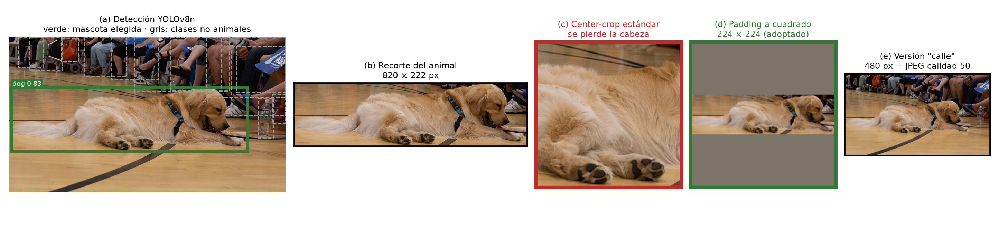
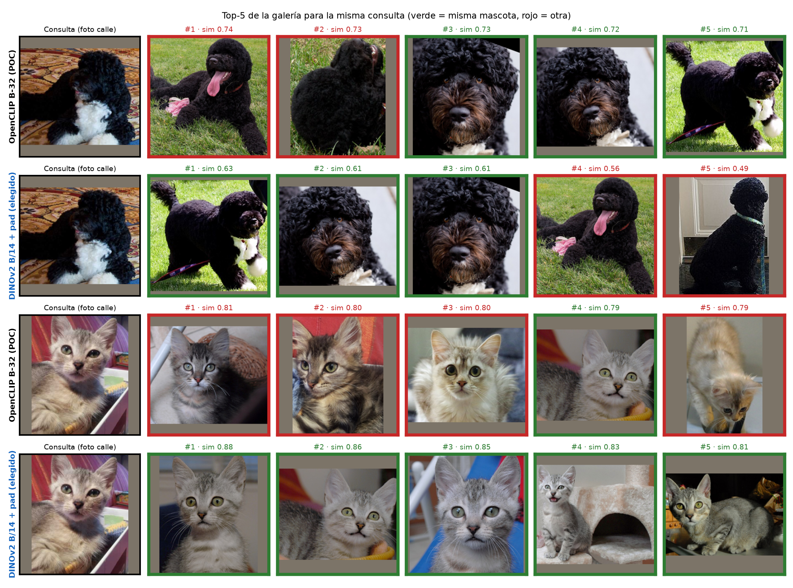
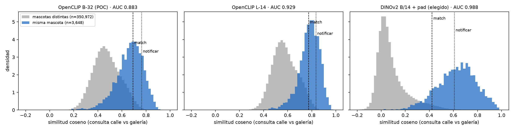
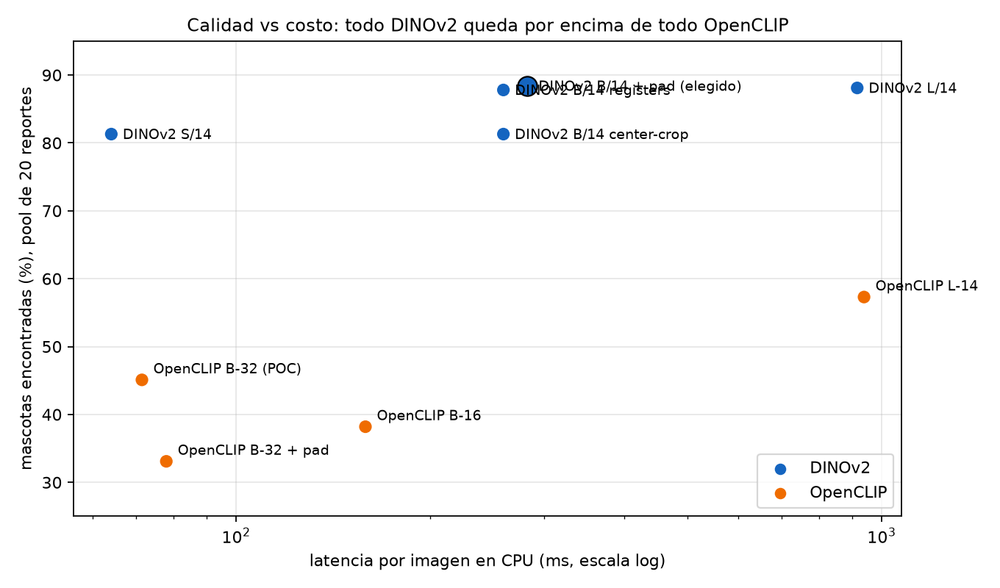
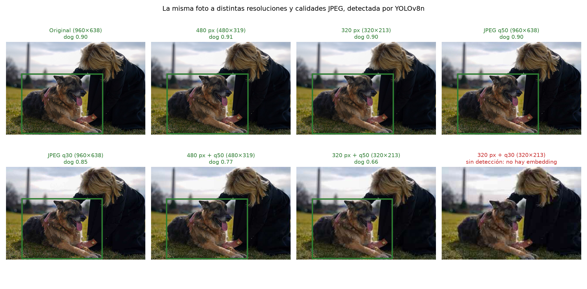

# ADR-0021: Modelo de embeddings DINOv2 ViT-B/14 para el matching

- **Estado:** Aceptada
- **Responsables:** Agustín Díaz

## Decisión

Los embeddings del matching se generan con DINOv2 ViT-B/14 a 224 px, con el recorte de la mascota rellenado a cuadrado, en vectores de 768 dimensiones. Reemplaza a OpenCLIP ViT-B/32 y a la dimensión de 512 de [ADR-0013](0013-dimension-embedding-512.md).

## Motivo

- El matching es una re-identificación de individuos: tiene que distinguir a dos animales de la misma raza y color, y OpenCLIP codifica cómo se describe la foto, no rasgos finos del individuo.
- En el benchmark del equipo (596 fotos de 92 perros y gatos, fotos de consulta degradadas como las de un celular y la misma tasa de falsos positivos para todos los modelos), DINOv2 ViT-B/14 encuentra a la mascota en el 88,4% de los reportes, contra el 45,1% de OpenCLIP ViT-B/32 (mAP 0,802 contra 0,427, con intervalos de confianza que no se superponen).
- Corre en CPU sin GPU: el pipeline completo queda cerca de 0,4 s por reporte, muy por debajo del objetivo de 5 s.
- Los umbrales calibrados de forma independiente (0,42 y 0,61) confirman los configurados en producción (0,45 para registrar un match y 0,63 para notificar).

## Alternativas

DINOv2 ViT-L/14 (ordena mejor pero no encuentra más mascotas y triplica el costo de CPU), DINOv2 ViT-S/14 (81,3%, plan B si el hardware no alcanza), OpenCLIP ViT-L/14 (57,3%) y la fusión con OpenCLIP (no mejora a DINOv2 solo).

## Consecuencias

- Cambiar de modelo obligó a migrar la columna a 768 dimensiones y a regenerar los embeddings existentes, como anticipaba [ADR-0013](0013-dimension-embedding-512.md).
- Los umbrales se calibraron con fotos de animales conocidos: hay que recalibrarlos con los matches que confirmen o rechacen los usuarios.
- Por decisión del PM, la evidencia es el informe del benchmark con sus figuras; los scripts y el dataset se borraron después de tomar la decisión y no se incluyen.

## Evidencia

Benchmark DINOv2 vs OpenCLIP del 2026-10-26 y decisión de implementación del 2026-10-27, elaborados por el equipo. Los documentos originales se conservan en `docs/adr/evidencia/DECISION/`.

### Configuración adoptada

DINOv2 ViT-B/14 (`vit_base_patch14_dinov2.lvd142m`, vía timm) en `backend-ia`, en reemplazo de OpenCLIP ViT-B/32.

| Parámetro | Valor |
| --- | --- |
| Checkpoint | `vit_base_patch14_dinov2.lvd142m` |
| Resolución de entrada | 224 × 224 px |
| Preproceso | Recorte YOLOv8n → padding a cuadrado con color `(124, 116, 104)` → transform de timm |
| Selección de mascota | Mayor confianza entre detecciones con área ≥ 25% del animal más grande (`MIN_RELATIVE_AREA = 0.25`) |
| Dimensión del vector | 768, normalizado L2 |
| Columna en BD | `report_embeddings.embedding vector(768)`, índice HNSW `vector_cosine_ops` |
| Umbral de match | 0,45 (`MATCH_THRESHOLD`) |
| Umbral de notificación | 0,63 (`NOTIFY_THRESHOLD`) |
| Consulta de candidatos | Tipo opuesto, ≤ 5 km, ≤ 30 días, `LIMIT 5`, operador `<=>` |

Tabla 2.2.2.4-1. Parámetros de la configuración adoptada. Fuente: decisión de implementación del modelo de embeddings, 2026-10-27.

### Conclusiones del benchmark

1. Todas las variantes de DINOv2 superan a todas las de OpenCLIP: la más chica de DINOv2 (S/14, 22 M de parámetros, 64 ms) supera a la más grande de OpenCLIP (L-14, 304 M, 940 ms), con mAP 0,729 contra 0,583 en fotos de calle.
2. En la simulación del producto, con 20 reportes cercanos y la misma tasa de falsos positivos para todos, DINOv2-B encuentra a la mascota en el 88% de los reportes; OpenCLIP B-32 (el de la prueba de concepto) en el 45% y OpenCLIP L-14 en el 57%.
3. DINOv2-L es mejor en ranking (+0,05 mAP, significativo), pero no encuentra más mascotas (88%, igual que B) y cuesta 3,2× más CPU (917 ms contra 283 ms).
4. Combinar DINOv2 con CLIP no aporta: la diferencia no es significativa con L-14 y empeora con B-32. La única razón para guardar embeddings de CLIP sería la búsqueda por texto.
5. El padding a cuadrado es correcto para DINOv2 (+0,046 mAP, significativo), pero empeora a CLIP (−0,10 mAP): la comparación contra CLIP usa su mejor versión (center-crop).
6. Los umbrales de producción quedan validados: calibrados a ciegas en este dataset (3% y 0,3% de falsos positivos) dan 0,42 y 0,61, cerca de los 0,45 y 0,63 configurados.

### Dataset

| Concepto | Valor |
| --- | --- |
| Fuente | Wikimedia Commons: una categoría por animal individual famoso (mascotas presidenciales, animales de redes, perros de trabajo, etc.) |
| Descargado | 165 categorías, 1.391 fotos (640 px de ancho) |
| Con animal detectado por YOLO | 992 recortes, 158 animales |
| Curación manual | 44 animales excluidos completos, 59 fotos sueltas excluidas, cada una con su motivo |
| Duplicados casi idénticos | 37 fotos excluidas automáticamente (ráfagas o la misma foto subida dos veces) |
| Requisito | Al menos 3 fotos por animal, especie perro o gato, detección también en la versión degradada |
| **Dataset final** | **596 fotos de 92 animales: 47 perros (281 fotos) y 45 gatos (315 fotos)** |

Tabla 2.2.2.4-2. Construcción del dataset del benchmark. Fuente: benchmark DINOv2 vs OpenCLIP, 2026-10-26.

La curación se hizo revisando 14 hojas de contacto: se excluye el animal completo si la categoría mezcla animales distintos, o si son estatuas, dibujos, pinturas o afiches; se excluye una foto suelta si muestra otro animal, varios animales o solo una parte del cuerpo.

### Protocolos

- **Limpio**: cada foto contra todas las demás.
- **Calle** (el principal): la foto consulta se degrada a 480 px de lado largo y JPEG calidad 50, antes de pasar por YOLO, como una foto sacada en la calle y reenviada por chat; se compara contra las fotos limpias (la del dueño). Es el caso real de "encontré este perro".

El recorte replica `detect_and_crop` de producción (YOLOv8n, clases animales COCO, se ignoran detecciones < 25% del área del animal más grande, gana la de mayor confianza). Todos los modelos usan exactamente los mismos recortes.

Figura 2.2.2.4-1. Procesamiento de una foto de ejemplo: detección YOLOv8n, recorte del animal, center-crop, padding a cuadrado y versión del protocolo calle. Fuente: benchmark DINOv2 vs OpenCLIP, 2026-10-26.

### Modelos evaluados

| Modelo | Checkpoint | Preproceso |
| --- | --- | --- |
| OpenCLIP ViT-B-32 (el de la prueba de concepto) | laion2b_s34b_b79k | center-crop (original) |
| OpenCLIP ViT-B-32 | laion2b_s34b_b79k | padding a cuadrado |
| OpenCLIP ViT-B-16 (mismo costo que DINOv2-B) | laion2b_s34b_b88k | padding |
| OpenCLIP ViT-L-14 (mismo tamaño que DINOv2-L) | laion2b_s32b_b82k | padding |
| DINOv2 ViT-S/14 | lvd142m | padding, 224 px |
| DINOv2 ViT-B/14 | lvd142m | center-crop, 224 px |
| **DINOv2 ViT-B/14 (adoptado)** | lvd142m | padding, 224 px |
| DINOv2 ViT-B/14 con registers | lvd142m | padding, 224 px |
| DINOv2 ViT-L/14 | lvd142m | padding, 224 px |
| Fusión: promedio de cosenos DINOv2-B + CLIP B-32 | — | — |
| Fusión: promedio de cosenos DINOv2-B + CLIP L-14 | — | — |

Tabla 2.2.2.4-3. Modelos y preprocesos comparados. Fuente: benchmark DINOv2 vs OpenCLIP, 2026-10-26.

### Métricas

- **AUC**: probabilidad de que un par de la misma mascota tenga más similitud que un par de mascotas distintas.
- **mAP / rank-1 / hit@5**: buscando con cada foto, qué tan arriba aparecen las otras fotos de la misma mascota.
- **TPR@1%**: proporción de pares de la misma mascota que superan el umbral que deja pasar solo el 1% de los pares distintos.
- **Intervalos de confianza del 95%** por bootstrap por animal (1.000 réplicas; las fotos de un mismo animal no son independientes). Las diferencias contra DINOv2-B son pareadas (misma consulta, dos modelos).
- **Simulación de matching** (protocolo calle): cada foto degradada es un reporte "encontrado"; el pool de reportes cercanos tiene exactamente una foto limpia de esa mascota más N−1 de otras. Se toman los 5 más parecidos (como `LIMIT 5` en producción) y se aplica el umbral. Los umbrales se calibran con la mitad de los animales y se evalúan en la otra mitad (5 particiones al azar × 2), con la misma tasa de falsos positivos para todos los modelos: 3% para crear match y 0,3% para notificar. Así todos generan la misma cantidad de matches falsos y gana el que encuentra más mascotas.
- **Latencia**: CPU, 4 hilos, una imagen por vez (como en producción), mediana de 40 imágenes tras 5 de calentamiento.

### Calidad de ranking (protocolo calle)

| Modelo | ms/img | AUC | mAP [IC 95%] | Δ mAP vs DINOv2-B [IC 95%] | Rank-1 | TPR@1% |
| --- | --- | --- | --- | --- | --- | --- |
| OpenCLIP B-32 (POC) | 72 | 0,883 | 0,427 [0,381–0,475] | −0,375 [−0,419; −0,332] | 61,6% | 29,3% |
| OpenCLIP B-32 + padding | 78 | 0,827 | 0,326 [0,289–0,365] | −0,477 [−0,514; −0,439] | 54,4% | 21,5% |
| OpenCLIP B-16 + padding | 159 | 0,864 | 0,389 [0,351–0,435] | −0,413 [−0,452; −0,374] | 59,1% | 24,8% |
| OpenCLIP L-14 + padding | 940 | 0,929 | 0,583 [0,536–0,629] | −0,220 [−0,259; −0,185] | 75,8% | 40,4% |
| DINOv2 S/14 + padding | 64 | 0,978 | 0,729 [0,689–0,771] | −0,073 [−0,090; −0,055] | 87,6% | 66,3% |
| DINOv2 B/14 center-crop | 260 | 0,980 | 0,756 [0,718–0,793] | −0,047 [−0,064; −0,029] | 89,6% | 69,5% |
| **DINOv2 B/14 + padding** | **283** | **0,988** | **0,802 [0,766–0,837]** | — | **92,3%** | **76,7%** |
| DINOv2 B/14 registers | 260 | 0,987 | 0,805 [0,767–0,842] | +0,002 [−0,011; +0,016] | 90,3% | 73,8% |
| DINOv2 L/14 + padding | 917 | 0,990 | 0,852 [0,817–0,882] | +0,049 [+0,034; +0,068] | 94,1% | 76,4% |
| Fusión DINOv2-B + CLIP B-32 | 361 | 0,976 | 0,714 [0,674–0,754] | −0,088 [−0,106; −0,073] | 86,6% | 63,8% |
| Fusión DINOv2-B + CLIP L-14 | 1.222 | 0,985 | 0,806 [0,771–0,839] | +0,003 [−0,007; +0,014] | 92,3% | 73,0% |

Tabla 2.2.2.4-4. Calidad de ranking y costo por modelo en el protocolo calle. Fuente: benchmark DINOv2 vs OpenCLIP, 2026-10-26.

Un Δ cuyo intervalo no cruza el 0 es una diferencia significativa.

Figura 2.2.2.4-2. Cinco resultados más similares para dos consultas del protocolo calle con OpenCLIP ViT-B/32 y con DINOv2 ViT-B/14 con padding (verde, misma mascota; rojo, otra). Fuente: benchmark DINOv2 vs OpenCLIP, 2026-10-26.

Figura 2.2.2.4-3. Distribución de la similitud coseno entre pares de la misma mascota y de mascotas distintas en el protocolo calle, con los umbrales de match y de notificación. Fuente: benchmark DINOv2 vs OpenCLIP, 2026-10-26.

### Simulación del producto (protocolo calle, umbrales con validación cruzada)

Pool de 20 reportes cercanos (lo esperable con el filtro de 5 km y 30 días) y de 100 (zona densa).

| Modelo | Encuentra a la mascota (20) | Match #1 correcto (20) | Dueño notificado (20) | Encuentra (100) | Match #1 correcto (100) | Umbral match / notificar |
| --- | --- | --- | --- | --- | --- | --- |
| OpenCLIP B-32 (POC) | 45,1% | 40,1% | 19,9% | 41,1% | 32,1% | 0,69 / 0,76 |
| OpenCLIP B-32 + padding | 33,1% | 29,7% | 14,0% | 31,1% | 24,4% | 0,73 / 0,81 |
| OpenCLIP B-16 + padding | 38,2% | 32,8% | 15,2% | 33,6% | 25,4% | 0,76 / 0,82 |
| OpenCLIP L-14 + padding | 57,3% | 52,4% | 28,3% | 55,1% | 45,5% | 0,77 / 0,83 |
| DINOv2 S/14 + padding | 81,3% | 77,1% | 50,2% | 79,9% | 68,7% | 0,45 / 0,61 |
| DINOv2 B/14 center-crop | 81,3% | 78,0% | 52,4% | 80,6% | 70,7% | 0,40 / 0,59 |
| **DINOv2 B/14 + padding** | **88,4%** | **85,0%** | **57,3%** | **87,8%** | **77,7%** | **0,42 / 0,61** |
| DINOv2 B/14 registers | 87,8% | 84,0% | 52,3% | 86,6% | 76,5% | 0,49 / 0,69 |
| DINOv2 L/14 + padding | 88,1% | 85,3% | 60,9% | 87,6% | 80,6% | 0,46 / 0,67 |
| Fusión DINOv2-B + CLIP B-32 | 79,5% | 75,1% | 47,0% | 77,7% | 65,9% | 0,53 / 0,66 |
| Fusión DINOv2-B + CLIP L-14 | 86,8% | 83,4% | 54,9% | 85,6% | 75,7% | 0,58 / 0,70 |

Tabla 2.2.2.4-5. Simulación del matching con pools de 20 y 100 reportes cercanos. Fuente: benchmark DINOv2 vs OpenCLIP, 2026-10-26.

Matches falsos por reporte, iguales por diseño para todos los modelos: ~0,56 con 20 reportes y ~1,9 con 100. Notificaciones falsas: ~0,06 y ~0,3.

### Perros y gatos (protocolo limpio)

| Modelo | Perros | Gatos | Solo misma especie |
| --- | --- | --- | --- |
| OpenCLIP B-32 (POC) | 0,914 | 0,817 | 0,836 |
| OpenCLIP L-14 + padding | 0,960 | 0,867 | 0,899 |
| DINOv2 S/14 + padding | 0,987 | 0,950 | 0,966 |
| **DINOv2 B/14 + padding** | **0,992** | **0,970** | **0,981** |
| DINOv2 L/14 + padding | 0,993 | 0,979 | 0,983 |

Tabla 2.2.2.4-6. AUC por especie en el protocolo limpio. Fuente: benchmark DINOv2 vs OpenCLIP, 2026-10-26.

Los gatos son el caso difícil para todos los modelos (muchos atigrados y negros casi iguales); DINOv2-L es el que más mejora en ese caso.

### Costo

| Modelo | Parámetros (visión) | Dimensión | ms/img CPU | Imágenes/s con 1 worker |
| --- | --- | --- | --- | --- |
| OpenCLIP B-32 | 88 M | 512 | 72 | ~14 |
| OpenCLIP L-14 | 304 M | 768 | 940 | ~1 |
| DINOv2 S/14 | 22 M | 384 | 64 | ~16 |
| **DINOv2 B/14** | **86 M** | **768** | **283** | **~3,5** |
| DINOv2 L/14 | 303 M | 1024 | 917 | ~1 |

Tabla 2.2.2.4-7. Tamaño, dimensión y latencia en CPU por modelo. Fuente: benchmark DINOv2 vs OpenCLIP, 2026-10-26.

A eso se suma YOLOv8n (~100 ms). Con DINOv2-B el pipeline completo queda en ~0,4 s por reporte, por debajo del objetivo de 5 s.

Figura 2.2.2.4-4. Mascotas encontradas con un pool de 20 reportes contra latencia por imagen en CPU, por modelo. Fuente: benchmark DINOv2 vs OpenCLIP, 2026-10-26.

### Robustez del detector (YOLOv8n) a fotos de baja calidad

Sobre las 675 fotos curadas, antes de exigir detección en la versión degradada:

| Degradación | Detecta al animal |
| --- | --- |
| Original (640–960 px) | 100,0% |
| 480 px | 98,2% |
| 320 px | 96,3% |
| JPEG calidad 50 | 97,6% |
| JPEG calidad 30 | 92,3% |
| 480 px + JPEG 50 | 91,3% |
| 320 px + JPEG 50 | 78,2% |
| **320 px + JPEG 30** | **42,8%** |

Tabla 2.2.2.4-8. Tasa de detección de YOLOv8n por nivel de degradación. Fuente: benchmark DINOv2 vs OpenCLIP, 2026-10-26.

Una foto sin detección no genera embedding (el backend IA responde 422), por lo que nunca puede matchear, sea cual sea el modelo. Reducir y comprimir a la vez es lo que rompe al detector. El proyecto no comprime en el frontend ni en el backend; si se agrega compresión del lado del cliente, no bajar de ~640 px ni de JPEG calidad 70.

Figura 2.2.2.4-5. Detección de YOLOv8n sobre la misma foto con distintas resoluciones y calidades JPEG. Fuente: benchmark DINOv2 vs OpenCLIP, 2026-10-26.

### Pruebas previas

Realizadas el 2026-10-14 con otro armado del mismo tipo de dataset (550 fotos, 83 animales, sin la curación ni la deduplicación posteriores).

| Prueba (DINOv2-B, 106 fotos de 15 animales) | AUC | mAP | Decisión |
| --- | --- | --- | --- |
| Recorte YOLO + center-crop (base) | 0,977 | 0,896 | Reemplazada |
| Padding a cuadrado | 0,987 | 0,918 | **Adoptada** (confirmada con 596 fotos) |
| 224 px en vez de 518 px | 0,984 vs 0,985 | 0,910 vs 0,907 | **Adoptada**: igual calidad, 6× más rápida |
| Mascota principal por confianza × área | 0,984 | 0,907 | **Adoptada** como filtro de área ≥ 25% |
| Margen extra en el recorte (5–10%) | 0,985 | 0,910 | Descartada |
| YOLOv8m en vez de v8n | 0,985 | 0,911 | Descartada |
| Flip test-time augmentation | 0,984 | 0,906 | Descartada (2× costo) |
| Pooling promedio de parches | 0,791 | 0,430 | Descartada |
| CLS + promedio de parches | 0,972 | 0,873 | Descartada |

Tabla 2.2.2.4-9. Pruebas previas de preproceso con DINOv2-B. Fuente: pruebas previas del benchmark DINOv2 vs OpenCLIP, 2026-10-14.

Consistencia entre ambas corridas (protocolo limpio): CLIP B-32 AUC 0,886 → 0,903 y DINOv2-B 0,980 → 0,990. La diferencia entre modelos se mantiene; los números absolutos suben porque la curación excluyó fotos de animales mezclados.

### Limitaciones

- **Fotos de animales famosos**: suelen estar mejor encuadradas que las de un reporte real. La degradación del protocolo calle lo compensa en parte, pero los umbrales deben recalibrarse con matches confirmados y rechazados reales.
- **92 animales**: alcanzan para separar familias de modelos con mucha confianza (los intervalos no se tocan), no para afinar diferencias chicas como B/14 contra registers.
- **Pool simulado al azar**: en la realidad los reportes cercanos se parecen más entre sí (misma zona, razas comunes), por lo que los matches falsos reales pueden ser más.
- **Latencia de una sola ronda completa**: la medición en 3 rondas se cortó por falta de memoria del equipo; la ronda 1 midió los 9 modelos en las mismas condiciones y la ronda 2 parcial coincide (±15%).
- **No se probaron** OpenCLIP ViT-H-14 (3,9 GB, ~3 s por imagen en CPU: inviable para el servidor) ni modelos con fine-tuning para mascotas.

### Recomendaciones

1. Dejar DINOv2-L como mejora futura si sobra CPU o hay GPU: mismo pipeline; cambian el checkpoint (`vit_large_patch14_dinov2.lvd142m`), la dimensión (1024) y los umbrales (0,46 / 0,67).
2. Si el hardware queda corto, DINOv2-S es el plan B: con 64 ms por imagen sigue por encima de cualquier CLIP (81% contra 57% de mascotas encontradas).
3. No guardar embeddings de CLIP salvo que la búsqueda por texto entre al alcance.
4. Registrar los matches confirmados y rechazados por los usuarios para recalibrar los umbrales con datos reales.
5. Si se comprimen las fotos en el cliente, no bajar de ~640 px ni de JPEG calidad 70 (Tabla 2.2.2.4-8).

### Implementación

Realizada en la rama `dbeagus/features` ([PR #238](https://github.com/ISI-ProyectoFinal-2026/Grupo1/pull/238)):

1. `backend-ia/app/ml/pipeline.py`: DINOv2 B/14 a 224 px, padding y `MIN_RELATIVE_AREA`.
2. `backend-ia/app/services/matching_service.py`: umbrales 0,45 / 0,63.
3. `backend-ia/app/services/embedding_service.py`: inferencia en `asyncio.to_thread`.
4. `backend/prisma/migrations/20261014000000_dinov2_embedding_dimension`: `vector(512)` → `vector(768)` con tabla de respaldo.
5. `backend-ia/scripts/reembed_reports.py`: regenera los embeddings de los reportes existentes después de migrar.

### Método de ejecución y material conservado

El benchmark se ejecutó con el entorno de `backend-ia` (torch, timm, open_clip, ultralytics) en seis pasos: descarga de las fotos de Wikimedia Commons; generación de los recortes YOLO limpios y degradados y de las hojas de contacto; curación (exclusiones manuales y duplicados); cálculo de embeddings y métricas; medición de latencia en CPU; y medición de la robustez del detector. Las métricas se verificaron con 6 pruebas automatizadas.

Según la anotación del 2026-10-27 del informe del benchmark, los scripts, el dataset, las hojas de contacto y los registros de ejecución se borraron después de tomar la decisión. Como evidencia de la ejecución se conservan en el repositorio el informe, la decisión de implementación y las figuras generadas (`docs/adr/evidencia/DECISION/` y `docs/adr/evidencia/0021-dinov2/`). Por lo tanto, el benchmark no puede reproducirse desde el repositorio.

## Referencias

[PR #238](https://github.com/ISI-ProyectoFinal-2026/Grupo1/pull/238); [informe del benchmark de embeddings](evidencia/0021-dinov2/INFORME.html); [ADR-0018](0018-criterio-evolucion-tecnologica.md) (criterio de evolución tecnológica).
