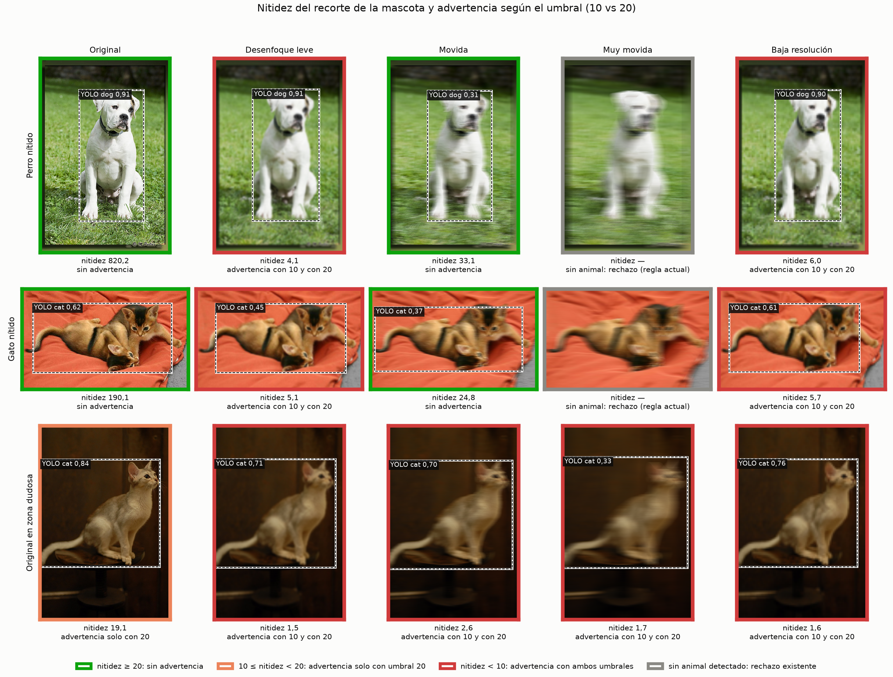
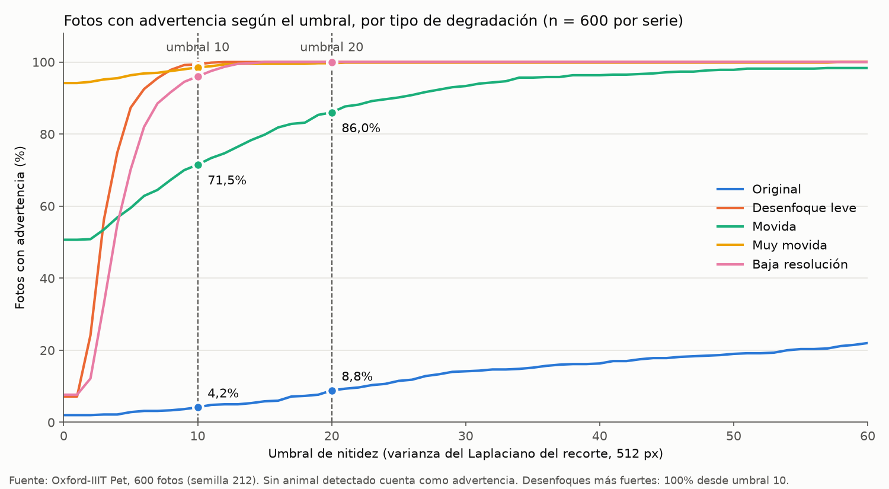
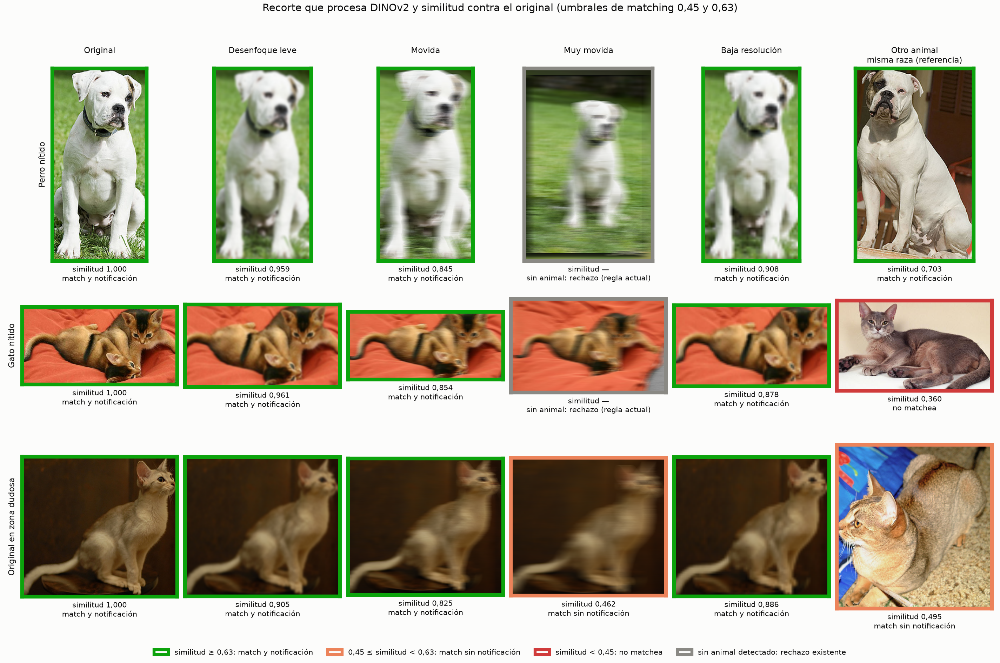
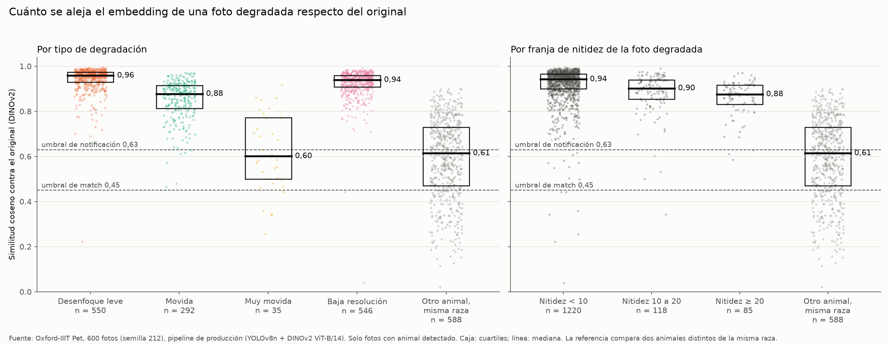

# ADR-0023: Aviso no bloqueante por foto borrosa o movida

- **Estado:** Aceptada
- **Responsables:** Agustín Díaz

## Decisión

Al subir la foto de un reporte, si el recorte de la mascota tiene una nitidez (varianza del laplaciano a 512 px) menor que 10, se muestra un aviso que sugiere subir una foto más nítida. El aviso no bloquea: el usuario puede publicar igual. El rechazo de fotos sin animales no cambia.

## Motivo

- Para el matching la diferencia entre los umbrales 10 y 20 no es medible: las fotos degradadas con nitidez entre 10 y 20 conservan una similitud mediana de 0,902 con su original, y el 96,6% supera el umbral de notificación de 0,63.
- El umbral 10 reduce a la mitad las falsas alarmas sobre fotos buenas: avisa en el 4,2% de las originales, contra el 8,8% con el umbral 20.
- El valor del aviso está en que las personas reconozcan a la mascota, no en el algoritmo.

## Alternativas

Umbral 20 o 30 (más falsas alarmas sobre fotos buenas: 8,8% y 14,2%) y la confianza mínima de YOLO (con 0,5 avisa en el 8,0% de las originales y detecta solo el 74,7% de las fotos movidas 15 px).

## Consecuencias

- El desenfoque por movimiento en una sola dirección conserva los bordes perpendiculares al movimiento: el 28,5% de las fotos levemente movidas (15 px) no recibe aviso.
- La medición se hace sobre el mismo recorte que elige el detector, en la misma pasada de YOLO del control temprano.

## Evidencia

Calibración realizada por el equipo el 2026-10-29 con el pipeline de producción (recorte de YOLOv8n y embedding de DINOv2 ViT-B/14, ver [ADR-0021](0021-modelo-embeddings-dinov2.md)).

### Métrica

| Parámetro | Valor |
| --- | --- |
| Recorte | El que elige el detector para la mascota principal |
| Tamaño | Lado largo del recorte llevado a 512 px, con la misma proporción (interpolación bilineal) |
| Escala de grises | Luma ITU-R 601 |
| Operador | Laplaciano 3 × 3 `[[0,1,0],[1,-4,1],[0,1,0]]`, bordes reflejados |
| Nitidez | Varianza del laplaciano sobre todo el recorte |
| Umbral | Nitidez < 10: aviso de baja calidad |

Tabla 1. Métrica de nitidez adoptada. Fuente: calibración de calidad de imagen, 2026-10-29.

### Dataset y degradaciones

Oxford-IIIT Pet: 600 fotos de perros y gatos elegidas al azar (semilla 212). De cada foto se generaron 7 versiones: original, desenfoque gaussiano de radio 2, 4 y 8, desenfoque por movimiento horizontal de 15 y 31 px, y reducción a 120 px con vuelta al tamaño original (baja resolución). Una foto en la que no se detecta animal cuenta como aviso.

### Fotos con aviso según el umbral

| Versión | Umbral 10 | Umbral 20 | Umbral 30 |
| --- | --- | --- | --- |
| Original | 4,2% | 8,8% | 14,2% |
| Desenfoque gaussiano r2 | 99,3% | 100% | — |
| Movida 15 px | 71,5% | 86,0% | 93,3% |
| Movida 31 px | 98,5% | 99,7% | — |
| Baja resolución | 96,0% | 100% | — |

Tabla 2. Porcentaje de fotos con aviso por versión y umbral. Fuente: calibración de calidad de imagen, 2026-10-29.

Nitidez mediana: 171,7 en las originales y 2,9 con desenfoque gaussiano de radio 2.

Figura 1. Recorte de la mascota, nitidez y aviso con los umbrales 10 y 20 sobre tres fotos y sus versiones degradadas. Fuente: calibración de calidad de imagen, 2026-10-29.

Figura 2. Porcentaje de fotos con aviso en función del umbral de nitidez, por tipo de degradación (600 fotos por serie). Fuente: calibración de calidad de imagen, 2026-10-29.

### Impacto en el matching

Similitud coseno entre el embedding de cada foto degradada y el de su propia original, con el pipeline de producción.

| Nitidez de la foto degradada | n | Similitud mediana | ≥ 0,63 (notificación) |
| --- | --- | --- | --- |
| < 10 | 1.220 | 0,942 | 98,1% |
| 10 a 20 | 118 | 0,902 | 96,6% |
| ≥ 20 | 85 | 0,876 | 96,5% |

Tabla 3. Similitud con la original por franja de nitidez. Fuente: calibración de calidad de imagen, 2026-10-29.

| Degradación | Similitud mediana | Animal detectado |
| --- | --- | --- |
| Desenfoque gaussiano r2 | 0,959 | 91,7% |
| Movida 15 px | 0,878 | 48,7% |
| Movida 31 px | 0,601 (42,9% ≥ 0,63) | 5,8% |
| Baja resolución | 0,939 | 91,0% |

Tabla 4. Similitud con la original y tasa de detección por degradación. Fuente: calibración de calidad de imagen, 2026-10-29.

Como referencia, dos animales distintos de la misma raza tienen una similitud mediana de 0,614.

Figura 3. Recorte que procesa DINOv2 y similitud con la original para tres fotos y sus versiones degradadas, con los umbrales de matching 0,45 y 0,63. Fuente: calibración de calidad de imagen, 2026-10-29.

Figura 4. Distribución de la similitud coseno con la original, por tipo de degradación y por franja de nitidez. Fuente: calibración de calidad de imagen, 2026-10-29.

### Limitaciones

- La similitud se mide contra la misma foto sin degradar, lo que es optimista: Oxford-IIIT Pet no identifica individuos, así que no se pudo comparar contra otra foto de la misma mascota.
- Los scripts, el dataset y los resultados intermedios quedaron fuera del repositorio; se conservan las figuras.

## Referencias

[Issue #212](https://github.com/ISI-ProyectoFinal-2026/Grupo1/issues/212); [ADR-0021](0021-modelo-embeddings-dinov2.md) (pipeline de detección y embeddings).
