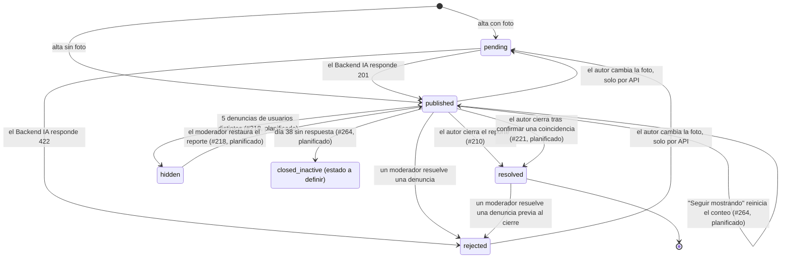

# Estados de un reporte (`ReportStatus`)

Diagrama único de estados de un reporte. Incluye lo implementado hoy y lo planificado en #218, #221 y #264. Los elementos planificados están marcados y no existen todavía en el código.

El D-39 (`../../archify/03-implementacion/ciclo-vida-publicaciones/reporte/reporte.html`) documenta solo lo implementado. Este diagrama lo completa con lo planificado; si el D-39 se regenera con esos estados, este archivo se elimina.

## Transiciones

| Transición | Origen | Estado |
|---|---|---|
| Alta, moderación por IA y cambio de foto | `backend/src/services/reports.service.ts`, `backend/src/services/matching.service.ts` | Implementada |
| `published → resolved` por el autor | #210, `POST /api/reports/:id/close` | Implementada |
| `published → rejected` por denuncia | `backend/src/services/report-flags.service.ts` | Implementada |
| `published → resolved` tras confirmar coincidencia | #221: se ofrece al dueño cerrar su reporte; reutiliza `resolved` | Planificada |
| `published ↔ hidden` | #218: 5 denuncias de usuarios distintos, reversible por el moderador | Planificada |
| `published → closed_inactive` | #264: avisos a los 30 y 37 días, cierre al día 38 | Planificada |

## Decisiones abiertas

- **Estado final del cierre por inactividad (#264).** El issue lo describe como "archivado, recuperable". Hoy `resolved` no tiene transición de salida y cerrar un reporte ya resuelto responde 409. Falta que el equipo defina si #264 reutiliza `resolved` o crea un estado propio. Al definirlo, se actualiza la fila y el nodo `closed_inactive` de este diagrama.
- **Recuperación de un reporte cerrado por inactividad (#264).** El issue dice "recuperable" sin indicar quién lo recupera ni cómo.

Relacionadas: #210, #218, #221, #264.
