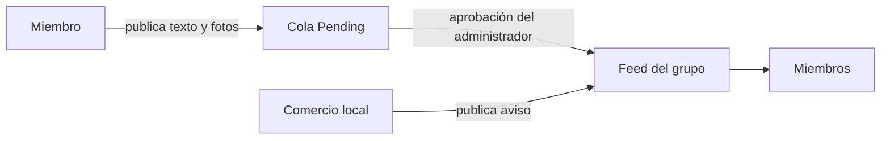

# 1.1 Definición de requerimientos

Esta sección releva los dos sistemas que hoy cubren la búsqueda de mascotas perdidas en San Rafael, Mendoza, identificados por el equipo: InfoAnimal SR (Competidor A) y los grupos de Facebook "Perritos Perdidos" y "4 Patitas Felices" (Competidor B).

- **Evidencia.** Capturas de pantalla aportadas por el equipo (`docs/informe/img/1-1/`). La fecha de captura no se registró.
- **Datos públicos.** La búsqueda en internet no devolvió información sobre ninguno de los competidores; lo que no surge de las capturas figura como `No disponible`.
- 1.1.3 y 1.1.4 quedan `Pendiente (Fase B)`.

## 1.1.1 Competidor A: InfoAnimal SR

### 1.1.1.1 Relevamiento general

#### 1.1.1.1.1 De la organización/sistema

| Dato | Valor | Evidencia |
|---|---|---|
| Nombre | InfoAnimalSR | Figura 1.1-1 |
| Canal principal | Cuenta de Instagram `infoanimalsr` | Figura 1.1-1 |
| Descripción declarada | "Información y actualidad animal", "Noticias, rescates y curiosidades" | Figura 1.1-1 |
| Ubicación | San Rafael, Mendoza | Figura 1.1-1 |
| Publicaciones / seguidores / seguidos | 87 / 269 / 22 | Figura 1.1-1 |
| Sitio web | `infoanimalsr.com`, enlazado desde el perfil | Figuras 1.1-1 y 1.1-2 |
| Responsables, antigüedad, forma jurídica | No disponible | — |

Tabla 1.1-1. Datos generales de InfoAnimal SR. Fuente: Figuras 1.1-1 y 1.1-2.

Figura 1.1-1. Perfil de Instagram de InfoAnimal SR. Fuente: `docs/informe/img/1-1/infoanimal-perfil.png`.

#### 1.1.1.1.2 Funciones detectadas a nivel general y relaciones con otros Sistemas y Entidades

| Función | Evidencia |
|---|---|
| Difusión de noticias, rescates y curiosidades sobre animales mediante publicaciones | Descripción del perfil (Figura 1.1-1) |
| Derivación a un sitio web propio | Enlace del perfil (Figura 1.1-1) |

Tabla 1.1-2. Funciones detectadas en InfoAnimal SR. Fuente: Figura 1.1-1.

Relaciones con otros sistemas y entidades:

- **Instagram (Meta):** plataforma sobre la que opera el canal principal.
- **Sitio `infoanimalsr.com`:** recibe el tráfico del perfil; el enlace lleva los parámetros `utm_source=ig&utm_medium=social&utm_content=link_in_bio` (Figura 1.1-2).
- Relación con refugios, veterinarias o entidades públicas: No disponible.

#### 1.1.1.1.3 Tecnología de Información

| Componente | Detalle |
|---|---|
| Red social | Instagram |
| Sitio web | `infoanimalsr.com`; respondió `503 Service Unavailable` con la leyenda `hws` (Figura 1.1-2) |
| Tecnología del sitio, hosting, base de datos | No disponible |

Tabla 1.1-3. Tecnología de información de InfoAnimal SR. Fuente: Figuras 1.1-1 y 1.1-2.

### 1.1.1.2 Relevamiento detallado y análisis del Sistema

#### 1.1.1.2.1 Detalle, explicación y documentación detallada de todas las funciones seleccionadas

- **Publicación de contenido.** La cuenta publica contenido propio (87 publicaciones) a sus 269 seguidores. Si la cuenta recibe y publica casos de mascotas perdidas enviados por terceros: No disponible.
- **Acceso al sitio web.** Desde el enlace del perfil, el sitio devolvió el error `503 Service Unavailable` (Figura 1.1-2): el contenido del sitio no estaba accesible.

Figura 1.1-2. Sitio `infoanimalsr.com` con error `503 Service Unavailable` al ingresar desde Instagram. Fuente: `docs/informe/img/1-1/infoanimal-web-503.png`.

#### 1.1.1.2.2 Modelo lógico del Sistema actual

Figura 1.1-3. Modelo lógico de InfoAnimal SR según lo observado. Fuente: Figuras 1.1-1 y 1.1-2.

#### 1.1.1.2.3 Problemas y necesidades detectados en las funciones relevadas en detalle y en su entorno organizacional

| Problema | Evidencia | Necesidad | Limitación del PDD |
|---|---|---|---|
| El sitio web enlazado no estaba disponible | Figura 1.1-2 | Un sistema accesible para consultar los casos | Falta de centralización |
| El perfil es un canal de noticias generales sobre animales, no específico de mascotas perdidas | Figura 1.1-1 | Una plataforma dedicada a la búsqueda de mascotas | Falta de especialización |
| El alcance depende de la cantidad de seguidores de la cuenta (269) | Figura 1.1-1 | Difusión que no dependa de una cuenta particular | Baja visibilidad |

Tabla 1.1-4. Problemas y necesidades de InfoAnimal SR. Fuente: Figuras 1.1-1 y 1.1-2; [`PDD v1.0.docx`](../pdd/PDD%20v1.0.docx), "Limitaciones identificadas".

## 1.1.2 Competidor B: grupos de Facebook

### 1.1.2.1 Relevamiento general

#### 1.1.2.1.1 De la organización/sistema

| Dato | Perritos Perdidos | 4 Patitas Felices |
|---|---|---|
| Tipo | Grupo de Facebook | Grupo de Facebook |
| Nombre visible en la captura | "Perritos Perdidos Sa…" (truncado por la aplicación) | Sin captura |
| Ubicación de las publicaciones | San Rafael (Figura 1.1-4) | No disponible |
| Cantidad de miembros, administradores, antigüedad, URL | No disponible | No disponible |

Tabla 1.1-5. Datos generales de los grupos de Facebook. Fuente: Figuras 1.1-4 a 1.1-6.

#### 1.1.2.1.2 Funciones detectadas a nivel general y relaciones con otros Sistemas y Entidades

| Función | Evidencia |
|---|---|
| Publicación de texto con fotos por parte de los miembros | Figuras 1.1-4 y 1.1-6 |
| Aprobación previa de publicaciones (cola `Pending`) | Figura 1.1-6 |
| Unión de nuevos miembros (botón `Join group`) | Figura 1.1-5 |
| Etiquetado de miembros (`@destacar`, `@todos`) | Figura 1.1-4 |

Tabla 1.1-6. Funciones detectadas en el grupo Perritos Perdidos. Fuente: Figuras 1.1-4 a 1.1-6.

Relaciones con otros sistemas y entidades:

- **Facebook (Meta):** plataforma sobre la que operan los grupos.
- **WhatsApp:** canal de contacto indicado en una publicación (Figura 1.1-5).
- **Comercios locales:** publican avisos en el grupo (Figuras 1.1-4 y 1.1-5).

#### 1.1.2.1.3 Tecnología de Información

| Componente | Detalle |
|---|---|
| Plataforma | Grupos de Facebook, accedidos desde la aplicación móvil (Figuras 1.1-4 a 1.1-6) |
| Desarrollo propio | No se observó |

Tabla 1.1-7. Tecnología de información de los grupos de Facebook. Fuente: Figuras 1.1-4 a 1.1-6.

### 1.1.2.2 Relevamiento detallado y análisis del Sistema

#### 1.1.2.2.1 Detalle, explicación y documentación detallada de todas las funciones seleccionadas

- **Publicación.** Un miembro publica texto y fotos. Las Figuras 1.1-4 y 1.1-5 muestran avisos comerciales (pollería con envío a domicilio; lavado de acolchados, frazadas y ropa, y servicio de cabañas) publicados en el grupo Perritos Perdidos, sin relación con mascotas.
- **Aprobación de publicaciones.** La Figura 1.1-6 muestra una publicación del 5 de agosto de 2025 que informa un perro caniche macho encontrado, en estado `Pending`, con 2 publicaciones en la cola. El tiempo que tardó la aprobación: No disponible.
- **Búsqueda, clasificación o seguimiento del estado de un caso:** no se observaron en las capturas.

Figura 1.1-4. Aviso comercial de una pollería en el grupo Perritos Perdidos. Fuente: `docs/informe/img/1-1/facebook-publicidad-1.png`.

Figura 1.1-5. Aviso comercial de lavandería y cabañas en el grupo Perritos Perdidos. Fuente: `docs/informe/img/1-1/facebook-publicidad-2.png`.

Figura 1.1-6. Publicación de mascota encontrada pendiente de aprobación en el grupo Perritos Perdidos. Fuente: `docs/informe/img/1-1/facebook-publicacion-pendiente.png`.

#### 1.1.2.2.2 Modelo lógico del Sistema actual

Figura 1.1-7. Modelo lógico del grupo Perritos Perdidos según lo observado. Fuente: Figuras 1.1-4 a 1.1-6.

#### 1.1.2.2.3 Problemas y necesidades detectados en las funciones relevadas en detalle y en su entorno organizacional

| Problema | Evidencia | Necesidad | Limitación del PDD |
|---|---|---|---|
| Avisos comerciales ajenos a mascotas mezclados con los casos | Figuras 1.1-4 y 1.1-5 | Contenido restringido a casos de mascotas | Contaminación informativa |
| Un aviso de mascota encontrada queda retenido hasta que un administrador lo aprueba | Figura 1.1-6 | Publicación inmediata con moderación automática | Baja visibilidad |
| Los casos son publicaciones de texto libre sin estado | Figuras 1.1-4 a 1.1-6 | Casos estructurados con estado | Dificultad de seguimiento |
| Información repartida entre varios grupos (Perritos Perdidos, 4 Patitas Felices) | Identificación del equipo | Un único punto de consulta | Falta de centralización |

Tabla 1.1-8. Problemas y necesidades de los grupos de Facebook. Fuente: Figuras 1.1-4 a 1.1-6; [`PDD v1.0.docx`](../pdd/PDD%20v1.0.docx), "Limitaciones identificadas".

## 1.1.3 Resumen funcionalidades de los sistemas relevados

Pendiente (Fase B).

## 1.1.4 Objetivos y alcances preliminares del nuevo sistema

Pendiente (Fase B).
