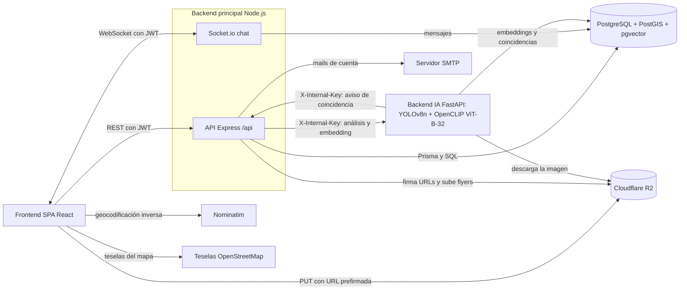
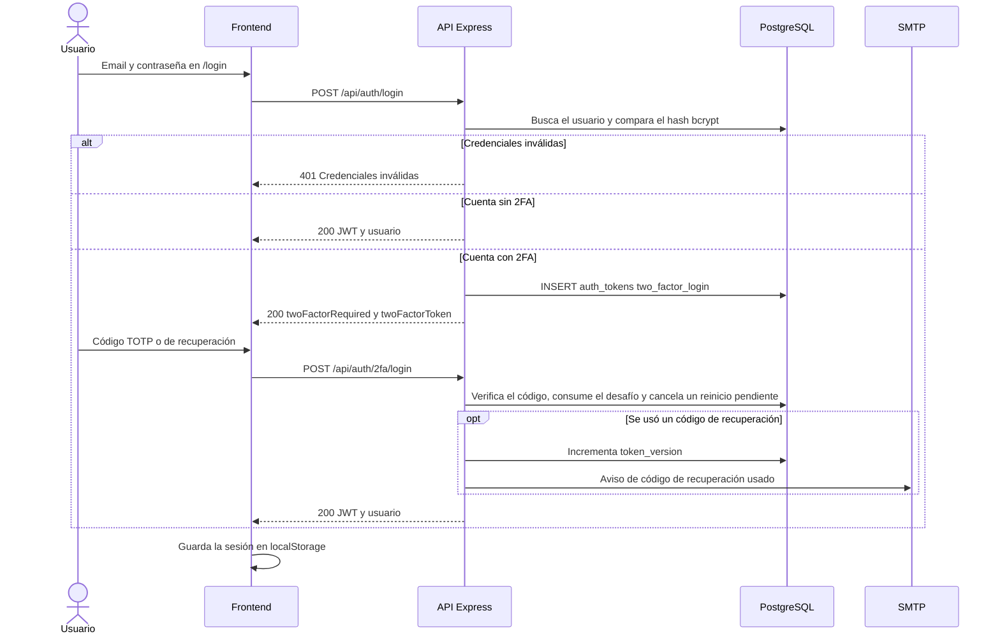
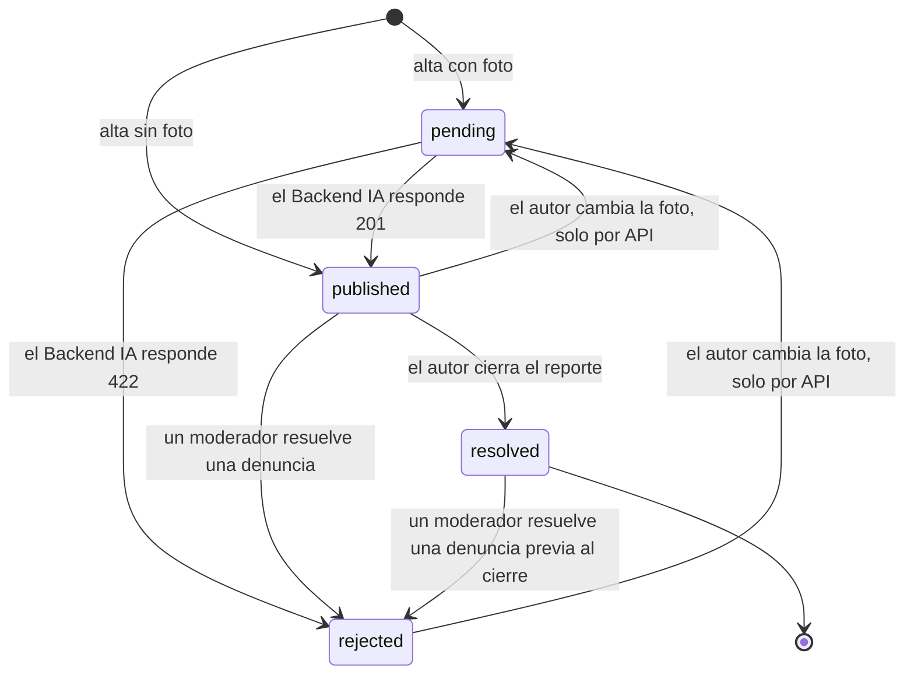
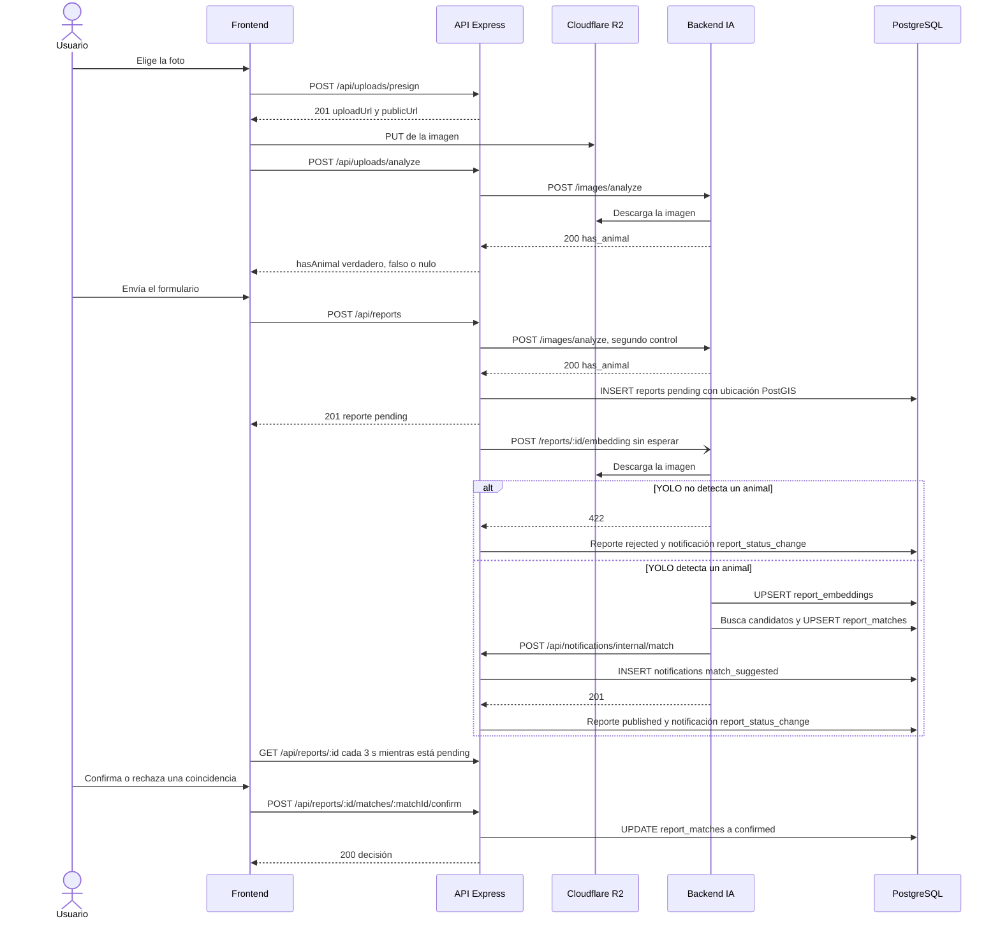
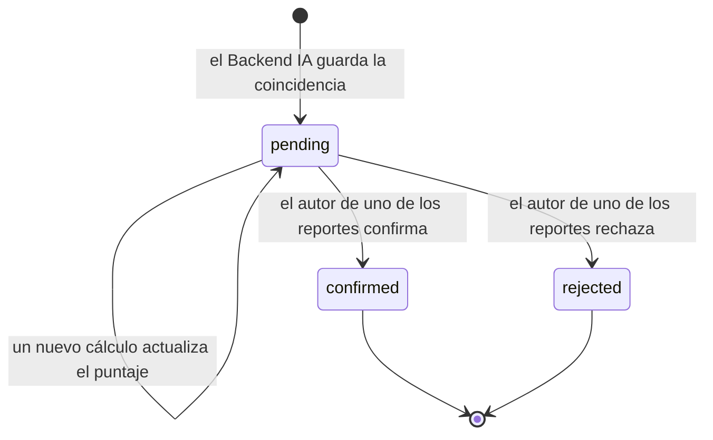
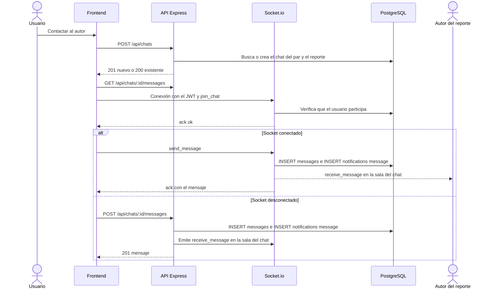
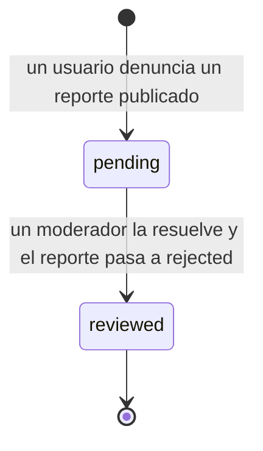

# 1.2.2.2 Historias de Usuario

Esta sección explica cómo funciona el sistema de punta a punta. Para cada módulo presenta las historias de usuario, el flujo completo (acción del usuario, pantalla, ruta de la API, servicio, tablas y servicios externos, respuesta), las reglas de negocio con sus valores, el comportamiento ante fallas y las limitaciones conocidas.

- **Historias.** Issues con la etiqueta `type: story` y la etiqueta `epic:` del módulo: `gh issue list --repo ISI-ProyectoFinal-2026/Grupo1 --state all --label "type: story" --limit 200 --json number,title,state,labels,body` (51 issues al 2026-10-24). La [#35](https://github.com/ISI-ProyectoFinal-2026/Grupo1/issues/35) no tiene etiqueta `epic:` y se ubica en Autenticación por su contenido.
- **Estado en el código.** *Implementada*: el código cumple los criterios de aceptación del issue. *Parcial*: cumple una parte y se indica cuál falta. *No implementada*: no hay código. El estado se juzga contra el código, no contra el estado del issue.
- **Citas.** Las rutas son relativas a la raíz del repositorio; `archivo:línea` remite a la línea donde empieza el elemento citado.
- Las especificaciones E2E de `frontend/e2e/` (F1 a F8) cubren varios de estos flujos; su resultado no se volvió a ejecutar para esta sección: No verificado.

## Visión general del funcionamiento

El navegador ejecuta una SPA en React que habla con una API Express bajo `/api` y, para el chat, con un servidor Socket.io montado en el mismo proceso HTTP (`backend/src/index.ts:9-10`). Las imágenes no pasan por la API: el navegador las sube directo a Cloudflare R2 con una URL prefirmada. La API delega el análisis de imágenes al Backend IA (FastAPI), que escribe los embeddings y las coincidencias en la misma base y avisa a la API cuando encuentra una coincidencia. No existe cola de trabajos: la cola Redis descrita en [`ARQUITECTURA.md`](../ARQUITECTURA.md) §4 no está implementada ([#177](https://github.com/ISI-ProyectoFinal-2026/Grupo1/issues/177)).

Figura 1.2.2-1. Componentes del sistema y cómo se comunican. Fuente: `backend/src/app.ts:34-45`, `backend/src/index.ts:9-10`, `backend/src/services/storage.service.ts:63`, `backend/src/services/matching.service.ts:93`, `backend/src/services/matching.service.ts:149`, `backend-ia/app/services/matching_service.py:28-55`, `frontend/src/components/reports/LocationPicker.tsx:61-68`, `frontend/src/components/reports/MapView.tsx:36-37`.

El rol del usuario se lee de la base en cada request y no viaja en el JWT (`backend/src/middlewares/auth.middleware.ts:78-102`, `backend/src/utils/jwt.ts:11-15`). "Comercio" no es un rol: es un perfil `Business` vinculado 1:1 a un usuario (`backend/prisma/schema.prisma:312`).

| Perfil | Cómo se obtiene | Qué puede hacer | Fuente |
|---|---|---|---|
| Anónimo | Sin sesión | La API permite leer el feed, el detalle de reportes publicados o resueltos, el flyer y el directorio de comercios; la interfaz exige iniciar sesión para todas esas pantallas ([#187](https://github.com/ISI-ProyectoFinal-2026/Grupo1/issues/187)) | `backend/src/routes/reports.routes.ts:19-40`, `backend/src/routes/businesses.routes.ts:15-16`, `frontend/src/router.tsx:45-67` |
| `usuario_regular` sin email verificado | Registro | Navegar, denunciar, registrar un comercio, ver coincidencias; no puede crear reportes, subir imágenes, chatear ni activar el 2FA | `backend/src/middlewares/auth.middleware.ts:110-119`, `backend/src/routes/uploads.routes.ts:17`, `backend/src/routes/chats.routes.ts:8-10`, `backend/src/routes/auth.routes.ts:35-36` |
| `usuario_regular` verificado | Enlace del mail de verificación | Todo lo anterior más crear reportes, subir imágenes, chatear y activar el 2FA | `backend/src/routes/reports.routes.ts:21` |
| `moderador` | No existe endpoint ni procedimiento para asignarlo ([#224](https://github.com/ISI-ProyectoFinal-2026/Grupo1/issues/224)) | Además, el panel `/moderation`: listar y resolver denuncias | `backend/src/routes/report-flags.routes.ts:10-11`, `frontend/src/router.tsx:63-66` |
| `admin` | Solo el seed | Los mismos permisos que `moderador` ([#224](https://github.com/ISI-ProyectoFinal-2026/Grupo1/issues/224)) | `backend/prisma/seed.ts:15-21` |

Tabla 1.2.2-1. Perfiles de usuario y permisos. Fuente: `backend/prisma/schema.prisma:18-24` y los archivos de la tabla.

## 1.2.2.2.1 Módulo de Autenticación y seguridad de la cuenta

### Historias de usuario

| Issue | Historia | Estado del issue | Estado en el código |
|---|---|---|---|
| [#10](https://github.com/ISI-ProyectoFinal-2026/Grupo1/issues/10) | Como usuario quiero registrarme con email y contraseña para acceder a la plataforma | Cerrado | Implementada (`backend/src/services/auth.service.ts:36`) |
| [#31](https://github.com/ISI-ProyectoFinal-2026/Grupo1/issues/31) | Como sistema quiero un modelo de roles (usuario_regular, moderador, admin, comercio) para gobernar permisos | Cerrado | Parcial: tres roles; "comercio" es un perfil y no un rol; `admin` no tiene permisos propios; no se puede asignar `moderador` |
| [#35](https://github.com/ISI-ProyectoFinal-2026/Grupo1/issues/35) | Como usuario quiero activar 2FA para mayor seguridad en mi cuenta | Cerrado | Implementada (`backend/src/services/two-factor/service.ts:150`, `:183`) |
| [#63](https://github.com/ISI-ProyectoFinal-2026/Grupo1/issues/63) | Como usuario quiero registrarme e iniciar sesión desde el navegador | Cerrado | Implementada (`frontend/src/pages/auth/Register.tsx`, `frontend/src/pages/auth/Login.tsx`) |
| [#185](https://github.com/ISI-ProyectoFinal-2026/Grupo1/issues/185) | Como usuario quiero verificar mi email y recuperar mi contraseña para tener una cuenta segura y recuperable | Cerrado | Implementada (`backend/src/services/auth.service.ts:106`, `:153`, `:163`) |
| [#224](https://github.com/ISI-ProyectoFinal-2026/Grupo1/issues/224) | Gestión de roles: asignar moderadores y definir los permisos de `admin` | Abierto | No implementada |

Tabla 1.2.2-2. Historias del módulo de autenticación. Fuente: `gh issue list` (comando al inicio de la sección).

### Flujo punta a punta

1. **Registro.** En `/register` el usuario ingresa email y contraseña. `POST /api/auth/register` (`backend/src/routes/auth.routes.ts:31`) llega a `register` (`backend/src/services/auth.service.ts:36-60`), que calcula el hash bcrypt e inserta en `users` con rol `usuario_regular` (`backend/prisma/schema.prisma:32`). Un email repetido responde 409. El usuario vuelve a `/login` (`frontend/src/pages/auth/Register.tsx:40`).
2. **Verificación.** El registro emite un token de un solo uso en `auth_tokens` (se guarda su sha256) y envía por SMTP el enlace `/verify-email` (`backend/src/services/auth.service.ts:31-34`). Al abrirlo, `POST /api/auth/verify-email` sella `users.email_verified_at` (`:106-115`). El reenvío es `POST /api/auth/verify-email/resend` (`:117-145`).
3. **Inicio de sesión.** En `/login`, `POST /api/auth/login` llega a `login` (`backend/src/services/auth.service.ts:66-96`). Si el email no existe compara contra un hash ficticio, para que ni el tiempo ni el mensaje revelen la cuenta; las credenciales inválidas responden 401.
4. **Sesión.** Sin 2FA, la respuesta trae un JWT con `sub`, `email` y `tv` (versión de sesión) (`backend/src/utils/jwt.ts:11-15`). El frontend lo guarda en `localStorage` mediante `persist` de zustand (`frontend/src/stores/auth.store.ts:15-24`) y lo envía en cada request. Cada request autenticada verifica la firma, que el usuario exista y que `tv` coincida con `users.token_version` (`backend/src/services/session.service.ts:27-52`).
5. **Segundo factor en el login.** Con 2FA activo, `login` devuelve un desafío `twoFactorToken` en lugar del JWT (`backend/src/services/auth.service.ts:84-93`) y la pantalla pide el código (`frontend/src/pages/auth/Login.tsx:90-95`). `POST /api/auth/2fa/login` llega a `loginWithSecondFactor` (`backend/src/services/two-factor/service.ts:91-125`), que acepta un código TOTP o uno de recuperación. Con un código de recuperación incrementa `token_version` (cierra las otras sesiones) y avisa por mail.
6. **Recuperación de contraseña.** `POST /api/auth/forgot-password` responde siempre el mismo mensaje y envía el enlace en segundo plano, solo si la cuenta existe (`backend/src/controllers/auth.controller.ts:42`, `backend/src/services/auth.service.ts:153-161`). `POST /api/auth/reset-password` guarda el nuevo hash, incrementa `token_version` (invalida todos los JWT) y marca usados los tokens de restablecimiento (`:163-183`).
7. **Alta del 2FA.** En `/account/security`, `POST /api/auth/2fa/setup` genera el secreto, lo guarda cifrado con AES-256-GCM (`backend/src/services/two-factor/crypto.ts:62-63`) y devuelve la URI `otpauth`, que la pantalla muestra como QR (`frontend/src/components/account/TwoFactorSetupPanel.tsx:47`). `POST /api/auth/2fa/enable` con un código válido activa el factor, genera los códigos de recuperación en `two_factor_recovery_codes` y avisa por mail (`backend/src/services/two-factor/service.ts:183`). Baja y regeneración: `POST /api/auth/2fa/disable` y `POST /api/auth/2fa/recovery-codes` (`:219`, `:263`).
8. **Dispositivo perdido.** Desde el segundo paso del login, `POST /api/auth/2fa/reset/request` (exige el desafío y la contraseña) envía un enlace de confirmación. Al confirmar se envía un enlace de cancelación y el reinicio se completa en el primer login posterior a la espera (`backend/src/services/two-factor/reset.ts:42`, `:86`, `:120`, `:144`). Un login con el segundo factor lo cancela (`backend/src/services/two-factor/service.ts:100-102`).

Figura 1.2.2-2. Inicio de sesión con segundo factor. Fuente: `backend/src/services/auth.service.ts:66-96`, `backend/src/services/two-factor/service.ts:91-125`, `frontend/src/stores/auth.store.ts:15-24`.

### Reglas de negocio

| Regla | Valor | Fuente |
|---|---|---|
| Contraseña | Mínimo 8 caracteres, con minúscula, mayúscula y número | `backend/src/validators/auth.validator.ts:5-10` |
| Hash de contraseña | bcrypt, costo 12 | `backend/src/services/auth.service.ts:15` |
| Vigencia del JWT | 24 h (configurable con `JWT_EXPIRY`) | `backend/src/utils/jwt.ts:13` |
| Tokens de enlace | Un solo uso, guardados como sha256; verificación 24 h, restablecimiento 30 min, desafío 2FA 5 min, cancelación del reinicio 7 días | `backend/src/services/auth-tokens.service.ts:9-14`, `:31` |
| Reenvío del mail de verificación | Una vez cada 60 s | `backend/src/services/auth.service.ts:20` |
| TOTP | Paso de 30 s, 6 dígitos, tolerancia de un paso | `backend/src/services/two-factor/totp.ts:3-5` |
| Códigos de recuperación | 10 códigos de 10 caracteres | `backend/src/services/two-factor/verify.ts:19`, `:46` |
| Bloqueo del 2FA | 5 intentos fallidos bloquean 15 min | `backend/src/services/two-factor/verify.ts:14-15` |
| Reinicio del 2FA | Efectivo 72 h después de confirmado | `backend/src/services/two-factor/service.ts:18` |
| Límites de tasa (por IP) | Login y registro 5/min; endpoints que envían mails o prueban enlaces 10 cada 15 min; 2FA 20 cada 15 min; toda la API 300/min | `backend/src/routes/auth.routes.ts:10-29`, `backend/src/middlewares/rate-limit.ts:8-30` |

Tabla 1.2.2-3. Reglas del módulo de autenticación. Fuente: archivos de la columna Fuente.

### Qué pasa si algo falla

- **Sin SMTP.** Sin `SMTP_HOST`, fuera de producción los mails se imprimen en la consola; en producción las acciones que envían mail responden 503 (`backend/src/services/mail/index.ts:17-32`).
- **Falla el mail del registro.** La cuenta queda creada y el usuario puede pedir el reenvío (`backend/src/services/auth.service.ts:51-57`).
- **Sesión invalidada.** Tras restablecer la contraseña o usar un código de recuperación, los JWT anteriores dejan de valer porque `tv` ya no coincide (`backend/src/services/session.service.ts:51-52`).

### Limitaciones conocidas

- El JWT se guarda en `localStorage` ([#215](https://github.com/ISI-ProyectoFinal-2026/Grupo1/issues/215)).
- No hay forma de asignar `moderador` y `admin` equivale a `moderador` ([#224](https://github.com/ISI-ProyectoFinal-2026/Grupo1/issues/224)).
- La interfaz exige sesión incluso para el contenido que la API sirve sin login ([#187](https://github.com/ISI-ProyectoFinal-2026/Grupo1/issues/187)).

## 1.2.2.2.2 Módulo de Reportes de mascotas (alta, detalle, feed y cierre)

### Historias de usuario

| Issue | Historia | Estado del issue | Estado en el código |
|---|---|---|---|
| [#12](https://github.com/ISI-ProyectoFinal-2026/Grupo1/issues/12) | Como dueño quiero registrar mi mascota con sus características para tenerla en mi perfil | Cerrado | Parcial: solo backend (`backend/src/routes/pets.routes.ts:8`); no hay formulario |
| [#13](https://github.com/ISI-ProyectoFinal-2026/Grupo1/issues/13) | Como dueño quiero editar, eliminar y añadir mascotas para mantener mi perfil | Cerrado | Parcial: solo backend (`backend/src/routes/pets.routes.ts:7-11`) |
| [#14](https://github.com/ISI-ProyectoFinal-2026/Grupo1/issues/14) | Como persona que encuentra quiero reportar una mascota avistada o encontrada para avisar al dueño | Cerrado | Implementada (`backend/src/services/reports.service.ts:148`) |
| [#15](https://github.com/ISI-ProyectoFinal-2026/Grupo1/issues/15) | Como usuario quiero ver etiquetas de estado en los reportes para identificarlos rápido | Cerrado | Implementada (`backend/src/services/reports.service.ts:38-47`) |
| [#16](https://github.com/ISI-ProyectoFinal-2026/Grupo1/issues/16) | Como usuario quiero ver y filtrar el feed de reportes para encontrar casos relevantes | Cerrado | Parcial: filtra por tipo, zona y fecha; no por raza |
| [#17](https://github.com/ISI-ProyectoFinal-2026/Grupo1/issues/17) | Como dueño quiero cerrar un reporte cuando aparece mi mascota para marcarlo resuelto | Cerrado | Implementada (`backend/src/services/reports.service.ts:263`) |
| [#65](https://github.com/ISI-ProyectoFinal-2026/Grupo1/issues/65) | Como usuario quiero publicar un reporte de mascota perdida o encontrada con foto e información desde el navegador | Cerrado | Implementada (`frontend/src/components/reports/ReportForm.tsx`) |
| [#187](https://github.com/ISI-ProyectoFinal-2026/Grupo1/issues/187) | Como visitante anónimo quiero ver el feed y el detalle de un reporte sin iniciar sesión | Abierto | No implementada en la interfaz (`frontend/src/router.tsx:45-67`) |
| [#225](https://github.com/ISI-ProyectoFinal-2026/Grupo1/issues/225) | Interfaz para mascotas y para editar o eliminar un reporte | Abierto | No implementada |

Tabla 1.2.2-4. Historias del módulo de reportes. Fuente: `gh issue list` (comando al inicio de la sección).

### Flujo punta a punta

1. **Formulario.** En `/reports/new` (`frontend/src/components/reports/ReportForm.tsx`) el usuario elige tipo (perdido o encontrado), título, descripción, foto y ubicación.
2. **Foto.** `ImageUploader` acepta JPG, PNG o WebP de hasta 10 MB, pide `POST /api/uploads/presign` y sube el archivo con `PUT` directo a R2 (`frontend/src/components/reports/ImageUploader.tsx:68-90`). `createPresignedUpload` firma la URL con la clave `pets/<uuid>.<ext>` (`backend/src/services/storage.service.ts:52-79`).
3. **Control temprano.** Con la imagen ya en R2, `POST /api/uploads/analyze` consulta al Backend IA si hay un animal (`backend/src/controllers/uploads.controller.ts:17-25`). Si no lo hay, el formulario muestra "Su publicación no se puede subir debido a que no se detectan animales. Posible SPAM" y deshabilita el envío (`backend/src/constants/moderation.ts:2-3`, `frontend/src/components/reports/ReportForm.tsx:26-32`). El detalle del análisis está en el módulo 1.2.2.2.3.
4. **Ubicación.** "Usar mi ubicación actual" toma la posición del navegador y la asigna de inmediato; después reemplaza la etiqueta de coordenadas por la ciudad que devuelve Nominatim (`frontend/src/components/reports/LocationPicker.tsx:21-68`).
5. **Envío.** `POST /api/reports` (`backend/src/routes/reports.routes.ts:21`) llega a `create` (`backend/src/services/reports.service.ts:148-195`). Si hay foto del bucket propio, repite el control y responde 422 si no hay animal (`:131-135`). En una transacción inserta en `reports` con estado `pending` si hay foto o `published` si no (`:165`) y guarda la ubicación como punto PostGIS `ST_SetSRID(ST_MakePoint(lng, lat), 4326)` (`:182-186`). Responde 201 y dispara la moderación por IA sin esperarla (`:140-146`, `:190-193`).
6. **Qué ve el usuario.** El formulario navega a `/reports/:id` (`frontend/src/components/reports/ReportForm.tsx:84-87`). Mientras el reporte está `pending`, el detalle muestra un aviso y se consulta de nuevo cada 3 s (`frontend/src/hooks/useReportDetailQuery.ts:4`, `:13`).
7. **Detalle.** `GET /api/reports/:id` llega a `getVisibleById` (`backend/src/services/reports.service.ts:112-120`): un reporte `published` o `resolved` es visible para todos; uno `pending` o `rejected`, solo para su autor; para el resto responde 404. La respuesta incluye la etiqueta PERDIDO, ENCONTRADO o RESUELTO (`:38-47`). Las acciones dependen de quién mira (`frontend/src/pages/reports/ReportDetailPage.tsx:115-122`): el autor puede cerrar; los demás pueden contactar al autor (1.2.2.2.5) y denunciar (1.2.2.2.7).
8. **Feed.** `/reports` pide `GET /api/reports` con `status=published` y los filtros de tipo, zona y fechas (`frontend/src/pages/reports/FeedPage.tsx:22-31`). `list` filtra la zona con `ILIKE` sobre `location_address` (`backend/src/services/reports.service.ts:72-100`). El feed se ve como lista o como mapa (1.2.2.2.8).
9. **Cierre.** El autor presiona cerrar y `POST /api/reports/:id/close` llega a `close` (`backend/src/services/reports.service.ts:263-279`): solo el autor (403) y solo desde `published` (409). El reporte pasa a `resolved` y sale del feed, que solo pide publicados.

Figura 1.2.2-3. Estados de un reporte (`ReportStatus`). Fuente: `backend/prisma/schema.prisma:136-143`, `backend/src/services/reports.service.ts:165`, `:225-234`, `:263-279`, `backend/src/services/matching.service.ts:73-90`, `backend/src/services/report-flags.service.ts:83`.

### Reglas de negocio

| Regla | Valor | Fuente |
|---|---|---|
| Imagen | JPG, PNG o WebP, hasta 10 MB | `backend/src/validators/uploads.validator.ts:5-15` |
| URL prefirmada | Válida 300 s | `backend/src/services/storage.service.ts:7` |
| Campos obligatorios | Tipo, título y ubicación; foto, descripción y dirección son opcionales | `backend/src/validators/reports.validator.ts:10-17` |
| Estado inicial | `pending` con foto, `published` sin foto | `backend/src/services/reports.service.ts:165` |
| Límite de creación | 10 reportes cada 15 min | `backend/src/middlewares/rate-limit.ts:12`, `:39-41` |
| Límite de subidas y análisis | 20 por minuto cada uno | `backend/src/routes/uploads.routes.ts:8-27` |
| Geocodificación inversa | Tiempo máximo 5 s | `frontend/src/components/reports/LocationPicker.tsx:61` |
| Visibilidad | `published` y `resolved`, todos; `pending` y `rejected`, solo el autor | `backend/src/services/reports.service.ts:112-120` |
| Etiquetas | PERDIDO `#EF4444`, ENCONTRADO `#3B82F6`, RESUELTO `#22C55E` | `backend/src/services/reports.service.ts:38-47` |
| Cierre | Solo el autor, solo desde `published` | `backend/src/services/reports.service.ts:201-208` |

Tabla 1.2.2-5. Reglas del módulo de reportes. Fuente: archivos de la columna Fuente.

### Qué pasa si algo falla

- **R2 sin configurar.** `POST /api/uploads/presign` responde 503 con las variables faltantes (`backend/src/services/storage.service.ts:30-39`).
- **Backend IA sin respuesta en el control temprano.** El usuario continúa (`hasAnimal` nulo) y el reporte se guarda `pending`; decide la moderación asíncrona (`frontend/src/components/reports/ImageUploader.tsx:36-43`, `backend/src/services/reports.service.ts:122-130`).
- **Geolocalización denegada.** Se muestra el error (`frontend/src/components/reports/LocationPicker.tsx:21-25`, `:54-57`) y no hay otra forma de elegir la ubicación, que es obligatoria: el reporte no se puede crear.
- **Nominatim no responde.** La etiqueta queda con las coordenadas; el reporte se crea igual.

### Limitaciones conocidas

- La foto figura como obligatoria ("Foto *") pero es opcional; sin foto no hay moderación ni matching ([#219](https://github.com/ISI-ProyectoFinal-2026/Grupo1/issues/219)).
- Mascotas, edición y eliminación de reportes existen solo en el backend; `GET /api/pets` lista todas las mascotas sin autenticación ([#225](https://github.com/ISI-ProyectoFinal-2026/Grupo1/issues/225), `backend/src/services/pets.service.ts:10-12`).
- No se puede elegir la ubicación en un mapa ([#208](https://github.com/ISI-ProyectoFinal-2026/Grupo1/issues/208)); el uso de Nominatim no cumple su política de uso ([#216](https://github.com/ISI-ProyectoFinal-2026/Grupo1/issues/216)).
- No hay cierre de reportes inactivos ni seguimiento de casos ([#210](https://github.com/ISI-ProyectoFinal-2026/Grupo1/issues/210)).

## 1.2.2.2.3 Módulo de Moderación automática por IA y matching

### Historias de usuario

| Issue | Historia | Estado del issue | Estado en el código |
|---|---|---|---|
| [#18](https://github.com/ISI-ProyectoFinal-2026/Grupo1/issues/18) | Como sistema quiero generar y comparar embeddings de imágenes para detectar la misma mascota | Cerrado | Implementada; el criterio de tiempo de matching: No verificado |
| [#19](https://github.com/ISI-ProyectoFinal-2026/Grupo1/issues/19) | Como sistema quiero validar y moderar publicaciones automáticamente para mantener contenido relevante | Cerrado | Parcial: detecta imágenes sin animal y las rechaza; no hay vía de moderación manual para los reportes que quedan `pending` |
| [#34](https://github.com/ISI-ProyectoFinal-2026/Grupo1/issues/34) | Como usuario quiero ver un listado de coincidencias con % de similitud para evaluar matches | Cerrado | Implementada (`frontend/src/components/reports/MatchCard.tsx:76-78`) |
| [#66](https://github.com/ISI-ProyectoFinal-2026/Grupo1/issues/66) | Como usuario quiero ver el detalle de un reporte y los matches sugeridos por la IA para identificar si es mi mascota | Cerrado | Implementada (`frontend/src/pages/reports/ReportDetailPage.tsx:262-292`) |
| [#181](https://github.com/ISI-ProyectoFinal-2026/Grupo1/issues/181) | Como dueño de un reporte quiero confirmar o rechazar una coincidencia sugerida por la IA | Cerrado | Implementada (`backend/src/services/matching.service.ts:302`) |
| [#217](https://github.com/ISI-ProyectoFinal-2026/Grupo1/issues/217) | Ajustar los parámetros del matching con evidencia (ventana de 90 días, umbral calibrado) | Abierto | No implementada |
| [#221](https://github.com/ISI-ProyectoFinal-2026/Grupo1/issues/221) | Confirmar una coincidencia debería avisar a la otra parte y ofrecer el cierre del reporte | Abierto | No implementada |

Tabla 1.2.2-6. Historias del módulo de IA y matching. Fuente: `gh issue list` (comando al inicio de la sección).

### Flujo punta a punta

1. **Control temprano (síncrono).** `analyzeImage` llama a `POST /images/analyze` del Backend IA con la cabecera `X-Internal-Key` y un tiempo máximo de 15 s (`backend/src/services/matching.service.ts:149-177`). El Backend IA corre YOLO y responde `has_animal` (`backend-ia/app/main.py:131-145`, `backend-ia/app/ml/pipeline.py:73-82`). Cualquier respuesta distinta de un 200 válido se trata como "no disponible".
2. **Disparo de la moderación.** Al crear un reporte con foto, `triggerEmbeddingGeneration` envía `POST /reports/:id/embedding` al Backend IA sin bloquear la respuesta al usuario (`backend/src/services/matching.service.ts:93-104`). Ante una falla de red o un 5xx hace hasta 3 intentos (`:33`, `:45-68`).
3. **Embedding.** `process_report_image` descarga la imagen y YOLOv8n elige la detección de mayor confianza entre las clases de animales de COCO (`backend-ia/app/services/embedding_service.py:23-38`, `backend-ia/app/ml/pipeline.py:44-70`). Si no hay animal, responde 422. Si lo hay, OpenCLIP genera un vector de 512 dimensiones normalizado (`backend-ia/app/ml/pipeline.py:85-93`) y lo guarda con upsert en `report_embeddings` (`backend-ia/app/services/embedding_service.py:42-48`).
4. **Matching.** En la misma request, `find_and_store_matches` busca hasta 5 reportes `published` del tipo opuesto, a menos de 5 km y creados en los últimos 30 días, ordenados por distancia coseno (`backend-ia/app/services/matching_service.py:96-105`). Guarda en `report_matches` los que alcanzan una similitud de 0,75 sin pisar los ya decididos (`:118`, `:126-138`) y, por cada uno, llama a `POST /api/notifications/internal/match` de la API (`:28-55`, `:141`).
5. **Veredicto.** El Backend IA responde 201 (o 422 en el paso 3). `applyModerationVerdict` pasa el reporte a `published` (con `published_at`) o a `rejected`, solo si sigue `pending` con la misma imagen, y crea una notificación `report_status_change` (`backend/src/services/matching.service.ts:73-90`, `:105-109`).
6. **Qué ve el usuario.** La consulta periódica del detalle detecta el cambio, el aviso desaparece y aparece la sección "Coincidencias sugeridas" (`frontend/src/pages/reports/ReportDetailPage.tsx:262-292`).
7. **Listado de coincidencias.** `GET /api/reports/:id/matches` (cualquier usuario con sesión, `backend/src/routes/reports.routes.ts:23-29`) llega a `listMatches` (`backend/src/services/matching.service.ts:274-292`): datos del otro reporte y porcentaje de similitud, sin las rechazadas, de mayor a menor.
8. **Decisión.** El autor confirma o rechaza con `POST /api/reports/:id/matches/:matchId/confirm` o `/reject` (`backend/src/routes/reports.routes.ts:31-32`). `decideMatch` exige ser el autor (403) y que la coincidencia involucre al reporte (404), y pasa de `pending` a `confirmed` (con `confirmed_at`) o `rejected`; una segunda decisión responde 409 (`backend/src/services/matching.service.ts:302-339`).
9. **Reconciliación.** Al arrancar y cada 5 min, la API reenvía al Backend IA hasta 10 reportes `pending` con foto actualizados entre 2 min y 24 h antes (`backend/src/services/matching.service.ts:198-255`, `backend/src/index.ts:17`).

Figura 1.2.2-4. Publicación de un reporte con foto, moderación, matching, notificación y decisión. Fuente: `frontend/src/components/reports/ImageUploader.tsx:68-90`, `backend/src/services/reports.service.ts:148-195`, `backend/src/services/matching.service.ts:73-132`, `backend-ia/app/services/embedding_service.py:23-58`, `backend-ia/app/services/matching_service.py:58-144`.

Figura 1.2.2-5. Estados de una coincidencia (`MatchStatus`). Fuente: `backend/prisma/schema.prisma:216-222`, `backend-ia/app/services/matching_service.py:126-138`, `backend/src/services/matching.service.ts:302-339`.

### Reglas de negocio

| Regla | Valor | Fuente |
|---|---|---|
| Modelos | YOLOv8n (`yolov8n.pt`) y OpenCLIP ViT-B-32 (`laion2b_s34b_b79k`) | `backend-ia/app/ml/pipeline.py:15-17` |
| Clases aceptadas | Las 10 clases de animales de COCO: bird, cat, dog, horse, sheep, cow, elephant, bear, zebra, giraffe | `backend-ia/app/ml/pipeline.py:22-33` |
| Embedding | 512 dimensiones, norma L2 = 1 ([ADR-0013](../adr/0013-dimension-embedding-512.md)) | `backend-ia/app/ml/pipeline.py:85-93` |
| Umbral de similitud | Coseno ≥ 0,75, provisional ([#217](https://github.com/ISI-ProyectoFinal-2026/Grupo1/issues/217)) | `backend-ia/app/services/matching_service.py:25`, `:118` |
| Candidatos | `published`, tipo opuesto, a menos de 5 km, creados en los últimos 30 días, máximo 5 | `backend-ia/app/services/matching_service.py:99-105` |
| Control temprano | Tiempo máximo 15 s, sin reintentos | `backend/src/services/matching.service.ts:139` |
| Reintentos del embedding | Hasta 3 intentos ante falla de red o 5xx, con esperas de 1 s y 5 s | `backend/src/services/matching.service.ts:33`, `:45-68` |
| Reconciliación | Cada 5 min; reportes `pending` actualizados entre 2 min y 24 h antes; 10 por pasada | `backend/src/services/matching.service.ts:198-203` |
| Quién ve y quién decide | Ve cualquier usuario con sesión; decide solo el autor del reporte | `backend/src/routes/reports.routes.ts:23-32` |

Tabla 1.2.2-7. Reglas del módulo de IA y matching. Fuente: archivos de la columna Fuente.

### Qué pasa si algo falla

- **Sin `AI_SERVICE_URL`.** No hay moderación ni reconciliación y los reportes con foto quedan `pending` indefinidamente ([#220](https://github.com/ISI-ProyectoFinal-2026/Grupo1/issues/220), `backend/src/services/matching.service.ts:94-95`, `:210`).
- **Backend IA caído.** Agotados los intentos, el reporte queda `pending` y la reconciliación lo reintenta durante 24 h; después queda `pending` sin aviso al usuario (`backend/src/services/matching.service.ts:126-131`, `:198-199`).
- **Clave interna distinta.** Un 401 deja el reporte `pending` y registra un error que nombra `INTERNAL_API_KEY` (`backend/src/services/matching.service.ts:110-119`).
- **Falla el matching.** El embedding queda guardado y el reporte se publica igual, sin coincidencias (`backend-ia/app/services/embedding_service.py:50-56`).
- **Falla el aviso a la API.** La coincidencia queda guardada sin notificación (`backend-ia/app/services/matching_service.py:52-55`).

### Limitaciones conocidas

- Los parámetros del matching son provisionales ([#217](https://github.com/ISI-ProyectoFinal-2026/Grupo1/issues/217)).
- Confirmar no avisa a la otra parte ni cierra el reporte, y el listado muestra coincidencias con reportes ya rechazados ([#221](https://github.com/ISI-ProyectoFinal-2026/Grupo1/issues/221)).
- El procesamiento no usa una cola: si el proceso se reinicia, depende de la reconciliación ([#177](https://github.com/ISI-ProyectoFinal-2026/Grupo1/issues/177)).
- Los reportes sin foto no participan del matching ([#219](https://github.com/ISI-ProyectoFinal-2026/Grupo1/issues/219)).

## 1.2.2.2.4 Módulo de Notificaciones

### Historias de usuario

| Issue | Historia | Estado del issue | Estado en el código |
|---|---|---|---|
| [#32](https://github.com/ISI-ProyectoFinal-2026/Grupo1/issues/32) | Como usuario quiero recibir notificaciones de eventos importantes para seguir mi caso | Cerrado | Parcial: solo dentro de la app; no hay push ni email |
| [#33](https://github.com/ISI-ProyectoFinal-2026/Grupo1/issues/33) | Como usuario quiero configurar mis preferencias de notificación para recibir solo lo relevante | Abierto | Implementada (`backend/src/services/notification-preferences.service.ts`, `frontend/src/pages/account/NotificationSettingsPage.tsx`); reabierto por [#226](https://github.com/ISI-ProyectoFinal-2026/Grupo1/issues/226) |
| [#149](https://github.com/ISI-ProyectoFinal-2026/Grupo1/issues/149) | Notificaciones en la interfaz: campana, lista y marcar como leída | Cerrado | Implementada (`frontend/src/components/notifications/`) |
| [#176](https://github.com/ISI-ProyectoFinal-2026/Grupo1/issues/176) | Como usuario que reportó una mascota quiero recibir una notificación cuando la IA detecta un match de alta similitud | Cerrado | Implementada (`backend/src/services/notifications.service.ts:59`) |
| [#182](https://github.com/ISI-ProyectoFinal-2026/Grupo1/issues/182) | Como dueño de un reporte quiero recibir una notificación cuando se publica, se rechaza por moderación o se resuelve | Cerrado | Implementada para la moderación por IA (`backend/src/services/notifications.service.ts:155`); el aviso al resolver era opcional en el issue y no existe |
| [#222](https://github.com/ISI-ProyectoFinal-2026/Grupo1/issues/222) | Las notificaciones deberían enlazar al reporte que mencionan | Abierto | No implementada |

Tabla 1.2.2-8. Historias del módulo de notificaciones. Fuente: `gh issue list` (comando al inicio de la sección).

### Flujo punta a punta

1. **Preferencias y ubicación.** Cada usuario tiene una fila opcional en `notification_preferences`; sin fila rigen los valores por defecto (`backend/prisma/schema.prisma:314`, `backend/src/services/notification-preferences.service.ts:24`, [ADR-0022](../adr/0022-preferencias-notificacion-tabla-propia.md)).
   - La primera vez que un usuario con sesión abre la app, `LocationConsentModal` le pregunta si acepta compartir su ubicación ("Aceptar" o "Ahora no"); la respuesta queda registrada y el modal no vuelve a aparecer (`frontend/src/components/account/LocationConsentModal.tsx`).
   - Con el consentimiento aceptado, `useLocationSync` envía la ubicación del navegador una vez por carga de página y el backend guarda solo la última, con su fecha (`frontend/src/hooks/useLocationSync.ts`, `backend/src/services/notification-preferences.service.ts:102`). Si el usuario revoca el consentimiento, se borra la ubicación y se desactiva el aviso de zona (`backend/src/services/notification-preferences.service.ts:76`).
   - En `/account/notifications`, enlazada desde el menú "Más", el usuario activa o desactiva cada tipo de aviso y, para el de zona, elige radio y tipo de reporte (`frontend/src/pages/account/NotificationSettingsPage.tsx`). Los endpoints son `GET` y `PUT /api/notification-preferences`, `PUT .../location-consent` y `PUT .../location`, todos con JWT y limitados a las preferencias del propio usuario (`backend/src/routes/notification-preferences.routes.ts:7-10`).
2. **Generación.** Toda notificación es una fila en `notifications` con un `type` de texto (`backend/prisma/schema.prisma:282`). Antes de crearla se consulta la preferencia del destinatario y, si ese tipo está desactivado, no se crea; la acción que la origina no cambia (`backend/src/services/notification-preferences.service.ts:56`). Hay cuatro orígenes:
   - `match_suggested`: el Backend IA llama a `POST /api/notifications/internal/match`, protegido con `X-Internal-Key` (`backend/src/routes/notifications.routes.ts:14`). `notifyMatch` y `createForMatch` crean una notificación por autor, apuntando al otro reporte, y no repiten una existente para el mismo usuario y reporte (`backend/src/services/notifications.service.ts:59-139`).
   - `report_status_change`: al aplicar el veredicto de la IA ("Tu reporte fue publicado" o "Tu reporte no fue publicado") (`backend/src/services/notifications.service.ts:155-177`).
   - `message`: por cada mensaje de chat, para el receptor, con una vista previa (`backend/src/services/notifications.service.ts:196-214`).
   - `nearby_report`: cuando un reporte pasa a `published`, `applyModerationVerdict` llama a `createForNearbyReport` (`backend/src/services/matching.service.ts:92-97`). Avisa a los usuarios que no son el autor, tienen el aviso de zona activado, aceptaron compartir su ubicación, coincide el tipo de reporte elegido y su última ubicación está dentro del radio (consulta PostGIS `ST_DWithin`); no repite el aviso para el mismo usuario y reporte (`backend/src/services/notifications.service.ts:224-263`).
3. **Visualización.** La campana del encabezado (`frontend/src/layouts/MainLayout.tsx:164`) consulta `GET /api/notifications` cada 30 s (`frontend/src/hooks/useNotificationsQuery.ts:12`, `:23`), que devuelve las del usuario de la más nueva a la más vieja (`backend/src/services/notifications.service.ts:6-11`).
4. **Gestión.** `PUT /api/notifications/:id/read` marca como leída y `DELETE /api/notifications/:id` borra; solo el destinatario (403 para otro usuario) (`backend/src/services/notifications.service.ts:13-35`).

### Reglas de negocio

| Regla | Valor | Fuente |
|---|---|---|
| Consulta de la campana | Cada 30 s | `frontend/src/hooks/useNotificationsQuery.ts:12` |
| Duplicados de coincidencia | Una por usuario y reporte; si ambos reportes son del mismo usuario, una sola | `backend/src/services/notifications.service.ts:62-90` |
| Vista previa del mensaje | Hasta 80 caracteres | `backend/src/services/notifications.service.ts:179` |
| Propiedad | Solo el destinatario lee, marca o borra | `backend/src/services/notifications.service.ts:13-22` |
| Valores por defecto | Todos los avisos activados, radio de 5 km y reportes perdidos y encontrados | `backend/prisma/schema.prisma:314` |
| Radio del aviso de zona | 1, 2, 5 o 10 km | `backend/src/validators/notification-preferences.validator.ts` |
| Aviso de zona sin consentimiento | No se puede activar (409) ni guardar la ubicación (403) | `backend/src/services/notification-preferences.service.ts:61`, `:102` |
| Duplicados del aviso de zona | Uno por usuario y reporte, también si el reporte se vuelve a publicar | `backend/src/services/notifications.service.ts:224-263` |

Tabla 1.2.2-9. Reglas del módulo de notificaciones. Fuente: archivos de la columna Fuente.

### Qué pasa si algo falla

- Un error al crear la notificación no hace fallar la acción que la origina, tampoco el aviso de zona al publicar un reporte (`backend/src/services/matching.service.ts:86-97`, `backend/src/sockets/chat.socket.ts:97-102`).
- Si el navegador deniega la geolocalización, el consentimiento queda registrado, no se guarda ubicación y no se muestra ningún error (`frontend/src/hooks/useLocationSync.ts`).
- Sin `NODE_BACKEND_URL` en el Backend IA, las coincidencias se guardan sin notificación (`backend-ia/app/services/matching_service.py:38-39`).

### Limitaciones conocidas

- La notificación no enlaza al reporte ([#222](https://github.com/ISI-ProyectoFinal-2026/Grupo1/issues/222)).
- La ubicación se actualiza solo al abrir la app, una vez por carga de página; el aviso de zona usa la última ubicación guardada.
- Los reportes sin ubicación no generan aviso de zona.
- No hay avisos por email ni push, ni aviso al cerrar un reporte o al ocultarlo por una denuncia ([#223](https://github.com/ISI-ProyectoFinal-2026/Grupo1/issues/223)).

## 1.2.2.2.5 Módulo de Chat

### Historias de usuario

| Issue | Historia | Estado del issue | Estado en el código |
|---|---|---|---|
| [#27](https://github.com/ISI-ProyectoFinal-2026/Grupo1/issues/27) | Como usuario quiero chatear en tiempo real con otro usuario para coordinar sobre un reporte | Cerrado | Implementada (`backend/src/sockets/chat.socket.ts:113`) |
| [#37](https://github.com/ISI-ProyectoFinal-2026/Grupo1/issues/37) | Como usuario quiero enviar imágenes en el chat para compartir fotos del caso | Cerrado | Implementada (`frontend/src/components/chat/ChatWindow.tsx:117-119`) |
| [#68](https://github.com/ISI-ProyectoFinal-2026/Grupo1/issues/68) | Como usuario quiero chatear en tiempo real desde el navegador para coordinar sobre un reporte | Cerrado | Implementada (`frontend/src/hooks/useChatSocket.ts`) |

Tabla 1.2.2-10. Historias del módulo de chat. Fuente: `gh issue list` (comando al inicio de la sección).

### Flujo punta a punta

1. **Apertura.** En el detalle, un usuario que no es el autor presiona "Contactar al autor" (`frontend/src/pages/reports/ReportDetailPage.tsx:121`, `:321`). `POST /api/chats` llega a `createChat` (`backend/src/services/chats.service.ts:34-80`): no se puede abrir un chat con uno mismo (400), el participante debe ser el autor del reporte (403) y hay un único chat por par de usuarios y reporte en `chats`. Responde el existente (200) o uno nuevo (201) y la pantalla navega a `/chats/:id`.
2. **Historial.** `ChatPage` pide `GET /api/chats` y `GET /api/chats/:id/messages` (`backend/src/routes/chats.routes.ts:7-9`).
3. **Conexión.** `useChatSocket` abre Socket.io con el JWT en el handshake (`frontend/src/hooks/useChatSocket.ts:59-60`); el servidor valida la sesión igual que la API (`backend/src/sockets/chat.socket.ts:119-140`). `join_chat` verifica que el usuario participe y lo une a la sala `chat:<id>` (`:143-154`).
4. **Envío.** `send_message` llega a `handleSendMessage` (`backend/src/sockets/chat.socket.ts:83-111`): valida texto o imagen, relee la verificación del email, verifica la participación, inserta en `messages`, crea la notificación `message` y emite `receive_message` a la sala. Los envíos de un mismo socket se procesan en orden (`:168`).
5. **Alternativa REST.** Si el socket no está conectado, el cliente usa `POST /api/chats/:id/messages` (`frontend/src/hooks/useChatSocket.ts:157-167`), que persiste, notifica y emite a la sala igual (`backend/src/controllers/chats.controller.ts:26-41`).
6. **Imágenes.** La ventana del chat sube la imagen con URL prefirmada a R2 y envía un mensaje con `imageUrl` (`frontend/src/components/chat/ChatWindow.tsx:117-119`). No pasa por el control de la IA.

Figura 1.2.2-6. Chat por Socket.io con alternativa REST. Fuente: `backend/src/services/chats.service.ts:34-80`, `backend/src/sockets/chat.socket.ts:83-154`, `backend/src/controllers/chats.controller.ts:26-41`, `frontend/src/hooks/useChatSocket.ts:157-167`.

### Reglas de negocio

| Regla | Valor | Fuente |
|---|---|---|
| Participantes | Dos: quien contacta y el autor del reporte | `backend/src/services/chats.service.ts:39-51` |
| Unicidad | Un chat por par de usuarios y reporte | `backend/src/services/chats.service.ts:53-62` |
| Mensaje | Texto de al menos 1 carácter o una imagen con URL http o https | `backend/src/validators/chat-socket.validator.ts:15-18` |
| Imagen | Mismas reglas que la foto del reporte (JPG, PNG o WebP, hasta 10 MB) | `backend/src/validators/uploads.validator.ts:5-15` |
| Email verificado | Exigido para abrir el chat y para enviar | `backend/src/routes/chats.routes.ts:8-10`, `backend/src/sockets/chat.socket.ts:93` |

Tabla 1.2.2-11. Reglas del módulo de chat. Fuente: archivos de la columna Fuente.

### Qué pasa si algo falla

- **Socket caído.** El mensaje sale por REST (paso 5); la pantalla muestra el estado de reconexión (`frontend/src/hooks/useChatSocket.ts:88`).
- **Sesión rechazada en el handshake.** El estado pasa a no autorizado (`frontend/src/hooks/useChatSocket.ts:92-99`).
- **Mensaje inválido.** El error vuelve al emisor por el ack y por el evento `error`, sin cortar la conexión (`backend/src/sockets/chat.socket.ts:106-110`).

### Limitaciones conocidas

- Las imágenes del chat no pasan por el control de la IA.
- Solo quien no es el autor puede iniciar el chat; el autor responde en el chat que se le abre.

## 1.2.2.2.6 Módulo de Flyers

### Historias de usuario

| Issue | Historia | Estado del issue | Estado en el código |
|---|---|---|---|
| [#25](https://github.com/ISI-ProyectoFinal-2026/Grupo1/issues/25) | Como dueño quiero que se genere un flyer automático del reporte para difundirlo | Cerrado | Parcial: incluye foto y datos, pero no un dato de contacto |
| [#26](https://github.com/ISI-ProyectoFinal-2026/Grupo1/issues/26) | Como dueño quiero descargar y compartir el flyer en redes para ampliar la búsqueda | Cerrado | Implementada: descarga y menú de compartir del sistema, sin botones por red social (`frontend/src/pages/reports/ReportDetailPage.tsx:75-85`) |
| [#36](https://github.com/ISI-ProyectoFinal-2026/Grupo1/issues/36) | Como usuario quiero generar flyers propios para personalizar mi difusión | Cerrado | Parcial: se sube una imagen propia; no un PDF |
| [#67](https://github.com/ISI-ProyectoFinal-2026/Grupo1/issues/67) | Como usuario quiero generar y descargar un flyer en PDF con los datos de mi reporte | Cerrado | Parcial: genera PNG, no PDF |

Tabla 1.2.2-12. Historias del módulo de flyers. Fuente: `gh issue list` (comando al inicio de la sección).

### Flujo punta a punta

1. **Pedido.** En el detalle de un reporte que no está `pending`, "Generar flyer" pide `GET /api/reports/:id/flyer` (`frontend/src/pages/reports/ReportDetailPage.tsx:207-218`). La ruta es pública, con la misma visibilidad que el detalle (`backend/src/routes/reports.routes.ts:40`, `backend/src/controllers/reports.controller.ts:70-81`).
2. **Flyer propio.** Si el reporte tiene `custom_flyer_url`, se devuelve esa URL.
3. **Flyer automático.** `getOrCreateFlyerUrl` calcula una versión a partir del contenido del reporte; si el objeto `flyers/report-<id>.png` de R2 tiene esa versión en sus metadatos, devuelve su URL con `?v=` (`backend/src/services/flyer.service.ts:247-262`). Si no, descarga la foto, compone un PNG de 1080×1920 con `@napi-rs/canvas` (banda con la etiqueta y su color, foto, título, descripción, zona y pie de PATITAS) y lo sube a R2 (`:99-169`, `:263-278`).
4. **Qué ve el usuario.** La imagen del flyer con "Descargar" (atributo `download`) y "Compartir", que usa el menú de compartir del sistema o, si no existe, copia el enlace (`frontend/src/pages/reports/ReportDetailPage.tsx:75-85`, `:242-251`).
5. **Carga propia.** "o subí tu propio flyer" sube una imagen a R2 y llama a `PUT /api/reports/:id/flyer/custom`; `setCustomFlyer` solo lo permite al autor y guarda `custom_flyer_url` (`backend/src/services/reports.service.ts:281-288`).

### Reglas de negocio

| Regla | Valor | Fuente |
|---|---|---|
| Formato | PNG de 1080×1920 (9:16) | `backend/src/services/flyer.service.ts:7-9` |
| Clave en R2 | `flyers/report-<id>.png` | `backend/src/services/flyer.service.ts:172-174` |
| Regeneración | Solo cuando cambia el contenido del reporte o el diseño | `backend/src/services/flyer.service.ts:176-178`, `:198` |
| Flyer degradado | Sin foto disponible usa un fondo liso y reintenta a los 10 min | `backend/src/services/flyer.service.ts:186` |
| Límite de tasa | 20 por minuto | `backend/src/routes/reports.routes.ts:10-17` |
| Flyer propio | Solo el autor | `backend/src/services/reports.service.ts:281-288` |

Tabla 1.2.2-13. Reglas del módulo de flyers. Fuente: archivos de la columna Fuente.

### Qué pasa si algo falla

- **La foto no se puede descargar.** El flyer sale con el fondo liso, marcado como degradado (`backend/src/services/flyer.service.ts:266-278`).
- **R2 sin configurar.** La generación responde 503 (`backend/src/services/storage.service.ts:81-84`).

### Limitaciones conocidas

- El flyer no incluye un dato de contacto ([#25](https://github.com/ISI-ProyectoFinal-2026/Grupo1/issues/25)) y se genera en PNG, no en PDF ([#67](https://github.com/ISI-ProyectoFinal-2026/Grupo1/issues/67)).
- El flyer propio no pasa por el control de la IA.
- La opción de subir un flyer propio se muestra a cualquier usuario; para quien no es el autor, la imagen se sube a R2 y después el `PUT` responde 403 (`frontend/src/pages/reports/ReportDetailPage.tsx:220-226`).

## 1.2.2.2.7 Módulo de Moderación comunitaria (denuncias)

### Historias de usuario

| Issue | Historia | Estado del issue | Estado en el código |
|---|---|---|---|
| [#20](https://github.com/ISI-ProyectoFinal-2026/Grupo1/issues/20) | Como usuario quiero reportar una publicación inapropiada o falsa para que sea revisada | Cerrado | Implementada (`backend/src/services/report-flags.service.ts:16`) |
| [#38](https://github.com/ISI-ProyectoFinal-2026/Grupo1/issues/38) | Como sistema quiero suspender usuarios con publicaciones inapropiadas para proteger la comunidad | Abierto | No implementada |
| [#183](https://github.com/ISI-ProyectoFinal-2026/Grupo1/issues/183) | Como moderador quiero listar y accionar las publicaciones denunciadas para ocultar contenido inapropiado | Cerrado | Implementada (`backend/src/services/report-flags.service.ts:52`, `:67`) |
| [#186](https://github.com/ISI-ProyectoFinal-2026/Grupo1/issues/186) | Como moderador quiero una pantalla para ver y accionar las publicaciones denunciadas | Cerrado | Implementada (`frontend/src/pages/moderation/ModerationPage.tsx`) |
| [#218](https://github.com/ISI-ProyectoFinal-2026/Grupo1/issues/218) | Ocultamiento automático de reportes por acumulación de denuncias | Abierto | No implementada |
| [#223](https://github.com/ISI-ProyectoFinal-2026/Grupo1/issues/223) | Moderación manual: descartar una denuncia sin ocultar el reporte | Abierto | No implementada |

Tabla 1.2.2-14. Historias del módulo de moderación comunitaria. Fuente: `gh issue list` (comando al inicio de la sección).

### Flujo punta a punta

1. **Denuncia.** Un usuario con sesión que no es el autor de un reporte `published` completa el motivo (`frontend/src/pages/reports/ReportDetailPage.tsx:120`, `:341`). `POST /api/reports/:id/flags` llega a `create` (`backend/src/services/report-flags.service.ts:16-45`): solo reportes `published` (404 en otro caso), no el propio (403), una vez por usuario y reporte (409). Inserta en `report_flags` con estado `pending`.
2. **Cola.** El moderador abre `/moderation` y la pantalla pide `GET /api/report-flags?status=pending` (`frontend/src/hooks/useReportFlagsQuery.ts:9`), que devuelve las denuncias con el título y el estado del reporte (`backend/src/services/report-flags.service.ts:52-59`).
3. **Resolución.** `PATCH /api/report-flags/:id` llega a `resolve` (`backend/src/services/report-flags.service.ts:67-87`): en una transacción, la denuncia pasa a `reviewed` y el reporte a `rejected`. Una segunda resolución responde 409.
4. **Resultado.** El reporte sale del feed y su detalle responde 404 a todos menos al autor (`backend/src/services/reports.service.ts:112-120`).

Figura 1.2.2-7. Estados de una denuncia (`ReportFlagStatus`). Fuente: `backend/prisma/schema.prisma:178-183`, `backend/src/services/report-flags.service.ts:16-87`.

### Reglas de negocio

| Regla | Valor | Fuente |
|---|---|---|
| Quién denuncia | Usuario con sesión, no autor; no exige email verificado | `backend/src/routes/reports.routes.ts:45`, `backend/src/services/report-flags.service.ts:21-26` |
| Motivo | Texto de al menos 1 carácter | `backend/src/validators/report-flags.validator.ts:5` |
| Unicidad | Una denuncia por usuario y reporte | `backend/src/services/report-flags.service.ts:37-38` |
| Quién resuelve | `moderador` o `admin` | `backend/src/routes/report-flags.routes.ts:10-11` |
| Efecto | Denuncia `reviewed` y reporte `rejected`, siempre | `backend/src/services/report-flags.service.ts:68-84` |

Tabla 1.2.2-15. Reglas del módulo de moderación comunitaria. Fuente: archivos de la columna Fuente.

### Qué pasa si algo falla

- Dos moderadores que resuelven la misma denuncia: gana el primero y el segundo recibe 409 (`backend/src/services/report-flags.service.ts:69-80`).
- Un usuario sin rol que llama a la API recibe 403; la interfaz no le muestra la pantalla (`frontend/src/router.tsx:63-66`).

### Limitaciones conocidas

- No se puede descartar una denuncia sin ocultar el reporte, y el autor no recibe aviso ([#223](https://github.com/ISI-ProyectoFinal-2026/Grupo1/issues/223)).
- No hay ocultamiento automático por acumulación ni restauración ([#218](https://github.com/ISI-ProyectoFinal-2026/Grupo1/issues/218)), ni suspensión de cuentas ([#38](https://github.com/ISI-ProyectoFinal-2026/Grupo1/issues/38)).
- Al resolver una denuncia, las demás denuncias pendientes del mismo reporte siguen en la cola (`backend/src/services/report-flags.service.ts:69-72`).

## 1.2.2.2.8 Módulo de Mapa y geolocalización

### Historias de usuario

| Issue | Historia | Estado del issue | Estado en el código |
|---|---|---|---|
| [#21](https://github.com/ISI-ProyectoFinal-2026/Grupo1/issues/21) | Como usuario quiero ver un mapa interactivo con los reportes activos para ubicarlos | Cerrado | Parcial: mapa con marcadores; el marcador no muestra la etiqueta de estado ([#209](https://github.com/ISI-ProyectoFinal-2026/Grupo1/issues/209)) |
| [#22](https://github.com/ISI-ProyectoFinal-2026/Grupo1/issues/22) | Como usuario quiero filtrar el mapa por tipo de reporte para ver solo lo que me interesa | Cerrado | Implementada: el mapa usa los filtros del feed (`frontend/src/pages/reports/FeedPage.tsx:22-31`) |
| [#23](https://github.com/ISI-ProyectoFinal-2026/Grupo1/issues/23) | Como usuario quiero abrir el detalle al hacer clic en un marcador del mapa para ver el reporte completo | Cerrado | Implementada (`frontend/src/components/reports/MapView.tsx:59`) |
| [#24](https://github.com/ISI-ProyectoFinal-2026/Grupo1/issues/24) | Como usuario quiero buscar por radio de cercanía para ver casos cerca de mí | Cerrado | Parcial: solo backend (`backend/src/services/geo.service.ts:11`); la interfaz no lo usa |
| [#64](https://github.com/ISI-ProyectoFinal-2026/Grupo1/issues/64) | Como usuario quiero ver los reportes activos en un mapa interactivo y en una lista filtrable | Cerrado | Implementada (`frontend/src/pages/reports/FeedPage.tsx`) |

Tabla 1.2.2-16. Historias del módulo de mapa. Fuente: `gh issue list` (comando al inicio de la sección).

### Flujo punta a punta

1. **Captura.** La ubicación del reporte se toma del navegador al crearlo (1.2.2.2.2, paso 4) y se guarda como punto PostGIS en `reports.location`.
2. **Mapa.** En `/reports`, el botón "Mapa" muestra `MapView` (react-leaflet) con teselas de OpenStreetMap, centrado en Buenos Aires con zoom 13 (`frontend/src/components/reports/MapView.tsx:18`, `:35-37`). Usa la misma lista y los mismos filtros que la vista de lista; los reportes sin ubicación no se dibujan.
3. **Marcador.** Cada reporte es un marcador genérico; su ventana muestra foto, título, descripción y un enlace a `/reports/:id` (`frontend/src/components/reports/MapView.tsx:40-65`).
4. **Uso en el matching.** El Backend IA compara solo reportes a menos de 5 km con `ST_DWithin` sobre `geography` (`backend-ia/app/services/matching_service.py:102`).
5. **Endpoints sin uso.** `GET /api/geo/nearby` (radio en km) y `GET /api/geo/map` (rectángulo visible) existen (`backend/src/routes/geo.routes.ts:6-7`, `backend/src/services/geo.service.ts:11-35`), pero el frontend no los llama.

### Reglas de negocio

| Regla | Valor | Fuente |
|---|---|---|
| Sistema de referencia | SRID 4326 (WGS84) | `backend/src/services/reports.service.ts:184` |
| Centro del mapa | -34,6037; -58,3816 (Buenos Aires), zoom 13 | `frontend/src/components/reports/MapView.tsx:18`, `:35` |
| Reportes en el mapa | Solo `published` con ubicación | `frontend/src/pages/reports/FeedPage.tsx:26` |
| Radio de `/api/geo/nearby` | Positivo, en km, sin máximo | `backend/src/validators/geo.validator.ts:6` |

Tabla 1.2.2-17. Reglas del módulo de mapa. Fuente: archivos de la columna Fuente.

### Qué pasa si algo falla

- Sin reportes con ubicación, el mapa muestra un estado vacío (`frontend/src/components/reports/MapView.tsx:24`).
- Comportamiento ante una caída de las teselas de OpenStreetMap: No verificado.

### Limitaciones conocidas

- No se puede marcar la ubicación en el mapa ni se muestra el mapa en el detalle ([#208](https://github.com/ISI-ProyectoFinal-2026/Grupo1/issues/208)).
- Los marcadores no se diferencian por tipo ([#209](https://github.com/ISI-ProyectoFinal-2026/Grupo1/issues/209)).
- No hay búsqueda por radio en la interfaz, y el centro del mapa es fijo.
- El uso de Nominatim no cumple su política de uso ([#216](https://github.com/ISI-ProyectoFinal-2026/Grupo1/issues/216)).

## 1.2.2.2.9 Módulo de Comercios

### Historias de usuario

| Issue | Historia | Estado del issue | Estado en el código |
|---|---|---|---|
| [#28](https://github.com/ISI-ProyectoFinal-2026/Grupo1/issues/28) | Como comercio quiero registrarme con un perfil distinto para participar como comercio | Cerrado | Parcial: perfil con nombre, CUIT, dirección, teléfono y categoría; sin logo, descripción ni rol propio |
| [#29](https://github.com/ISI-ProyectoFinal-2026/Grupo1/issues/29) | Como comercio quiero un dashboard para gestionar mi cuenta | Cerrado | Parcial: datos y estadísticas; sin suscripción ni pasarela de pago |
| [#30](https://github.com/ISI-ProyectoFinal-2026/Grupo1/issues/30) | Como comercio quiero crear publicidad segmentada por zona para llegar a usuarios cercanos | Abierto | No implementada |
| [#69](https://github.com/ISI-ProyectoFinal-2026/Grupo1/issues/69) | Como dueño de un comercio quiero registrar mi negocio en PATITAS para ofrecer servicios | Cerrado | Implementada (`frontend/src/pages/business/BusinessRegisterPage.tsx`) |
| [#70](https://github.com/ISI-ProyectoFinal-2026/Grupo1/issues/70) | Como dueño de un comercio quiero un panel para ver las interacciones con mi negocio | Cerrado | Implementada (`frontend/src/pages/business/BusinessDashboardPage.tsx:182`) |

Tabla 1.2.2-18. Historias del módulo de comercios. Fuente: `gh issue list` (comando al inicio de la sección).

### Flujo punta a punta

1. **Registro.** En `/businesses/register`, `POST /api/businesses` (sesión, sin exigir email verificado) llega a `create` (`backend/src/services/businesses.service.ts:38-56`): nombre, CUIT, dirección, teléfono y categoría; el plan es siempre `FREE`. Inserta en `businesses`.
2. **Directorio.** `/businesses` pide `GET /api/businesses` con la categoría opcional; `listPublic` ordena por nombre y omite `cuit` y `user_id` (`backend/src/services/businesses.service.ts:91-97`).
3. **Perfil.** `GET /api/businesses/:id` registra un evento `VIEW` en `business_events`, salvo que lo mire el dueño (`backend/src/controllers/businesses.controller.ts:19`, `backend/src/services/businesses.service.ts:125-135`). El perfil muestra domicilio y teléfono.
4. **Contacto.** "Contactar" llama a `POST /api/businesses/:id/contact`, que registra un evento `CONTACT` (400 si es el propio comercio) (`backend/src/services/businesses.service.ts:141-149`); la pantalla confirma y repite el teléfono (`frontend/src/pages/business/BusinessProfilePage.tsx:84`).
5. **Panel.** `/businesses/dashboard` usa `GET` y `PUT /api/businesses/me` (el plan no se puede cambiar) y `GET /api/businesses/me/stats`, que cuenta visitas y contactos (`backend/src/services/businesses.service.ts:157-171`, `frontend/src/pages/business/BusinessDashboardPage.tsx:56`).

### Reglas de negocio

| Regla | Valor | Fuente |
|---|---|---|
| Categorías | `VETERINARIA`, `REFUGIO`, `PET_SHOP`, `OTRO` | `backend/prisma/schema.prisma:295-302` |
| Planes | `FREE`, `PRO`, `PREMIUM`; todo comercio nace `FREE` y no hay flujo de pago | `backend/prisma/schema.prisma:304-310`, `backend/src/services/businesses.service.ts:39-43` |
| Cantidad | Un comercio por usuario (409) | `backend/src/services/businesses.service.ts:50` |
| CUIT | Único (409) | `backend/src/services/businesses.service.ts:47-48` |
| Métricas | Las visitas del dueño no cuentan | `backend/src/services/businesses.service.ts:125-129` |

Tabla 1.2.2-19. Reglas del módulo de comercios. Fuente: archivos de la columna Fuente.

### Qué pasa si algo falla

- Un usuario sin comercio que abre el panel recibe 404 de `GET /api/businesses/me` (`backend/src/services/businesses.service.ts:59-63`).

### Limitaciones conocidas

- No hay publicidad segmentada ([#30](https://github.com/ISI-ProyectoFinal-2026/Grupo1/issues/30)), ni suscripción ni pago ([#29](https://github.com/ISI-ProyectoFinal-2026/Grupo1/issues/29)).
- La ubicación del comercio es un texto sin validar ([#208](https://github.com/ISI-ProyectoFinal-2026/Grupo1/issues/208)).
- "Comercio" no es un rol del sistema ([#31](https://github.com/ISI-ProyectoFinal-2026/Grupo1/issues/31)).
