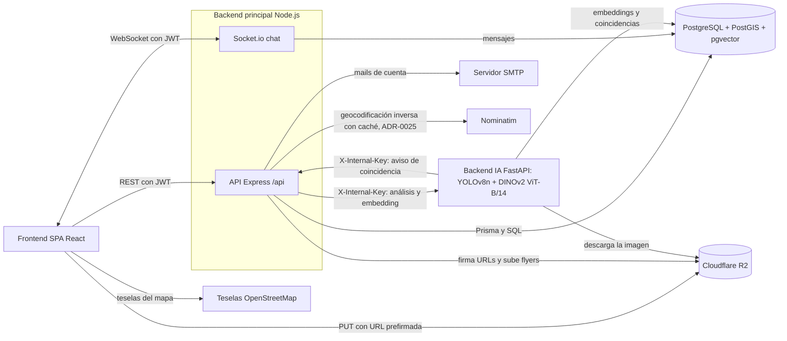
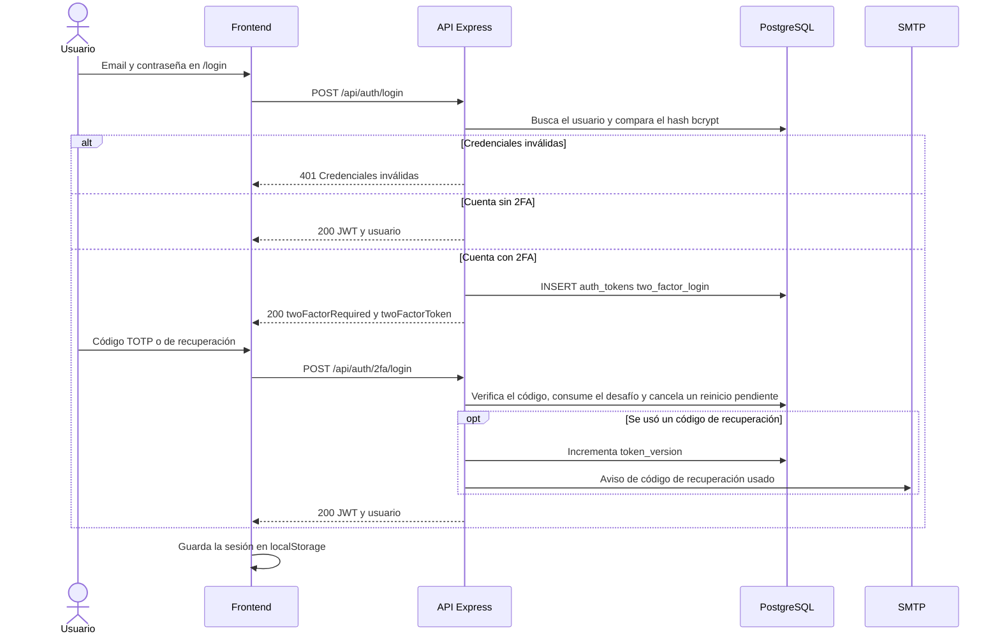
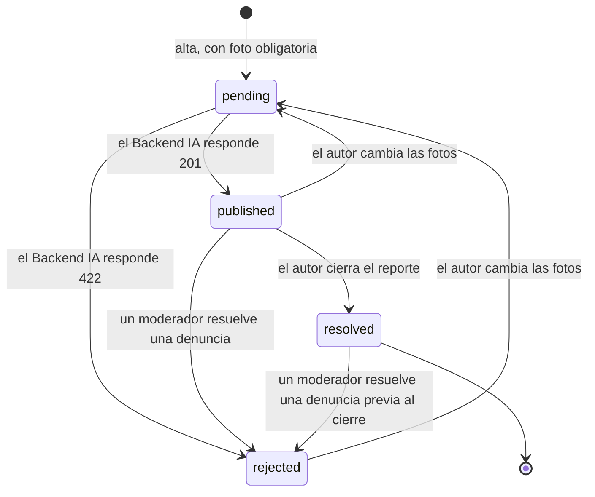
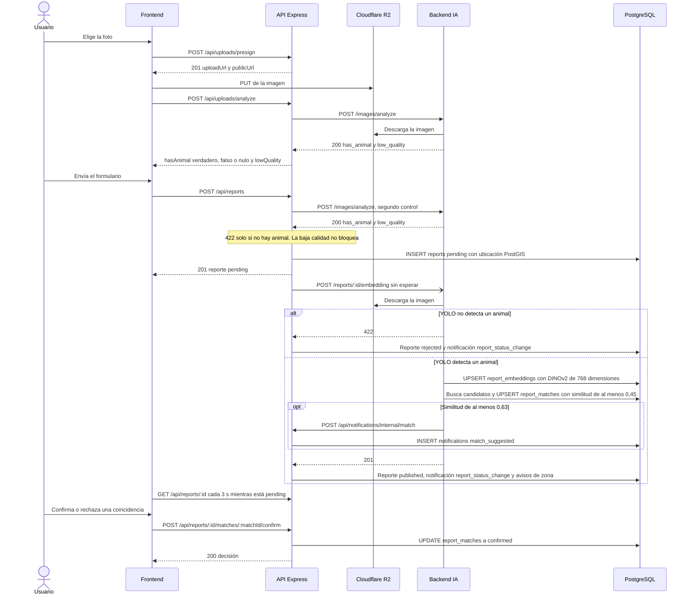
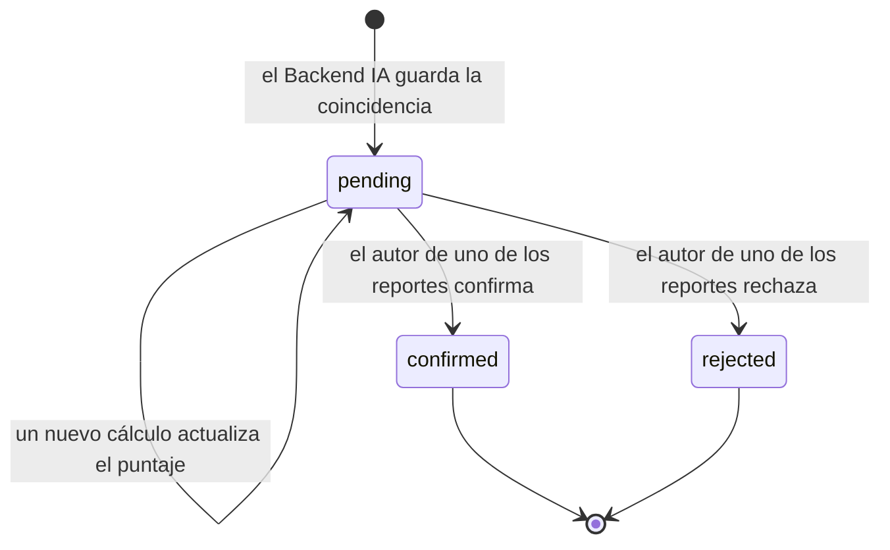
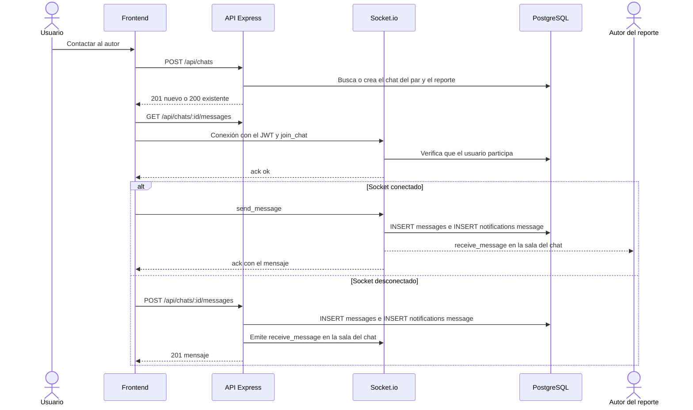
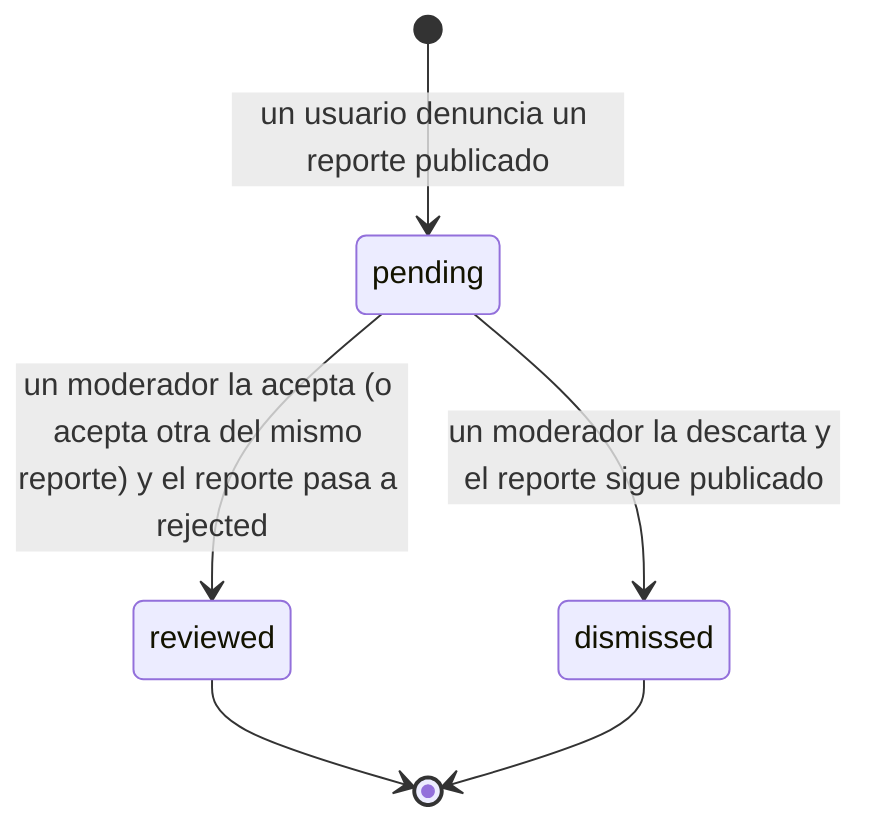

# 1.2.2.2 Historias de Usuario

Esta sección explica cómo funciona el sistema de punta a punta. Para cada módulo presenta las historias de usuario, el flujo completo (acción del usuario, pantalla, ruta de la API, servicio, tablas y servicios externos, respuesta), las reglas de negocio con sus valores, el comportamiento ante fallas y las limitaciones conocidas.

- **Historias.** Issues con la etiqueta `type: story` y la etiqueta `epic:` del módulo: `gh issue list --repo ISI-ProyectoFinal-2026/Grupo1 --state all --label "type: story" --limit 200 --json number,title,state,labels,body` (51 issues al 2026-10-24). La [#35](https://github.com/ISI-ProyectoFinal-2026/Grupo1/issues/35) no tiene etiqueta `epic:` y se ubica en Autenticación por su contenido.
- **Estado en el código.** *Implementada*: el código cumple los criterios de aceptación del issue. *Parcial*: cumple una parte y se indica cuál falta. *No implementada*: no hay código. El estado se juzga contra el código, no contra el estado del issue.
- **Citas.** Las rutas son relativas a la raíz del repositorio; `archivo:línea` remite a la línea donde empieza el elemento citado.
- Las especificaciones E2E de `frontend/e2e/` (F1 a F14) cubren varios de estos flujos; su resultado no se volvió a ejecutar para esta sección: No verificado.

## Visión general del funcionamiento

El navegador ejecuta una SPA en React que habla con una API Express bajo `/api` y, para el chat, con un servidor Socket.io montado en el mismo proceso HTTP (`backend/src/index.ts:15-16`). Las imágenes no pasan por la API: el navegador las sube directo a Cloudflare R2 con una URL prefirmada. La API delega el análisis de imágenes al Backend IA (FastAPI), que escribe los embeddings y las coincidencias en la misma base y avisa a la API cuando encuentra una coincidencia. No existe cola de trabajos: la cola Redis descrita en [`ARQUITECTURA.md`](../ARQUITECTURA.md) §4 no está implementada ([#177](https://github.com/ISI-ProyectoFinal-2026/Grupo1/issues/177)).

Figura 1.2.2-1. Componentes del sistema y cómo se comunican. Fuente: `backend/src/app.ts:34-57`, `backend/src/index.ts:15-16`, `backend/src/services/storage.service.ts:63`, `backend/src/services/matching.service.ts:102`, `backend/src/services/matching.service.ts:166`, `backend-ia/app/services/matching_service.py:59-88`, `backend/src/services/reverse-geocode.service.ts:3-13`, `frontend/src/components/maps/OsmTileLayer.tsx:4-10`.

El rol del usuario se lee de la base en cada request y no viaja en el JWT (`backend/src/middlewares/auth.middleware.ts:78-102`, `backend/src/utils/jwt.ts:11-15`). "Comercio" no es un rol: es un perfil `Business` vinculado 1:1 a un usuario (`backend/prisma/schema.prisma:513-515`).

| Perfil | Cómo se obtiene | Qué puede hacer | Fuente |
|---|---|---|---|
| Anónimo | Sin sesión | Ver el feed, el detalle de reportes publicados o resueltos, el flyer y el directorio y el perfil de los comercios, sin las coincidencias ni acciones de cuenta ([#187](https://github.com/ISI-ProyectoFinal-2026/Grupo1/issues/187)) | `backend/src/routes/reports.routes.ts:20-47`, `backend/src/routes/businesses.routes.ts:18-19`, `frontend/src/router.tsx:54-59` |
| `usuario_regular` sin email verificado | Registro | Navegar, denunciar reportes, registrar un comercio, ver coincidencias; no puede crear reportes, subir imágenes, chatear, denunciar cuentas ni activar el 2FA | `backend/src/middlewares/auth.middleware.ts:110-119`, `backend/src/routes/uploads.routes.ts:17`, `backend/src/routes/chats.routes.ts:8-10`, `backend/src/routes/account-reports.routes.ts:9-15`, `backend/src/routes/auth.routes.ts:35-36` |
| `usuario_regular` verificado | Enlace del mail de verificación | Todo lo anterior más crear reportes, subir imágenes, chatear, denunciar cuentas y activar el 2FA | `backend/src/routes/reports.routes.ts:24` |
| `moderador` | Lo asigna un `admin` desde `/admin/users` (`PATCH /api/admin/users/:id/role`) | Además, el panel `/moderation` (listar y resolver denuncias de reportes) y la cola de sanciones `/admin/sanctions`, donde solo decide reincidencias de usuarios regulares | `backend/src/routes/admin.routes.ts:8-19`, `backend/src/services/account-sanctions/policy.ts:78-87`, `frontend/src/router.tsx:81-88` |
| `admin` | El seed o la asignación por otro `admin` | Lo mismo que `moderador`, más cambiar roles, ver el registro de cambios de rol y decidir cualquier caso de sanción | `backend/prisma/seed.ts:15-21`, `backend/src/routes/admin.routes.ts:14-19`, `frontend/src/router.tsx:89-92` |

Tabla 1.2.2-1. Perfiles de usuario y permisos. Fuente: `backend/prisma/schema.prisma:18-24` y los archivos de la tabla.

## 1.2.2.2.1 Módulo de Autenticación y seguridad de la cuenta

### Historias de usuario

| Issue | Historia | Estado del issue | Estado en el código |
|---|---|---|---|
| [#10](https://github.com/ISI-ProyectoFinal-2026/Grupo1/issues/10) | Como usuario quiero registrarme con email y contraseña para acceder a la plataforma | Cerrado | Implementada (`backend/src/services/auth.service.ts:37`) |
| [#31](https://github.com/ISI-ProyectoFinal-2026/Grupo1/issues/31) | Como sistema quiero un modelo de roles (usuario_regular, moderador, admin, comercio) para gobernar permisos | Cerrado | Parcial: tres roles; "comercio" es un perfil y no un rol |
| [#35](https://github.com/ISI-ProyectoFinal-2026/Grupo1/issues/35) | Como usuario quiero activar 2FA para mayor seguridad en mi cuenta | Cerrado | Implementada (`backend/src/services/two-factor/service.ts:152`, `:185`) |
| [#63](https://github.com/ISI-ProyectoFinal-2026/Grupo1/issues/63) | Como usuario quiero registrarme e iniciar sesión desde el navegador | Cerrado | Implementada (`frontend/src/pages/auth/Register.tsx`, `frontend/src/pages/auth/Login.tsx`) |
| [#185](https://github.com/ISI-ProyectoFinal-2026/Grupo1/issues/185) | Como usuario quiero verificar mi email y recuperar mi contraseña para tener una cuenta segura y recuperable | Cerrado | Implementada (`backend/src/services/auth.service.ts:108`, `:155`, `:165`) |
| [#224](https://github.com/ISI-ProyectoFinal-2026/Grupo1/issues/224) | Gestión de roles: asignar moderadores y definir los permisos de `admin` | Abierto | Implementada: el `admin` cambia roles y consulta su auditoría (`backend/src/routes/admin.routes.ts:14-19`, `frontend/src/pages/admin/AdminUsersPage.tsx`) |

Tabla 1.2.2-2. Historias del módulo de autenticación. Fuente: `gh issue list` (comando al inicio de la sección).

### Flujo punta a punta

1. **Registro.** En `/register` el usuario ingresa email y contraseña. `POST /api/auth/register` (`backend/src/routes/auth.routes.ts:31`) llega a `register` (`backend/src/services/auth.service.ts:37-61`), que calcula el hash bcrypt e inserta en `users` con rol `usuario_regular` (`backend/prisma/schema.prisma:32`). Un email repetido responde 409. El usuario vuelve a `/login` (`frontend/src/pages/auth/Register.tsx:40`).
2. **Verificación.** El registro emite un token de un solo uso en `auth_tokens` (se guarda su sha256) y envía por SMTP el enlace `/verify-email` (`backend/src/services/auth.service.ts:32-35`). Al abrirlo, `POST /api/auth/verify-email` sella `users.email_verified_at` (`:108-117`). El reenvío es `POST /api/auth/verify-email/resend` (`:119-147`).
3. **Inicio de sesión.** En `/login`, `POST /api/auth/login` llega a `login` (`backend/src/services/auth.service.ts:67-98`). Si el email no existe compara contra un hash ficticio, para que ni el tiempo ni el mensaje revelen la cuenta; las credenciales inválidas responden 401.
4. **Sesión.** Sin 2FA, la respuesta trae un JWT con `sub`, `email` y `tv` (versión de sesión) (`backend/src/utils/jwt.ts:11-15`). El frontend lo guarda en `localStorage` mediante `persist` de zustand (`frontend/src/stores/auth.store.ts:15-24`) y lo envía en cada request. Cada request autenticada verifica la firma, que el usuario exista y que `tv` coincida con `users.token_version` (`backend/src/services/session.service.ts:42-72`).
5. **Segundo factor en el login.** Con 2FA activo, `login` devuelve un desafío `twoFactorToken` en lugar del JWT (`backend/src/services/auth.service.ts:84-95`) y la pantalla pide el código (`frontend/src/pages/auth/Login.tsx:109-117`). `POST /api/auth/2fa/login` llega a `loginWithSecondFactor` (`backend/src/services/two-factor/service.ts:92-127`), que acepta un código TOTP o uno de recuperación. Con un código de recuperación incrementa `token_version` (cierra las otras sesiones) y avisa por mail.
6. **Recuperación de contraseña.** `POST /api/auth/forgot-password` responde siempre el mismo mensaje y envía el enlace en segundo plano, solo si la cuenta existe (`backend/src/controllers/auth.controller.ts:42`, `backend/src/services/auth.service.ts:155-163`). `POST /api/auth/reset-password` guarda el nuevo hash, incrementa `token_version` (invalida todos los JWT) y marca usados los tokens de restablecimiento (`:165-185`).
7. **Alta del 2FA.** En `/account/security`, `POST /api/auth/2fa/setup` genera el secreto, lo guarda cifrado con AES-256-GCM (`backend/src/services/two-factor/crypto.ts:62-63`) y devuelve la URI `otpauth`, que la pantalla muestra como QR (`frontend/src/components/account/TwoFactorSetupPanel.tsx:47`). `POST /api/auth/2fa/enable` con un código válido activa el factor, genera los códigos de recuperación en `two_factor_recovery_codes` y avisa por mail (`backend/src/services/two-factor/service.ts:185`). Baja y regeneración: `POST /api/auth/2fa/disable` y `POST /api/auth/2fa/recovery-codes` (`:221`, `:265`).
8. **Dispositivo perdido.** Desde el segundo paso del login, `POST /api/auth/2fa/reset/request` (exige el desafío y la contraseña) envía un enlace de confirmación. Al confirmar se envía un enlace de cancelación y el reinicio se completa en el primer login posterior a la espera (`backend/src/services/two-factor/reset.ts:42`, `:86`, `:120`, `:144`). Un login con el segundo factor lo cancela (`backend/src/services/two-factor/service.ts:103-104`).

Figura 1.2.2-2. Inicio de sesión con segundo factor. Fuente: `backend/src/services/auth.service.ts:67-98`, `backend/src/services/two-factor/service.ts:92-127`, `frontend/src/stores/auth.store.ts:15-24`.

### Reglas de negocio

| Regla | Valor | Fuente |
|---|---|---|
| Contraseña | Mínimo 8 caracteres, con minúscula, mayúscula y número | `backend/src/validators/auth.validator.ts:5-10` |
| Hash de contraseña | bcrypt, costo 12 | `backend/src/services/auth.service.ts:16` |
| Vigencia del JWT | 24 h (configurable con `JWT_EXPIRY`) | `backend/src/utils/jwt.ts:13` |
| Tokens de enlace | Un solo uso, guardados como sha256; verificación 24 h, restablecimiento 30 min, desafío 2FA 5 min, cancelación del reinicio 7 días | `backend/src/services/auth-tokens.service.ts:9-14`, `:31` |
| Reenvío del mail de verificación | Una vez cada 60 s | `backend/src/services/auth.service.ts:21` |
| TOTP | Paso de 30 s, 6 dígitos, tolerancia de un paso | `backend/src/services/two-factor/totp.ts:3-5` |
| Códigos de recuperación | 10 códigos de 10 caracteres | `backend/src/services/two-factor/verify.ts:19`, `:46` |
| Bloqueo del 2FA | 5 intentos fallidos bloquean 15 min | `backend/src/services/two-factor/verify.ts:14-15` |
| Reinicio del 2FA | Efectivo 72 h después de confirmado | `backend/src/services/two-factor/service.ts:19` |
| Límites de tasa (por IP) | Login y registro 5/min; endpoints que envían mails o prueban enlaces 10 cada 15 min; 2FA 20 cada 15 min; toda la API 300/min | `backend/src/routes/auth.routes.ts:10-29`, `backend/src/middlewares/rate-limit.ts:8-35` |

Tabla 1.2.2-3. Reglas del módulo de autenticación. Fuente: archivos de la columna Fuente.

### Qué pasa si algo falla

- **Sin SMTP.** Sin `SMTP_HOST`, fuera de producción los mails se imprimen en la consola; en producción las acciones que envían mail responden 503 (`backend/src/services/mail/index.ts:17-34`).
- **Falla el mail del registro.** La cuenta queda creada y el usuario puede pedir el reenvío (`backend/src/services/auth.service.ts:52-58`).
- **Sesión invalidada.** Tras restablecer la contraseña o usar un código de recuperación, los JWT anteriores dejan de valer porque `tv` ya no coincide (`backend/src/services/session.service.ts:66-68`).

### Limitaciones conocidas

- El JWT se guarda en `localStorage` ([#215](https://github.com/ISI-ProyectoFinal-2026/Grupo1/issues/215)).

## 1.2.2.2.2 Módulo de Reportes de mascotas (alta, detalle, feed y cierre)

### Historias de usuario

| Issue | Historia | Estado del issue | Estado en el código |
|---|---|---|---|
| [#12](https://github.com/ISI-ProyectoFinal-2026/Grupo1/issues/12) | Como dueño quiero registrar mi mascota con sus características para tenerla en mi perfil | Cerrado | Implementada (`backend/src/routes/pets.routes.ts:8`, `frontend/src/pages/pets/CreatePetPage.tsx`) |
| [#13](https://github.com/ISI-ProyectoFinal-2026/Grupo1/issues/13) | Como dueño quiero editar, eliminar y añadir mascotas para mantener mi perfil | Cerrado | Implementada (`backend/src/routes/pets.routes.ts:7-11`, `frontend/src/pages/pets/`) |
| [#14](https://github.com/ISI-ProyectoFinal-2026/Grupo1/issues/14) | Como persona que encuentra quiero reportar una mascota avistada o encontrada para avisar al dueño | Cerrado | Implementada (`backend/src/services/reports.service.ts:154`) |
| [#15](https://github.com/ISI-ProyectoFinal-2026/Grupo1/issues/15) | Como usuario quiero ver etiquetas de estado en los reportes para identificarlos rápido | Cerrado | Implementada (`backend/src/services/reports.service.ts:41-50`) |
| [#16](https://github.com/ISI-ProyectoFinal-2026/Grupo1/issues/16) | Como usuario quiero ver y filtrar el feed de reportes para encontrar casos relevantes | Cerrado | Parcial: filtra por tipo, zona y fecha; no por raza |
| [#17](https://github.com/ISI-ProyectoFinal-2026/Grupo1/issues/17) | Como dueño quiero cerrar un reporte cuando aparece mi mascota para marcarlo resuelto | Cerrado | Implementada (`backend/src/services/reports.service.ts:277`) |
| [#65](https://github.com/ISI-ProyectoFinal-2026/Grupo1/issues/65) | Como usuario quiero publicar un reporte de mascota perdida o encontrada con foto e información desde el navegador | Cerrado | Implementada (`frontend/src/components/reports/ReportForm.tsx`) |
| [#187](https://github.com/ISI-ProyectoFinal-2026/Grupo1/issues/187) | Como visitante anónimo quiero ver el feed y el detalle de un reporte sin iniciar sesión | Abierto | Implementada (`frontend/src/router.tsx:54-59`, `frontend/src/pages/reports/ReportDetailPage.tsx`) |
| [#225](https://github.com/ISI-ProyectoFinal-2026/Grupo1/issues/225) | Interfaz para mascotas y para editar o eliminar un reporte | Abierto | Implementada (`frontend/src/pages/pets/`, `frontend/src/pages/reports/EditReportPage.tsx`, `frontend/src/pages/reports/MyReportsPage.tsx`, `frontend/src/components/reports/DeleteReportButton.tsx`) |

Tabla 1.2.2-4. Historias del módulo de reportes. Fuente: `gh issue list` (comando al inicio de la sección).

### Flujo punta a punta

1. **Formulario.** En `/reports/new` (`frontend/src/components/reports/ReportForm.tsx`) el usuario elige tipo (perdido o encontrado), una mascota propia opcional, título, fecha del suceso, descripción, fotos y ubicación. Si elige una mascota en un reporte de pérdida, el formulario precarga sus datos y fotos (`frontend/src/components/reports/ReportForm.tsx:135-169`).
2. **Fotos.** `MultiImageUploader` acepta hasta 4 fotos JPG, PNG o WebP de hasta 10 MB; la primera es la principal y el resto son fotos extra. Por cada una pide `POST /api/uploads/presign` y sube el archivo con `PUT` directo a R2 (`frontend/src/components/common/MultiImageUploader.tsx:34-47`, `frontend/src/components/reports/ReportForm.tsx:292-301`). `createPresignedUpload` firma la URL con la clave `pets/<uuid>.<ext>` (`backend/src/services/storage.service.ts:52-79`).
3. **Control temprano.** Con cada imagen ya en R2, `POST /api/uploads/analyze` consulta al Backend IA si hay un animal (`frontend/src/lib/screen-image.ts:13-23`, `backend/src/controllers/uploads.controller.ts:18-34`). Si no lo hay, la foto no se agrega y se muestra "Su publicación no se puede subir debido a que no se detectan animales. Posible SPAM" (`backend/src/constants/moderation.ts:2-3`, `frontend/src/components/common/MultiImageUploader.tsx:106-107`); si la foto rechazada es una precargada de la mascota, se deshabilita el envío (`frontend/src/components/reports/ReportForm.tsx:93-97`). El detalle del análisis está en el módulo 1.2.2.2.3.
4. **Ubicación.** El usuario toca el mapa para colocar un pin y puede arrastrarlo, o usa "Usar mi ubicación actual", que toma la posición del navegador. La coordenada se asigna de inmediato; después la etiqueta se reemplaza por la zona que devuelve `GET /api/geo/reverse`, un proxy del backend hacia Nominatim (`frontend/src/components/maps/LocationPicker.tsx:34-39`, `:55-86`, `:88-127`; `backend/src/routes/geo.routes.ts:9`).
5. **Reportes similares.** En el alta, con la ubicación elegida, `SimilarReportsSuggestions` pide `POST /api/reports/similar` (`frontend/src/components/reports/ReportForm.tsx:354-361`, `backend/src/routes/reports.routes.ts:25-26`). `findSimilarReports` devuelve hasta 3 reportes publicados o resueltos del mismo tipo, a menos de 2 km y de los últimos 30 días; con foto los ordena por similitud del embedding y, sin ella o si la IA no responde, por distancia (`backend/src/services/similar-reports.service.ts:7-10`, `:31-58`).
6. **Envío.** `POST /api/reports` (`backend/src/routes/reports.routes.ts:24`) llega a `create` (`backend/src/services/reports.service.ts:154-198`). Repite el control sobre la foto principal y las extra del bucket propio y responde 422 si alguna no tiene un animal (`:156`, `backend/src/services/image-screening.service.ts:7-15`). En una transacción inserta en `reports` con estado `pending` (`backend/src/services/reports.service.ts:169`) y guarda la ubicación como punto PostGIS `ST_SetSRID(ST_MakePoint(lng, lat), 4326)` (`:187-191`). Responde 201 y dispara la moderación por IA de la foto principal sin esperarla (`:146-152`, `:196`).
7. **Qué ve el usuario.** El formulario navega a `/reports/:id` (`frontend/src/components/reports/ReportForm.tsx:194-196`). Mientras el reporte está `pending`, el detalle muestra un aviso y se consulta de nuevo cada 3 s (`frontend/src/hooks/useReportDetailQuery.ts:4`, `:13`).
8. **Detalle.** `GET /api/reports/:id` llega a `getVisibleById` (`backend/src/services/reports.service.ts:130-141`): un reporte `published` o `resolved` es visible para todos si su autor no tiene una suspensión vigente; uno `pending` o `rejected`, solo para su autor; para el resto responde 404, y la pantalla avisa que el reporte ya no está disponible (`frontend/src/pages/reports/ReportDetailPage.tsx:125-140`). La respuesta incluye la etiqueta PERDIDO, ENCONTRADO o RESUELTO (`backend/src/services/reports.service.ts:41-50`). El detalle muestra las fotos y un mapa con la ubicación (`frontend/src/pages/reports/ReportDetailPage.tsx:199`, `:250-258`). Las acciones dependen de quién mira (`:162-176`): el autor puede cerrar, editar y eliminar; los demás pueden contactar al autor (1.2.2.2.5), denunciar el reporte y denunciar la cuenta del autor (1.2.2.2.7).
9. **Feed.** `/reports` pide `GET /api/reports` con `status=published` y los filtros de tipo, zona y fechas (`frontend/src/pages/reports/FeedPage.tsx:41-52`). `list` filtra la zona con `ILIKE` sobre `location_address` y excluye a los autores suspendidos (`backend/src/services/reports.service.ts:81-111`). El feed se ve como lista o como mapa (1.2.2.2.8).
10. **Cierre.** El autor presiona cerrar y `POST /api/reports/:id/close` llega a `close` (`backend/src/services/reports.service.ts:277-293`): solo el autor (403) y solo desde `published` (409). El reporte pasa a `resolved` y sale del feed, que solo pide publicados.
11. **Edición, eliminación y "Mis reportes".** El autor edita en `/reports/:id/edit` con `PUT /api/reports/:id`; si cambia la foto principal o las extra, las nuevas pasan por el control y el reporte vuelve a `pending` (`backend/src/services/reports.service.ts:218-275`). `DELETE /api/reports/:id` lo elimina (`:304-321`). `/reports/mine` lista los reportes propios en cualquier estado (`backend/src/routes/reports.routes.ts:22`, `backend/src/services/reports.service.ts:113-118`).
12. **Mascotas.** En `/pets` el usuario crea, edita y elimina sus mascotas con hasta 4 fotos, que pasan por el mismo control de la IA (`frontend/src/router.tsx:74-76`, `backend/src/validators/pets.validator.ts:4`, `backend/src/services/pets.service.ts:15-16`, `:51`). `GET /api/pets` lista solo las del usuario autenticado (`backend/src/services/pets.service.ts:11-13`).

Figura 1.2.2-3. Estados de un reporte (`ReportStatus`). Fuente: `backend/prisma/schema.prisma:144-151`, `backend/src/validators/reports.validator.ts:41`, `backend/src/services/reports.service.ts:169`, `:231-247`, `:277-293`, `backend/src/services/matching.service.ts:72-99`, `backend/src/services/report-flags.service.ts:89`.

### Reglas de negocio

| Regla | Valor | Fuente |
|---|---|---|
| Imagen | JPG, PNG o WebP, hasta 10 MB | `backend/src/validators/uploads.validator.ts:4-14` |
| URL prefirmada | Válida 300 s | `backend/src/services/storage.service.ts:7` |
| Campos obligatorios | Tipo, título, foto principal y ubicación; descripción, dirección, fecha del suceso, mascota y fotos extra son opcionales | `backend/src/validators/reports.validator.ts:36-51` |
| Fotos | Hasta 4: la principal y 3 extra, sin repetir la principal; mascotas, hasta 4 | `backend/src/validators/reports.validator.ts:33-34`, `:53-60`, `backend/src/validators/pets.validator.ts:4` |
| Estado inicial | Siempre `pending` | `backend/src/services/reports.service.ts:169` |
| Límite de creación | 10 reportes cada 15 min por usuario | `backend/src/middlewares/rate-limit.ts:12`, `:53-61` |
| Límite de subidas y análisis | 20 por minuto cada uno | `backend/src/routes/uploads.routes.ts:8-27` |
| Reportes similares | Mismo tipo, `published` o `resolved`, a menos de 2 km, de los últimos 30 días, máximo 3; 20 consultas por minuto por usuario | `backend/src/services/similar-reports.service.ts:7-10`, `backend/src/middlewares/rate-limit.ts:39-49` |
| Geocodificación inversa | Tiempo máximo 5 s en el navegador; el backend consulta Nominatim de a una solicitud cada 1,1 s, con caché de 24 h, User-Agent propio y 30 consultas por minuto por IP ([ADR-0025](../adr/0025-geocodificacion-inversa-proxy-backend.md)) | `frontend/src/components/maps/LocationPicker.tsx:18`, `backend/src/services/reverse-geocode.service.ts:3-13`, `backend/src/middlewares/rate-limit.ts:82-91` |
| Visibilidad | `published` y `resolved`, todos, salvo autor suspendido; `pending` y `rejected`, solo el autor | `backend/src/services/reports.service.ts:130-141` |
| Etiquetas | PERDIDO `#C4342B`, ENCONTRADO `#2457A6`, RESUELTO `#1F7A4D` | `backend/src/services/reports.service.ts:41-50` |
| Cierre | Solo el autor, solo desde `published` | `backend/src/services/reports.service.ts:209-216`, `:277-293` |

Tabla 1.2.2-5. Reglas del módulo de reportes. Fuente: archivos de la columna Fuente.

### Qué pasa si algo falla

- **R2 sin configurar.** `POST /api/uploads/presign` responde 503 con las variables faltantes (`backend/src/services/storage.service.ts:30-39`).
- **Backend IA sin respuesta en el control temprano.** El usuario continúa (`hasAnimal` nulo) y el reporte se guarda `pending`; decide la moderación asíncrona (`frontend/src/lib/screen-image.ts:10-23`, `backend/src/services/image-screening.service.ts:7-11`).
- **Geolocalización denegada.** Se muestra el error y el usuario puede marcar la ubicación con el pin del mapa (`frontend/src/components/maps/LocationPicker.tsx:110-117`, `:127`).
- **Nominatim no responde.** La etiqueta queda con las coordenadas; el reporte se crea igual (`frontend/src/components/maps/LocationPicker.tsx:74-83`). Con la cola del proxy llena, `GET /api/geo/reverse` responde 503 (`backend/src/services/reverse-geocode.service.ts:58-60`).

### Limitaciones conocidas

- No hay cierre de reportes inactivos ni seguimiento de casos ([#210](https://github.com/ISI-ProyectoFinal-2026/Grupo1/issues/210)).

## 1.2.2.2.3 Módulo de Moderación automática por IA y matching

### Historias de usuario

| Issue | Historia | Estado del issue | Estado en el código |
|---|---|---|---|
| [#18](https://github.com/ISI-ProyectoFinal-2026/Grupo1/issues/18) | Como sistema quiero generar y comparar embeddings de imágenes para detectar la misma mascota | Cerrado | Implementada; el criterio de tiempo de matching: No verificado |
| [#19](https://github.com/ISI-ProyectoFinal-2026/Grupo1/issues/19) | Como sistema quiero validar y moderar publicaciones automáticamente para mantener contenido relevante | Cerrado | Parcial: detecta imágenes sin animal y las rechaza; no hay vía de moderación manual para los reportes que quedan `pending` |
| [#34](https://github.com/ISI-ProyectoFinal-2026/Grupo1/issues/34) | Como usuario quiero ver un listado de coincidencias con % de similitud para evaluar matches | Cerrado | Implementada (`frontend/src/components/reports/MatchCard.tsx:76-78`) |
| [#66](https://github.com/ISI-ProyectoFinal-2026/Grupo1/issues/66) | Como usuario quiero ver el detalle de un reporte y los matches sugeridos por la IA para identificar si es mi mascota | Cerrado | Implementada (`frontend/src/pages/reports/ReportDetailPage.tsx:345-404`) |
| [#181](https://github.com/ISI-ProyectoFinal-2026/Grupo1/issues/181) | Como dueño de un reporte quiero confirmar o rechazar una coincidencia sugerida por la IA | Cerrado | Implementada (`backend/src/services/matching.service.ts:369-410`) |
| [#217](https://github.com/ISI-ProyectoFinal-2026/Grupo1/issues/217) | Ajustar los parámetros del matching con evidencia (ventana de 90 días, umbral calibrado) | Abierto | Parcial: ventana de 90 días y parámetros configurables (`backend-ia/app/config.py:20-25`, commit `024ce49`); los umbrales siguen marcados como provisionales (`backend-ia/app/services/matching_service.py:38-39`) |
| [#221](https://github.com/ISI-ProyectoFinal-2026/Grupo1/issues/221) | Confirmar una coincidencia debería avisar a la otra parte y ofrecer el cierre del reporte | Cerrado | Implementada en [PR #301](https://github.com/ISI-ProyectoFinal-2026/Grupo1/pull/301) (`backend/src/services/matching.service.ts:405-426`, `backend/src/services/notifications.service.ts:151-168`, `frontend/src/pages/reports/ReportDetailPage.tsx:170-171`) |

Tabla 1.2.2-6. Historias del módulo de IA y matching. Fuente: `gh issue list` (comando al inicio de la sección).

### Flujo punta a punta

1. **Control temprano (síncrono).** Al subir cada foto, `MultiImageUploader` llama a `POST /api/uploads/analyze` (`frontend/src/components/common/MultiImageUploader.tsx:42-47`, `frontend/src/lib/screen-image.ts:13-23`, `backend/src/routes/uploads.routes.ts:29`). `analyzeImage` llama a `POST /images/analyze` del Backend IA con la cabecera `X-Internal-Key` y un tiempo máximo de 15 s, sin reintentos (`backend/src/services/matching.service.ts:151-196`). El Backend IA descarga la imagen y, en una sola pasada de YOLO, `detect_and_crop` busca la mascota (`backend-ia/app/main.py:131-146`, `backend-ia/app/services/image_analysis_service.py:63-88`). Responde `has_animal` y `low_quality`: este último es verdadero si el recorte de la mascota tiene una nitidez menor que 10 (`backend-ia/app/ml/quality.py:11-32`, ver ADR-0023). Cualquier respuesta distinta de un 200 válido se trata como "no disponible" y no bloquea al usuario.
2. **Qué ve el usuario al subir la foto.** Sin animal, el formulario muestra el rechazo y no agrega la foto. Con una foto borrosa o movida, la agrega y muestra el aviso "La foto parece borrosa o movida. Probá subir una foto más nítida para que sea más fácil reconocer a tu mascota.", que no bloquea el envío (`backend/src/controllers/uploads.controller.ts:18-34`, `frontend/src/components/common/MultiImageUploader.tsx:106-112`; issue #212).
3. **Segundo control y alta.** Al crear o editar el reporte, `assertImagesHaveAnimals` vuelve a analizar la foto principal y las extra nuevas y responde 422 solo si alguna no tiene animal; una foto de baja calidad se acepta (`backend/src/services/image-screening.service.ts:7-15`, `backend/src/services/reports.service.ts:156`, `:245`). El mismo control se aplica a las fotos de las mascotas (`backend/src/services/pets.service.ts:16`, `:51`). El reporte se guarda `pending`.
4. **Disparo de la moderación.** `triggerEmbeddingGeneration` envía `POST /reports/:id/embedding` al Backend IA con la foto principal, sin bloquear la respuesta al usuario (`backend/src/services/reports.service.ts:146-152`, `backend/src/services/matching.service.ts:101-148`). Ante una falla de red o un 5xx hace hasta 3 intentos, con esperas de 1 s y 5 s (`:35`, `:47-70`).
5. **Embedding.** `process_report_image` descarga la imagen y `detect_and_crop` elige la mascota principal: la detección de mayor confianza entre las clases de animales de COCO que ocupan al menos el 25% del área del animal más grande (`backend-ia/app/services/embedding_service.py:24-43`, `backend-ia/app/ml/pipeline.py:75-100`). Si no hay animal, responde 422. Si lo hay, DINOv2 ViT-B/14 genera un vector de 768 dimensiones normalizado sobre el recorte llevado a un cuadrado (`backend-ia/app/ml/pipeline.py:115-137`, ver ADR-0021) y lo guarda con upsert en `report_embeddings` (`backend-ia/app/services/embedding_service.py:45-51`).
6. **Matching.** En la misma request, `find_and_store_matches` busca hasta 5 reportes `published` del tipo opuesto, a menos de 5 km y creados en los últimos 90 días, cuyos autores no tienen una suspensión vigente, ordenados por distancia coseno; si el autor del reporte procesado está suspendido, no busca candidatos (`backend-ia/app/services/matching_service.py:46-51`, `:97-155`; parámetros en `backend-ia/app/config.py:20-25`). Guarda en `report_matches` los que alcanzan una similitud de 0,45, sin pisar los ya decididos, y solo por los que alcanzan 0,63 llama a `POST /api/notifications/internal/match` de la API (`backend-ia/app/services/matching_service.py:157-185`, `:59-88`).
7. **Veredicto.** El Backend IA responde 201 (o 422 en el paso 5). `applyModerationVerdict` pasa el reporte a `published` (con `published_at`) o a `rejected`, solo si sigue `pending` con la misma imagen, y crea una notificación `report_status_change`. Si se publica, también avisa a los usuarios cercanos (`backend/src/services/matching.service.ts:72-99`, `:121-125`).
8. **Qué ve el usuario después.** La consulta del detalle se repite cada 3 s mientras el reporte está `pending` (`frontend/src/hooks/useReportDetailQuery.ts:4`, `:13`); al cambiar el estado aparece la sección "Coincidencias sugeridas" (`frontend/src/pages/reports/ReportDetailPage.tsx:345-404`).
9. **Listado de coincidencias.** `GET /api/reports/:id/matches` (cualquier usuario con sesión, `backend/src/routes/reports.routes.ts:36`) llega a `listMatches` (`backend/src/services/matching.service.ts:338-359`): datos del otro reporte y porcentaje de similitud, sin las rechazadas y solo con reportes `published` o `resolved`, de mayor a menor (`:353-354`, [PR #301](https://github.com/ISI-ProyectoFinal-2026/Grupo1/pull/301)).
10. **Decisión.** El autor confirma o rechaza con `POST /api/reports/:id/matches/:matchId/confirm` o `/reject` (`backend/src/routes/reports.routes.ts:38-39`). `decideMatch` exige ser el autor (403) y que la coincidencia involucre al reporte (404), y pasa de `pending` a `confirmed` (con `confirmed_at`) o `rejected`; una segunda decisión responde 409 (`backend/src/services/matching.service.ts:369-410`). Al confirmar, avisa al autor del otro reporte con una notificación `match_confirmed`; si el aviso falla, la decisión se mantiene (`:405-407`, `:413-426`, `backend/src/services/notifications.service.ts:151-168`). Con una coincidencia confirmada, el detalle le ofrece al autor cerrar su reporte publicado (`frontend/src/pages/reports/ReportDetailPage.tsx:170-171`, [PR #301](https://github.com/ISI-ProyectoFinal-2026/Grupo1/pull/301)).
11. **Reconciliación.** Al arrancar y cada 5 min, la API reenvía al Backend IA hasta 10 reportes `pending` con foto actualizados entre 2 min y 24 h antes (`backend/src/services/matching.service.ts:262-319`, `backend/src/index.ts:23`).

Figura 1.2.2-4. Publicación de un reporte con foto, moderación, matching, notificación y decisión. Fuente: `frontend/src/components/common/MultiImageUploader.tsx:42-120`, `backend/src/controllers/uploads.controller.ts:18-34`, `backend/src/services/reports.service.ts:146-198`, `backend/src/services/matching.service.ts:72-196`, `backend-ia/app/services/image_analysis_service.py:63-88`, `backend-ia/app/services/embedding_service.py:24-61`, `backend-ia/app/services/matching_service.py:59-185`.

Figura 1.2.2-5. Estados de una coincidencia (`MatchStatus`). Fuente: `backend/prisma/schema.prisma:326-332`, `backend-ia/app/services/matching_service.py:166-178`, `backend/src/services/matching.service.ts:368-413`.

### Reglas de negocio

| Regla | Valor | Fuente |
|---|---|---|
| Modelos | YOLOv8n (`yolov8n.pt`) y DINOv2 ViT-B/14 (`vit_base_patch14_dinov2.lvd142m`) ([ADR-0021](../adr/0021-modelo-embeddings-dinov2.md)) | `backend-ia/app/ml/pipeline.py:24-25` |
| Clases aceptadas | Las 10 clases de animales de COCO: bird, cat, dog, horse, sheep, cow, elephant, bear, zebra, giraffe | `backend-ia/app/ml/pipeline.py:49-60` |
| Mascota principal | Detección de mayor confianza entre las que ocupan al menos el 25% del área del animal más grande | `backend-ia/app/ml/pipeline.py:39`, `:75-100` |
| Embedding | 768 dimensiones, norma L2 = 1, sobre el recorte llevado a un cuadrado de 224 px ([ADR-0021](../adr/0021-modelo-embeddings-dinov2.md)) | `backend-ia/app/ml/pipeline.py:28`, `:35`, `:115-137` |
| Umbrales de similitud | Coseno ≥ 0,45 registra la coincidencia; ≥ 0,63 además notifica ([ADR-0021](../adr/0021-modelo-embeddings-dinov2.md); ajuste pendiente en [#217](https://github.com/ISI-ProyectoFinal-2026/Grupo1/issues/217)) | `backend-ia/app/config.py:21-22`, `backend-ia/app/services/matching_service.py:158`, `:181` |
| Candidatos | `published`, tipo opuesto, a menos de 5 km, creados en los últimos 90 días, autor sin suspensión vigente, máximo 5 | `backend-ia/app/services/matching_service.py:115-141`, `backend-ia/app/config.py:20-25` |
| Control temprano | Tiempo máximo 15 s, sin reintentos | `backend/src/services/matching.service.ts:156` |
| Calidad de la foto | Nitidez del recorte (varianza del laplaciano a 512 px) menor que 10: aviso que no bloquea la publicación ([ADR-0023](../adr/0023-aviso-calidad-imagen.md)) | `backend-ia/app/ml/quality.py:11-32`, `backend/src/services/image-screening.service.ts:7-11` |
| Reintentos del embedding | Hasta 3 intentos ante falla de red o 5xx, con esperas de 1 s y 5 s | `backend/src/services/matching.service.ts:35`, `:47-70` |
| Reconciliación | Cada 5 min; reportes `pending` actualizados entre 2 min y 24 h antes; 10 por pasada | `backend/src/services/matching.service.ts:262-267` |
| Quién ve y quién decide | Ve cualquier usuario con sesión; decide solo el autor del reporte | `backend/src/routes/reports.routes.ts:36-39` |

Tabla 1.2.2-7. Reglas del módulo de IA y matching. Fuente: archivos de la columna Fuente.

### Qué pasa si algo falla

- **Sin `AI_SERVICE_URL`.** No hay moderación ni reconciliación y los reportes con foto quedan `pending` indefinidamente ([#220](https://github.com/ISI-ProyectoFinal-2026/Grupo1/issues/220), `backend/src/services/matching.service.ts:102-104`, `:274`). Al arrancar, la API registra una advertencia si falta la variable (`backend/src/index.ts:8`, `:11`).
- **Backend IA caído.** Agotados los intentos, el reporte queda `pending` y la reconciliación lo reintenta durante 24 h; después queda `pending` sin aviso al usuario (`backend/src/services/matching.service.ts:142-148`, `:262-263`).
- **Clave interna distinta.** Un 401 deja el reporte `pending` y registra un error que nombra `INTERNAL_API_KEY` (`backend/src/services/matching.service.ts:126-135`).
- **Falla el matching.** El embedding queda guardado y el reporte se publica igual, sin coincidencias (`backend-ia/app/services/embedding_service.py:53-59`).
- **Falla el aviso a la API.** La coincidencia queda guardada sin notificación (`backend-ia/app/services/matching_service.py:83-88`).

### Limitaciones conocidas

- Los umbrales del matching son provisionales ([#217](https://github.com/ISI-ProyectoFinal-2026/Grupo1/issues/217), `backend-ia/app/services/matching_service.py:38-39`).
- El procesamiento no usa una cola: si el proceso se reinicia, depende de la reconciliación ([#177](https://github.com/ISI-ProyectoFinal-2026/Grupo1/issues/177)).
- La moderación asíncrona y el embedding usan solo la foto principal; las fotos extra pasan únicamente por el control temprano (`backend/src/services/reports.service.ts:156`, `:196`).

## 1.2.2.2.4 Módulo de Notificaciones

### Historias de usuario

| Issue | Historia | Estado del issue | Estado en el código |
|---|---|---|---|
| [#32](https://github.com/ISI-ProyectoFinal-2026/Grupo1/issues/32) | Como usuario quiero recibir notificaciones de eventos importantes para seguir mi caso | Cerrado | Parcial: solo dentro de la app; no hay push ni email |
| [#33](https://github.com/ISI-ProyectoFinal-2026/Grupo1/issues/33) | Como usuario quiero configurar mis preferencias de notificación para recibir solo lo relevante | Abierto | Implementada (`backend/src/services/notification-preferences.service.ts`, `frontend/src/pages/account/NotificationSettingsPage.tsx`); reabierto por [#226](https://github.com/ISI-ProyectoFinal-2026/Grupo1/issues/226) |
| [#149](https://github.com/ISI-ProyectoFinal-2026/Grupo1/issues/149) | Notificaciones en la interfaz: campana, lista y marcar como leída | Cerrado | Implementada (`frontend/src/components/notifications/`) |
| [#176](https://github.com/ISI-ProyectoFinal-2026/Grupo1/issues/176) | Como usuario que reportó una mascota quiero recibir una notificación cuando la IA detecta un match de alta similitud | Cerrado | Implementada (`backend/src/services/notifications.service.ts:120`) |
| [#182](https://github.com/ISI-ProyectoFinal-2026/Grupo1/issues/182) | Como dueño de un reporte quiero recibir una notificación cuando se publica, se rechaza por moderación o se resuelve | Cerrado | Implementada para la moderación por IA y el ocultamiento por una denuncia (`backend/src/services/notifications.service.ts:151-190`); el aviso al resolver era opcional en el issue y no existe |
| [#222](https://github.com/ISI-ProyectoFinal-2026/Grupo1/issues/222) | Las notificaciones deberían enlazar al reporte que mencionan | Abierto | No implementada |

Tabla 1.2.2-8. Historias del módulo de notificaciones. Fuente: `gh issue list` (comando al inicio de la sección).

### Flujo punta a punta

1. **Preferencias y ubicación.** Cada usuario tiene una fila opcional en `notification_preferences`; sin fila rigen los valores por defecto (`backend/prisma/schema.prisma:440-446`, `backend/src/services/notification-preferences.service.ts:24`, [ADR-0022](../adr/0022-preferencias-notificacion-tabla-propia.md)).
   - La primera vez que un usuario con sesión abre la app, `LocationConsentModal` le pregunta si acepta compartir su ubicación ("Aceptar" o "Ahora no"); la respuesta queda registrada y el modal no vuelve a aparecer (`frontend/src/components/account/LocationConsentModal.tsx`).
   - Con el consentimiento aceptado, `useLocationSync` envía la ubicación del navegador una vez por carga de página y el backend guarda solo la última, con su fecha (`frontend/src/hooks/useLocationSync.ts`, `backend/src/services/notification-preferences.service.ts:102`). Si el usuario revoca el consentimiento, se borra la ubicación y se desactiva el aviso de zona (`backend/src/services/notification-preferences.service.ts:76`).
   - En `/account/notifications`, enlazada desde el menú "Más", el usuario activa o desactiva cada tipo de aviso y, para el de zona, elige radio y tipo de reporte (`frontend/src/pages/account/NotificationSettingsPage.tsx`). Los endpoints son `GET` y `PUT /api/notification-preferences`, `PUT .../location-consent` y `PUT .../location`, todos con JWT y limitados a las preferencias del propio usuario (`backend/src/routes/notification-preferences.routes.ts:7-10`).
2. **Generación.** Toda notificación es una fila en `notifications` con un `type` de texto (`backend/prisma/schema.prisma:391`). Antes de crearla se consulta la preferencia del destinatario y, si ese tipo está desactivado, no se crea; la acción que la origina no cambia (`backend/src/services/notification-preferences.service.ts:56`). Hay cinco orígenes:
   - `match_suggested`: el Backend IA llama a `POST /api/notifications/internal/match`, protegido con `X-Internal-Key` (`backend/src/routes/notifications.routes.ts:14`). `notifyMatch` y `createForMatch` crean una notificación por autor, apuntando al otro reporte, y no repiten una existente para el mismo usuario y reporte (`backend/src/services/notifications.service.ts:60-144`).
   - `report_status_change`: al aplicar el veredicto de la IA ("Tu reporte fue publicado" o "Tu reporte no fue publicado") o cuando un moderador acepta una denuncia ("Tu reporte fue ocultado") (`backend/src/services/notifications.service.ts:146-190`).
   - `message`: por cada mensaje de chat, para el receptor, con una vista previa (`backend/src/services/notifications.service.ts:209-227`).
   - `nearby_report`: cuando un reporte pasa a `published`, `applyModerationVerdict` llama a `createForNearbyReport` (`backend/src/services/matching.service.ts:93-98`). Avisa a los usuarios que no son el autor, tienen el aviso de zona activado, aceptaron compartir su ubicación, coincide el tipo de reporte elegido y su última ubicación está dentro del radio (consulta PostGIS `ST_DWithin`); no repite el aviso para el mismo usuario y reporte (`backend/src/services/notifications.service.ts:237-276`).
   - `role_change`: cuando un `admin` cambia el rol de un usuario; no consulta las preferencias (`backend/src/services/admin-users.service.ts:116-124`).
3. **Visualización.** La campana del encabezado (`frontend/src/layouts/MainLayout.tsx:179`) consulta `GET /api/notifications` cada 30 s (`frontend/src/hooks/useNotificationsQuery.ts:12`, `:23`), que devuelve las del usuario de la más nueva a la más vieja (`backend/src/services/notifications.service.ts:7-12`).
4. **Gestión.** `PUT /api/notifications/:id/read` marca como leída y `DELETE /api/notifications/:id` borra; solo el destinatario (403 para otro usuario) (`backend/src/services/notifications.service.ts:14-36`).

### Reglas de negocio

| Regla | Valor | Fuente |
|---|---|---|
| Consulta de la campana | Cada 30 s | `frontend/src/hooks/useNotificationsQuery.ts:12` |
| Duplicados de coincidencia | Una por usuario y reporte; si ambos reportes son del mismo usuario, una sola | `backend/src/services/notifications.service.ts:63-92` |
| Vista previa del mensaje | Hasta 80 caracteres | `backend/src/services/notifications.service.ts:192` |
| Propiedad | Solo el destinatario lee, marca o borra | `backend/src/services/notifications.service.ts:14-23` |
| Valores por defecto | Todos los avisos activados, radio de 5 km y reportes perdidos y encontrados | `backend/prisma/schema.prisma:440-447` |
| Radio del aviso de zona | 1, 2, 5 o 10 km | `backend/src/validators/notification-preferences.validator.ts` |
| Aviso de zona sin consentimiento | No se puede activar (409) ni guardar la ubicación (403) | `backend/src/services/notification-preferences.service.ts:61`, `:102` |
| Duplicados del aviso de zona | Uno por usuario y reporte, también si el reporte se vuelve a publicar | `backend/src/services/notifications.service.ts:237-276` |

Tabla 1.2.2-9. Reglas del módulo de notificaciones. Fuente: archivos de la columna Fuente.

### Qué pasa si algo falla

- Un error al crear la notificación no hace fallar la acción que la origina, tampoco el aviso de zona al publicar un reporte (`backend/src/services/matching.service.ts:87-98`, `backend/src/sockets/chat.socket.ts:102-107`).
- Si el navegador deniega la geolocalización, el consentimiento queda registrado, no se guarda ubicación y no se muestra ningún error (`frontend/src/hooks/useLocationSync.ts`).
- Sin `NODE_BACKEND_URL` en el Backend IA, las coincidencias se guardan sin notificación (`backend-ia/app/services/matching_service.py:66-70`).

### Limitaciones conocidas

- La notificación no enlaza al reporte ([#222](https://github.com/ISI-ProyectoFinal-2026/Grupo1/issues/222)).
- La ubicación se actualiza solo al abrir la app, una vez por carga de página; el aviso de zona usa la última ubicación guardada.
- Los reportes sin ubicación no generan aviso de zona.
- No hay avisos por email ni push, ni aviso al cerrar un reporte.

## 1.2.2.2.5 Módulo de Chat

### Historias de usuario

| Issue | Historia | Estado del issue | Estado en el código |
|---|---|---|---|
| [#27](https://github.com/ISI-ProyectoFinal-2026/Grupo1/issues/27) | Como usuario quiero chatear en tiempo real con otro usuario para coordinar sobre un reporte | Cerrado | Implementada (`backend/src/sockets/chat.socket.ts:118`) |
| [#37](https://github.com/ISI-ProyectoFinal-2026/Grupo1/issues/37) | Como usuario quiero enviar imágenes en el chat para compartir fotos del caso | Cerrado | Implementada (`frontend/src/components/chat/ChatWindow.tsx:117-119`) |
| [#68](https://github.com/ISI-ProyectoFinal-2026/Grupo1/issues/68) | Como usuario quiero chatear en tiempo real desde el navegador para coordinar sobre un reporte | Cerrado | Implementada (`frontend/src/hooks/useChatSocket.ts`) |

Tabla 1.2.2-10. Historias del módulo de chat. Fuente: `gh issue list` (comando al inicio de la sección).

### Flujo punta a punta

1. **Apertura.** En el detalle, un usuario que no es el autor presiona "Contactar al autor" (`frontend/src/pages/reports/ReportDetailPage.tsx:168`, `:428-437`). `POST /api/chats` llega a `createChat` (`backend/src/services/chats.service.ts:35-86`): no se puede abrir un chat con uno mismo (400), el participante debe ser el autor del reporte (403), no se abre un chat nuevo si el autor tiene una suspensión vigente (404) y hay un único chat por par de usuarios y reporte en `chats`. Responde el existente (200) o uno nuevo (201) y la pantalla navega a `/chats/:id`.
2. **Historial.** `ChatPage` pide `GET /api/chats` y `GET /api/chats/:id/messages` (`backend/src/routes/chats.routes.ts:7-9`).
3. **Conexión.** `useChatSocket` abre Socket.io con el JWT en el handshake (`frontend/src/hooks/useChatSocket.ts:59-60`); el servidor valida la sesión igual que la API (`backend/src/sockets/chat.socket.ts:126-146`). `join_chat` verifica que el usuario participe y lo une a la sala `chat:<id>` (`:151-163`).
4. **Envío.** `send_message` llega a `handleSendMessage` (`backend/src/sockets/chat.socket.ts:88-116`): valida texto o imagen, relee la verificación del email, verifica la participación, inserta en `messages`, crea la notificación `message` y emite `receive_message` a la sala. Los envíos de un mismo socket se procesan en orden (`:187-191`).
5. **Alternativa REST.** Si el socket no está conectado, el cliente usa `POST /api/chats/:id/messages` (`frontend/src/hooks/useChatSocket.ts:157-167`), que persiste, notifica y emite a la sala igual (`backend/src/controllers/chats.controller.ts:26-41`).
6. **Imágenes.** La ventana del chat sube la imagen con URL prefirmada a R2 y envía un mensaje con `imageUrl` (`frontend/src/components/chat/ChatWindow.tsx:117-119`). No pasa por el control de la IA.

Figura 1.2.2-6. Chat por Socket.io con alternativa REST. Fuente: `backend/src/services/chats.service.ts:35-86`, `backend/src/sockets/chat.socket.ts:88-163`, `backend/src/controllers/chats.controller.ts:26-41`, `frontend/src/hooks/useChatSocket.ts:157-167`.

### Reglas de negocio

| Regla | Valor | Fuente |
|---|---|---|
| Participantes | Dos: quien contacta y el autor del reporte | `backend/src/services/chats.service.ts:40-52` |
| Unicidad | Un chat por par de usuarios y reporte | `backend/src/services/chats.service.ts:54-63` |
| Autor suspendido | No se abre un chat nuevo (404); uno existente se devuelve | `backend/src/services/chats.service.ts:61-66` |
| Mensaje | Texto de al menos 1 carácter o una imagen con URL http o https | `backend/src/validators/chat-socket.validator.ts:15-18` |
| Imagen | Mismas reglas que la foto del reporte (JPG, PNG o WebP, hasta 10 MB) | `backend/src/validators/uploads.validator.ts:4-14` |
| Email verificado | Exigido para abrir el chat y para enviar | `backend/src/routes/chats.routes.ts:8-10`, `backend/src/sockets/chat.socket.ts:98` |

Tabla 1.2.2-11. Reglas del módulo de chat. Fuente: archivos de la columna Fuente.

### Qué pasa si algo falla

- **Socket caído.** El mensaje sale por REST (paso 5); la pantalla muestra el estado de reconexión (`frontend/src/hooks/useChatSocket.ts:88`).
- **Sesión rechazada en el handshake.** El estado pasa a no autorizado (`frontend/src/hooks/useChatSocket.ts:92-99`).
- **Mensaje inválido.** El error vuelve al emisor por el ack y por el evento `error`, sin cortar la conexión (`backend/src/sockets/chat.socket.ts:111-115`).

### Limitaciones conocidas

- Las imágenes del chat no pasan por el control de la IA.
- Solo quien no es el autor puede iniciar el chat; el autor responde en el chat que se le abre.

## 1.2.2.2.6 Módulo de Flyers

### Historias de usuario

| Issue | Historia | Estado del issue | Estado en el código |
|---|---|---|---|
| [#25](https://github.com/ISI-ProyectoFinal-2026/Grupo1/issues/25) | Como dueño quiero que se genere un flyer automático del reporte para difundirlo | Cerrado | Implementada: incluye fotos, datos de la mascota y del suceso y, si el autor lo autoriza, su teléfono (`backend/src/services/flyer.service.ts:207-217`, `:692-707`) |
| [#26](https://github.com/ISI-ProyectoFinal-2026/Grupo1/issues/26) | Como dueño quiero descargar y compartir el flyer en redes para ampliar la búsqueda | Cerrado | Implementada: descarga y menú de compartir del sistema, sin botones por red social (`frontend/src/pages/reports/ReportDetailPage.tsx:93-103`) |
| [#36](https://github.com/ISI-ProyectoFinal-2026/Grupo1/issues/36) | Como usuario quiero generar flyers propios para personalizar mi difusión | Cerrado | Parcial: se sube una imagen propia; no un PDF |
| [#67](https://github.com/ISI-ProyectoFinal-2026/Grupo1/issues/67) | Como usuario quiero generar y descargar un flyer en PDF con los datos de mi reporte | Cerrado | Parcial: genera PNG, no PDF |

Tabla 1.2.2-12. Historias del módulo de flyers. Fuente: `gh issue list` (comando al inicio de la sección).

### Flujo punta a punta

1. **Pedido.** En el detalle de un reporte que no está `pending`, "Generar flyer" pide `GET /api/reports/:id/flyer` (`frontend/src/pages/reports/ReportDetailPage.tsx:277-289`). La ruta es pública, con la misma visibilidad que el detalle (`backend/src/routes/reports.routes.ts:47`, `backend/src/controllers/reports.controller.ts:83-94`).
2. **Flyer propio.** Si el reporte tiene `custom_flyer_url`, se devuelve esa URL.
3. **Flyer automático.** `getOrCreateFlyerUrl` calcula una versión a partir del contenido del reporte; si el objeto `flyers/report-<id>.png` de R2 tiene esa versión en sus metadatos, devuelve su URL con `?v=` (`backend/src/services/flyer.service.ts:728-743`). Si no, descarga la foto principal y hasta 3 extra, compone un PNG de 1080×1920 con `@napi-rs/canvas` (etiqueta, fotos, título, descripción, datos de la mascota, zona, fecha del suceso, teléfono del autor si este lo autorizó y pie de PATITAS) y lo sube a R2 (`:207-217`, `:692-727`, `:745-758`).
4. **Qué ve el usuario.** La imagen del flyer con "Descargar" (atributo `download`) y "Compartir", que usa el menú de compartir del sistema o, si no existe, copia el enlace (`frontend/src/pages/reports/ReportDetailPage.tsx:93-103`, `:305-328`).
5. **Carga propia.** Solo el autor ve "o subí tu propio flyer", que sube una imagen a R2 y llama a `PUT /api/reports/:id/flyer/custom`; `setCustomFlyer` solo lo permite al autor y guarda `custom_flyer_url` (`frontend/src/pages/reports/ReportDetailPage.tsx:290-302`, `backend/src/services/reports.service.ts:295-302`).

### Reglas de negocio

| Regla | Valor | Fuente |
|---|---|---|
| Formato | PNG de 1080×1920 (9:16) | `backend/src/services/flyer.service.ts:9-10` |
| Clave en R2 | `flyers/report-<id>.png` | `backend/src/services/flyer.service.ts:608-610` |
| Regeneración | Solo cuando cambia el contenido del reporte o el diseño | `backend/src/services/flyer.service.ts:614-615`, `:634` |
| Teléfono | Solo si el autor marcó "Mostrar mi teléfono en el flyer" y tiene un teléfono cargado | `backend/src/validators/reports.validator.ts:44-45`, `backend/src/services/flyer.service.ts:692-707` |
| Flyer degradado | Sin foto disponible usa una ilustración en su lugar y reintenta a los 10 min | `backend/src/services/flyer.service.ts:488-494`, `:622` |
| Límite de tasa | 20 por minuto | `backend/src/routes/reports.routes.ts:11-18` |
| Flyer propio | Solo el autor | `backend/src/services/reports.service.ts:295-302` |

Tabla 1.2.2-13. Reglas del módulo de flyers. Fuente: archivos de la columna Fuente.

### Qué pasa si algo falla

- **La foto no se puede descargar.** El flyer sale con la ilustración en lugar de la foto, marcado como degradado (`backend/src/services/flyer.service.ts:745-758`).
- **R2 sin configurar.** La generación responde 503 (`backend/src/services/storage.service.ts:81-84`).

### Limitaciones conocidas

- El flyer se genera en PNG, no en PDF ([#67](https://github.com/ISI-ProyectoFinal-2026/Grupo1/issues/67)).
- El flyer propio no pasa por el control de la IA.

## 1.2.2.2.7 Módulo de Moderación comunitaria (denuncias)

### Historias de usuario

| Issue | Historia | Estado del issue | Estado en el código |
|---|---|---|---|
| [#20](https://github.com/ISI-ProyectoFinal-2026/Grupo1/issues/20) | Como usuario quiero reportar una publicación inapropiada o falsa para que sea revisada | Cerrado | Implementada (`backend/src/services/report-flags.service.ts:21`) |
| [#38](https://github.com/ISI-ProyectoFinal-2026/Grupo1/issues/38) | Como sistema quiero suspender usuarios con publicaciones inapropiadas para proteger la comunidad | Abierto | Implementada mediante denuncias de cuentas y sanciones (`backend/src/services/account-reports.service.ts:18`, `backend/src/services/account-sanctions/policy.ts:56`, `frontend/src/pages/admin/SanctionQueuePage.tsx`) |
| [#183](https://github.com/ISI-ProyectoFinal-2026/Grupo1/issues/183) | Como moderador quiero listar y accionar las publicaciones denunciadas para ocultar contenido inapropiado | Cerrado | Implementada (`backend/src/services/report-flags.service.ts:57`, `:67`) |
| [#186](https://github.com/ISI-ProyectoFinal-2026/Grupo1/issues/186) | Como moderador quiero una pantalla para ver y accionar las publicaciones denunciadas | Cerrado | Implementada (`frontend/src/pages/moderation/ModerationPage.tsx`) |
| [#218](https://github.com/ISI-ProyectoFinal-2026/Grupo1/issues/218) | Ocultamiento automático de reportes por acumulación de denuncias | Abierto | No implementada |
| [#223](https://github.com/ISI-ProyectoFinal-2026/Grupo1/issues/223) | Moderación manual: descartar una denuncia sin ocultar el reporte | Cerrado (commit `dc8d2a9`) | Implementada (`backend/src/services/report-flags.service.ts:67`, `frontend/src/components/moderation/ReportFlagList.tsx`) |

Tabla 1.2.2-14. Historias del módulo de moderación comunitaria. Fuente: `gh issue list` (comando al inicio de la sección).

### Flujo punta a punta

1. **Denuncia.** Un usuario con sesión que no es el autor de un reporte `published` completa el motivo (`frontend/src/pages/reports/ReportDetailPage.tsx:167`, `:471-479`). `POST /api/reports/:id/flags` llega a `create` (`backend/src/services/report-flags.service.ts:21-50`): solo reportes `published` (404 en otro caso), no el propio (403), una vez por usuario y reporte (409). Inserta en `report_flags` con estado `pending`.
2. **Cola.** El moderador abre `/moderation` y la pantalla pide `GET /api/report-flags?status=pending` (`frontend/src/hooks/useReportFlagsQuery.ts:10`), que devuelve las denuncias con el título y el estado del reporte (`backend/src/services/report-flags.service.ts:57-63`).
3. **Resolución.** El moderador elige "Ocultar reporte" o "Descartar" (`frontend/src/components/moderation/ReportFlagList.tsx`). `PATCH /api/report-flags/:id` con `{ action: "accept" | "dismiss" }` llega a `resolve` (`backend/src/services/report-flags.service.ts:67-105`):
   - `accept`: en una transacción, la denuncia y las demás denuncias pendientes del mismo reporte pasan a `reviewed`, y el reporte a `rejected`. Después se avisa al autor con una notificación `report_status_change` ("Tu reporte fue ocultado"), si no la desactivó en sus preferencias (`backend/src/services/notifications.service.ts:161-165`).
   - `dismiss`: solo esa denuncia pasa a `dismissed`; el reporte sigue publicado y las demás denuncias siguen pendientes.

   Una segunda resolución de la misma denuncia responde 409.
4. **Resultado.** Si se aceptó, el reporte sale del feed y su detalle responde 404 a todos menos al autor (`backend/src/services/reports.service.ts:130-141`).
5. **Denuncia de cuentas y sanciones.** Desde el detalle, un usuario con email verificado que no es el autor denuncia la cuenta del autor con una gravedad (leve, moderada o grave) (`frontend/src/pages/reports/ReportDetailPage.tsx:175`, `:481`, `backend/src/routes/account-reports.routes.ts:9-15`). Cada denunciante cuenta una vez por cuenta y ciclo (`backend/prisma/schema.prisma:252`); al llegar a 5 denuncias sin sanción se crea una sanción con la gravedad más frecuente (`backend/src/services/account-reports.service.ts:10`, `:18-67`, `backend/src/services/account-sanctions/policy.ts:13-21`). Para un `usuario_regular`, leve suspende 14 días, moderada un mes y grave o reincidencia lo suspende hasta que se decida la eliminación de la cuenta; para un `moderador` o `admin`, la sanción queda en revisión (`backend/src/services/account-sanctions/policy.ts:53-65`). Una suspensión vigente bloquea el login, la sesión y el chat, oculta los reportes, coincidencias, comercios y anuncios del usuario y se avisa por mail (`backend/src/services/auth.service.ts:77`, `backend/src/services/session.service.ts:27-30`, `backend/src/services/account-sanctions/visibility.ts:6-20`, `backend/src/services/account-sanctions/effects.ts:7-16`). En `/admin/sanctions`, el `admin` confirma o revierte cualquier caso y el `moderador` solo las reincidencias de usuarios regulares; confirmar una suspensión provisional elimina la cuenta (`backend/src/routes/admin.routes.ts:8-12`, `backend/src/services/account-sanctions/policy.ts:78-101`). Un barrido cada 5 min registra el vencimiento de las suspensiones temporales (`backend/src/services/account-sanctions/sweep.ts:5`, `backend/src/index.ts:25`).

Figura 1.2.2-7. Estados de una denuncia (`ReportFlagStatus`). Fuente: `backend/prisma/schema.prisma:192-198`, `backend/src/services/report-flags.service.ts:21-105`.

### Reglas de negocio

| Regla | Valor | Fuente |
|---|---|---|
| Quién denuncia | Usuario con sesión, no autor; no exige email verificado | `backend/src/routes/reports.routes.ts:52`, `backend/src/services/report-flags.service.ts:26-31` |
| Motivo | Texto de al menos 1 carácter | `backend/src/validators/report-flags.validator.ts:5` |
| Unicidad | Una denuncia por usuario y reporte | `backend/src/services/report-flags.service.ts:42-43` |
| Quién resuelve | `moderador` o `admin` | `backend/src/routes/report-flags.routes.ts:10-11` |
| Acciones | `accept` oculta el reporte, cierra sus demás denuncias pendientes y avisa al autor; `dismiss` cierra solo esa denuncia | `backend/src/validators/report-flags.validator.ts:17-19`, `backend/src/services/report-flags.service.ts:68-101` |
| Denuncia de cuentas | Exige email verificado; 10 por hora por usuario; no la propia cuenta (403); no si la cuenta ya tiene una sanción en curso (409) | `backend/src/routes/account-reports.routes.ts:9-15`, `backend/src/middlewares/rate-limit.ts:66-77`, `backend/src/services/account-reports.service.ts:18-37` |
| Umbral y sanción | 5 denuncias; leve 14 días, moderada un mes, grave o reincidencia hasta decidir la eliminación; staff en revisión | `backend/src/services/account-reports.service.ts:10`, `backend/src/services/account-sanctions/policy.ts:5`, `:53-65` |

Tabla 1.2.2-15. Reglas del módulo de moderación comunitaria. Fuente: archivos de la columna Fuente.

### Qué pasa si algo falla

- Dos moderadores que resuelven la misma denuncia: gana el primero y el segundo recibe 409 (`backend/src/services/report-flags.service.ts:71-82`).
- Si falla la notificación al autor, la denuncia queda resuelta igual y el error se registra en el log (`backend/src/services/report-flags.service.ts:97-102`).
- Un usuario sin rol que llama a la API recibe 403; la interfaz no le muestra la pantalla (`frontend/src/router.tsx:81-88`).

### Limitaciones conocidas

- No hay ocultamiento automático de reportes por acumulación de denuncias ni restauración ([#218](https://github.com/ISI-ProyectoFinal-2026/Grupo1/issues/218)).
- Un reporte oculto por una denuncia no se puede restaurar desde el panel; la restauración se alinea con [#218](https://github.com/ISI-ProyectoFinal-2026/Grupo1/issues/218).

## 1.2.2.2.8 Módulo de Mapa y geolocalización

### Historias de usuario

| Issue | Historia | Estado del issue | Estado en el código |
|---|---|---|---|
| [#21](https://github.com/ISI-ProyectoFinal-2026/Grupo1/issues/21) | Como usuario quiero ver un mapa interactivo con los reportes activos para ubicarlos | Cerrado | Implementada: el color del marcador distingue perdido y encontrado ([#209](https://github.com/ISI-ProyectoFinal-2026/Grupo1/issues/209), `frontend/src/components/reports/reportPinIcon.ts:5-9`) |
| [#22](https://github.com/ISI-ProyectoFinal-2026/Grupo1/issues/22) | Como usuario quiero filtrar el mapa por tipo de reporte para ver solo lo que me interesa | Cerrado | Implementada: el mapa usa los filtros del feed (`frontend/src/pages/reports/FeedPage.tsx:41-60`) |
| [#23](https://github.com/ISI-ProyectoFinal-2026/Grupo1/issues/23) | Como usuario quiero abrir el detalle al hacer clic en un marcador del mapa para ver el reporte completo | Cerrado | Implementada (`frontend/src/components/reports/MapView.tsx:89-94`) |
| [#24](https://github.com/ISI-ProyectoFinal-2026/Grupo1/issues/24) | Como usuario quiero buscar por radio de cercanía para ver casos cerca de mí | Cerrado | Parcial: solo backend (`backend/src/services/geo.service.ts:41`); la interfaz no lo usa |
| [#64](https://github.com/ISI-ProyectoFinal-2026/Grupo1/issues/64) | Como usuario quiero ver los reportes activos en un mapa interactivo y en una lista filtrable | Cerrado | Implementada (`frontend/src/pages/reports/FeedPage.tsx`) |

Tabla 1.2.2-16. Historias del módulo de mapa. Fuente: `gh issue list` (comando al inicio de la sección).

### Flujo punta a punta

1. **Captura.** La ubicación del reporte se toma del pin del mapa o del navegador al crearlo o editarlo (1.2.2.2.2, paso 4) y se guarda como punto PostGIS en `reports.location`.
2. **Mapa.** En `/reports`, el botón "Mapa" muestra `MapView` (react-leaflet) con teselas de OpenStreetMap, centrado en la zona del piloto (San Rafael, Mendoza) con zoom 13 (`frontend/src/lib/map.ts:1-4`, `frontend/src/components/reports/MapView.tsx:64-66`). Pide `GET /api/geo/map` con el área visible y los mismos filtros que la lista, 300 ms después del último movimiento del mapa (`frontend/src/pages/reports/FeedPage.tsx:25-26`, `:54-60`, `frontend/src/services/geo.service.ts:13-27`); los reportes sin ubicación no se dibujan.
3. **Marcador.** Cada reporte es un pin rojo (perdido) o azul (encontrado); su ventana muestra foto, título, descripción y un enlace a `/reports/:id` (`frontend/src/components/reports/MapView.tsx:67-98`, `frontend/src/components/reports/reportPinIcon.ts:5-9`).
4. **Detalle.** El detalle de un reporte muestra un mapa con su ubicación (`frontend/src/pages/reports/ReportDetailPage.tsx:250-258`).
5. **Uso en el matching.** El Backend IA compara solo reportes a menos de 5 km con `ST_DWithin` sobre `geography` (`backend-ia/app/services/matching_service.py:137`).
6. **Endpoints.** `GET /api/geo/map` (rectángulo visible) lo usa el mapa del feed; `GET /api/geo/nearby` (radio en km) existe, pero el frontend no lo llama; `GET /api/geo/reverse` es el proxy de geocodificación inversa (`backend/src/routes/geo.routes.ts:7-9`, `backend/src/services/geo.service.ts:41-55`).

### Reglas de negocio

| Regla | Valor | Fuente |
|---|---|---|
| Sistema de referencia | SRID 4326 (WGS84) | `backend/src/services/reports.service.ts:189` |
| Centro del mapa | -34,6251; -68,3221 (San Rafael, Mendoza), zoom 13 | `frontend/src/lib/map.ts:1-4` |
| Reportes en el mapa | Solo `published` con ubicación, dentro del área visible y de autores sin suspensión vigente; 200 por defecto, máximo 500 | `backend/src/services/geo.service.ts:10-33`, `:50-55`, `backend/src/validators/geo.validator.ts:4-5` |
| Radio de `/api/geo/nearby` | Positivo, en km, sin máximo | `backend/src/validators/geo.validator.ts:19` |

Tabla 1.2.2-17. Reglas del módulo de mapa. Fuente: archivos de la columna Fuente.

### Qué pasa si algo falla

- Sin reportes con ubicación en el área visible, el mapa muestra "No hay reportes en esta zona del mapa" y sigue montado para poder moverse (`frontend/src/components/reports/MapView.tsx:44-50`).
- Comportamiento ante una caída de las teselas de OpenStreetMap: No verificado.

### Limitaciones conocidas

- No hay búsqueda por radio en la interfaz, y el centro del mapa es fijo.

## 1.2.2.2.9 Módulo de Comercios

### Historias de usuario

| Issue | Historia | Estado del issue | Estado en el código |
|---|---|---|---|
| [#28](https://github.com/ISI-ProyectoFinal-2026/Grupo1/issues/28) | Como comercio quiero registrarme con un perfil distinto para participar como comercio | Cerrado | Parcial: perfil con nombre, CUIT, dirección, teléfono, categoría, ubicación en el mapa, descripción, sitio web y redes (`backend/prisma/schema.prisma:513-528`); sin logo ni rol propio |
| [#29](https://github.com/ISI-ProyectoFinal-2026/Grupo1/issues/29) | Como comercio quiero un dashboard para gestionar mi cuenta | Cerrado | Parcial: datos, estadísticas y compra del plan Premium con pago simulado; sin pasarela de pago real ([ADR-0024](../adr/0024-modelo-monetizacion.md)) |
| [#30](https://github.com/ISI-ProyectoFinal-2026/Grupo1/issues/30) | Como comercio quiero crear publicidad segmentada por zona para llegar a usuarios cercanos | Cerrado (commit `1eb4959`) | Implementada ([ADR-0024](../adr/0024-modelo-monetizacion.md)) |
| [#69](https://github.com/ISI-ProyectoFinal-2026/Grupo1/issues/69) | Como dueño de un comercio quiero registrar mi negocio en PATITAS para ofrecer servicios | Cerrado | Implementada (`frontend/src/pages/business/BusinessRegisterPage.tsx`) |
| [#70](https://github.com/ISI-ProyectoFinal-2026/Grupo1/issues/70) | Como dueño de un comercio quiero un panel para ver las interacciones con mi negocio | Cerrado | Implementada (`frontend/src/pages/business/BusinessDashboardPage.tsx:294`) |

Tabla 1.2.2-18. Historias del módulo de comercios. Fuente: `gh issue list` (comando al inicio de la sección).

### Flujo punta a punta

1. **Registro.** En `/businesses/register`, `POST /api/businesses` (sesión, sin exigir email verificado) llega a `create` (`backend/src/services/businesses.service.ts:65-97`): nombre, CUIT, dirección, teléfono, categoría y ubicación; descripción, sitio web y redes son opcionales (`backend/src/validators/businesses.validator.ts:42-57`). El plan es siempre `FREE`. Inserta en `businesses`.
2. **Directorio.** `/businesses` pide `GET /api/businesses` con la categoría opcional; `listPublic` ordena por nombre con los Premium vigentes primero, excluye a los titulares suspendidos y omite `cuit` y `user_id` (`backend/src/services/businesses.service.ts:14-29`, `:126-136`).
3. **Perfil.** `GET /api/businesses/:id` registra un evento `VIEW` en `business_events`, salvo que lo mire el dueño (`backend/src/controllers/businesses.controller.ts:20`, `backend/src/services/businesses.service.ts:212-221`). El perfil muestra domicilio y teléfono.
4. **Contacto.** "Contactar" llama a `POST /api/businesses/:id/contact`, que registra un evento `CONTACT` (400 si es el propio comercio) (`backend/src/services/businesses.service.ts:228-237`); la pantalla confirma y repite el teléfono (`frontend/src/pages/business/BusinessProfilePage.tsx:135`).
5. **Panel.** `/businesses/dashboard` usa `GET` y `PUT /api/businesses/me` (el plan no se puede cambiar) y `GET /api/businesses/me/stats`, que cuenta visitas y contactos (`backend/src/services/businesses.service.ts:244-260`, `frontend/src/pages/business/BusinessDashboardPage.tsx:260`).

### Reglas de negocio

| Regla | Valor | Fuente |
|---|---|---|
| Categorías | `VETERINARIA`, `REFUGIO`, `PET_SHOP`, `OTRO` | `backend/prisma/schema.prisma:462-470` |
| Planes | `FREE` y `PREMIUM`; todo comercio nace `FREE` y pasa a `PREMIUM` solo con una compra aprobada (pago simulado). Un `PREMIUM` vencido cuenta como `FREE` | `backend/prisma/schema.prisma:472-477`, `:528`, `backend/src/services/businesses.service.ts:156`, `backend/src/services/business-plan.ts:4` |
| Cantidad | Un comercio por usuario (409) | `backend/src/services/businesses.service.ts:90` |
| CUIT | Único (409) | `backend/src/services/businesses.service.ts:85-88` |
| Métricas | Las visitas del dueño no cuentan | `backend/src/services/businesses.service.ts:205-216` |

Tabla 1.2.2-19. Reglas del módulo de comercios. Fuente: archivos de la columna Fuente.

### Qué pasa si algo falla

- Un usuario sin comercio que abre el panel recibe 404 de `GET /api/businesses/me` (`backend/src/services/businesses.service.ts:99-105`).

### Limitaciones conocidas

- La compra de Premium usa un proveedor de pago simulado: no hay pasarela real ([ADR-0024](../adr/0024-modelo-monetizacion.md)).
- "Comercio" no es un rol del sistema ([#31](https://github.com/ISI-ProyectoFinal-2026/Grupo1/issues/31)).
