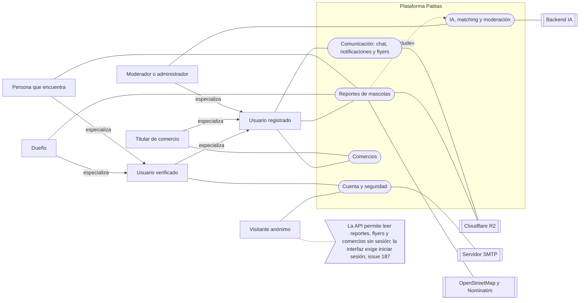
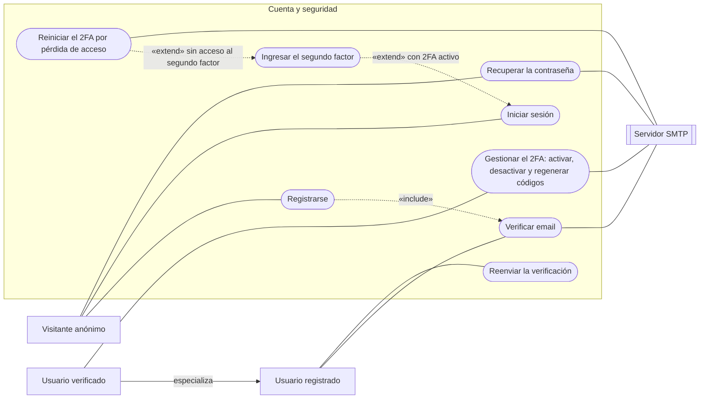
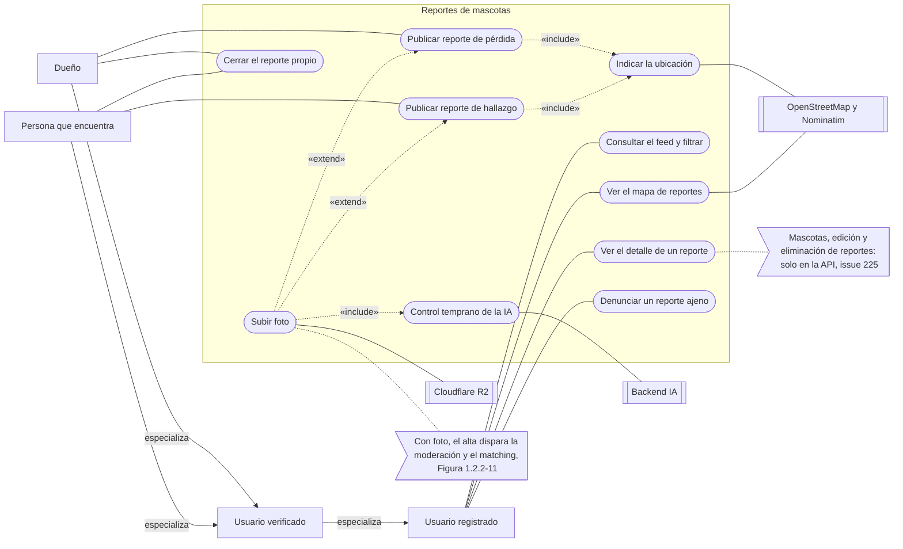
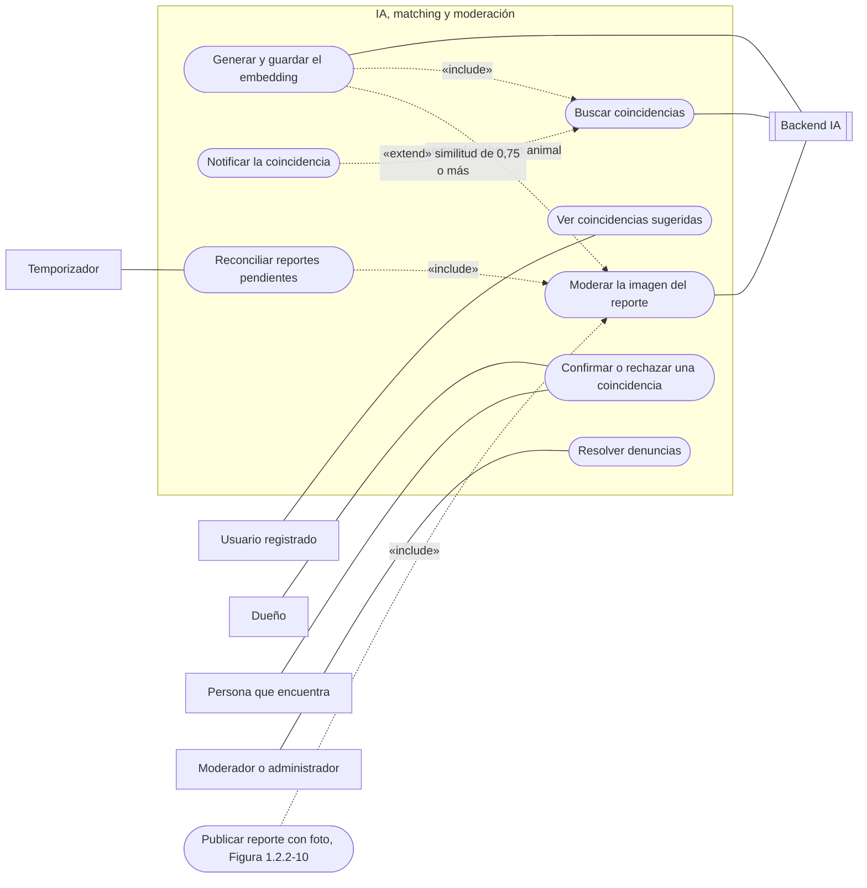
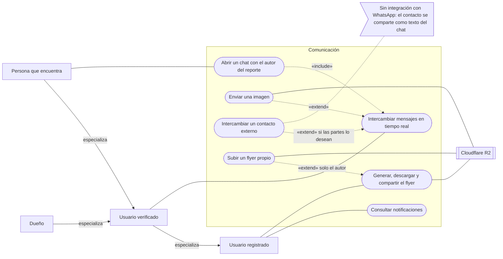
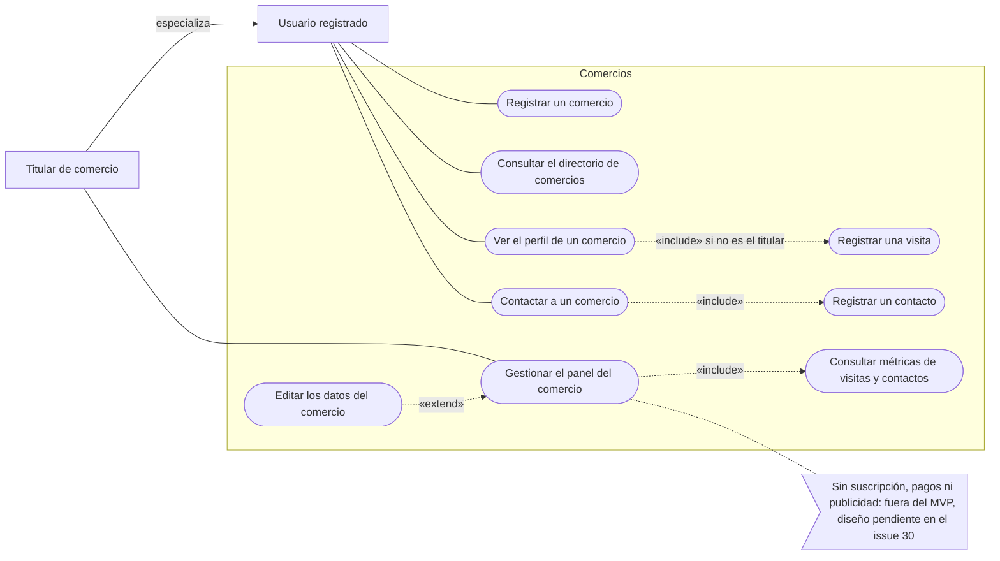

# 1.2.2 Modelo funcional

El modelo funcional describe qué hace el sistema y cómo lo hace. La sección 1.2.2.2 está en un archivo propio por su extensión.

## 1.2.2.1 Diagrama de casos de uso

Los diagramas describen el sistema tal como está implementado. Reemplazan a los seis diagramas del PDD v1.0, que preveían actores y casos que no existen (el rol `comercio`, la pasarela de pago, la gamificación y la publicidad; ver [1.2.1](1-2-1-objetivos-y-alcances.md)). Las rutas son relativas a la raíz del repositorio y `archivo:línea` remite a la línea donde empieza el elemento citado.

**Notación.** Mermaid no tiene un diagrama de casos de uso; se aproxima con `flowchart LR`:

- Actor: rectángulo. Caso de uso: rectángulo redondeado. Sistema externo: rectángulo con doble borde. Nota: bandera.
- El recuadro que agrupa los casos es el límite del subsistema.
- Línea sin flecha: el actor participa del caso. Flecha continua con la palabra "especializa": generalización entre actores. Flecha punteada: `«include»` (de la base al caso incluido) o `«extend»` (del caso que extiende a la base).

### Actores

| Actor | Quién es en el sistema | Fuente |
|---|---|---|
| Visitante anónimo | Persona sin sesión. Se registra, inicia sesión y recupera su cuenta. La API le permite leer reportes, flyers y comercios, pero la interfaz exige iniciar sesión ([#187](https://github.com/ISI-ProyectoFinal-2026/Grupo1/issues/187)) | `backend/src/routes/reports.routes.ts:19`, `:22`, `:40`; `backend/src/routes/businesses.routes.ts:15-16` |
| Usuario registrado | Cuenta con rol `usuario_regular` y el email todavía sin verificar. Consulta, denuncia, registra un comercio y recibe notificaciones | `backend/prisma/schema.prisma:18-24`, `:32` |
| Usuario verificado | Especializa al usuario registrado: además publica reportes, sube imágenes, chatea y activa el 2FA | `backend/src/middlewares/auth.middleware.ts:110`; `backend/src/routes/reports.routes.ts:21`; `backend/src/routes/chats.routes.ts:8`, `:10`; `backend/src/routes/auth.routes.ts:35-36` |
| Dueño | Actor conceptual que especializa al usuario verificado: perdió su mascota y publica un reporte de pérdida. En el sistema es la misma cuenta | `backend/src/validators/reports.validator.ts:12` |
| Persona que encuentra | Actor conceptual que especializa al usuario verificado: publica un reporte de hallazgo, que el matching vincula con el de pérdida, o ve un reporte de pérdida y abre un chat con su autor. No se puede abrir un chat con uno mismo | `backend/src/validators/reports.validator.ts:12`; `backend/src/services/chats.service.ts:39-41`, `:49-51` |
| Titular de comercio | Usuario registrado con un perfil de comercio. No es un rol ([ADR-0019](../adr/0019-comercio-perfil-no-rol.md)) | `backend/prisma/schema.prisma:312-314`; `backend/src/routes/businesses.routes.ts:10-13` |
| Moderador o administrador | Roles `moderador` y `admin`, con los mismos permisos: resolver denuncias. `admin` se crea solo con el seed y no existe forma de asignar `moderador` ([#224](https://github.com/ISI-ProyectoFinal-2026/Grupo1/issues/224)) | `backend/src/routes/report-flags.routes.ts:10-11`; `backend/prisma/seed.ts:17-21` |
| Temporizador | Proceso de la API que cada 5 min reenvía al Backend IA los reportes que siguen pendientes | `backend/src/services/matching.service.ts:198-200` |
| Sistemas externos | Backend IA (YOLOv8n y OpenCLIP), Cloudflare R2, servidor SMTP, OpenStreetMap y Nominatim | Figura 1.2.2-1 en [1.2.2.2](1-2-2-2-historias-y-flujos.md#visión-general-del-funcionamiento) |

Tabla 1.2.2-22. Actores del sistema. Fuente: archivos de la columna Fuente.

### Vista general

Figura 1.2.2-8. Actores y subsistemas. Fuente: Tabla 1.2.2-22 y las figuras 1.2.2-9 a 1.2.2-13.

### Cuenta y seguridad

Figura 1.2.2-9. Casos de uso de cuenta y seguridad. Fuente: `backend/src/routes/auth.routes.ts:31-47`, `backend/src/services/auth.service.ts:36`, `:66`, `:106`, `:153`, `backend/src/services/two-factor/service.ts:91`, `:183`, `backend/src/services/two-factor/reset.ts:42`.

### Reportes de mascotas

Figura 1.2.2-10. Casos de uso de reportes. La foto es opcional ([#219](https://github.com/ISI-ProyectoFinal-2026/Grupo1/issues/219)), por eso extiende el alta. Fuente: `backend/src/routes/reports.routes.ts:19-45`, `backend/src/validators/reports.validator.ts:10-18`, `backend/src/routes/uploads.routes.ts:17`, `:29`, `frontend/src/pages/reports/FeedPage.tsx:22-31`, `frontend/src/components/reports/MapView.tsx:40-65`.

### IA, matching y moderación

Figura 1.2.2-11. Casos de uso de IA, matching y moderación. Solo el autor de uno de los dos reportes decide la coincidencia. Fuente: `backend/src/services/matching.service.ts:93`, `:198-200`, `:274`, `:302`, `backend-ia/app/services/embedding_service.py:23`, `backend-ia/app/services/matching_service.py:25`, `:58`, `backend/src/services/report-flags.service.ts:67`.

### Comunicación

Figura 1.2.2-12. Casos de uso de comunicación. Fuente: `backend/src/services/chats.service.ts:34`, `backend/src/sockets/chat.socket.ts:83`, `backend/src/validators/chats.validator.ts:13-20`, `backend/src/services/notifications.service.ts:58`, `:151`, `:189`, `backend/src/services/flyer.service.ts:247`, `backend/src/services/reports.service.ts:281`.

### Comercios

Figura 1.2.2-13. Casos de uso de comercios. Fuente: `backend/src/routes/businesses.routes.ts:10-17`, `backend/src/services/businesses.service.ts:38`, `:91`, `:125-135`, `:141`, `:157`.

### 1.2.2.1.1 Lista de Requerimientos

Cada requerimiento funcional (RF) del PDD v1.0 se traza hasta el issue, el código y la prueba. El estado se juzga contra el código, no contra el estado del issue.

- **Estado.** *Implementado*, *Parcial* (se indica qué falta), *No implementado* o *Fuera de alcance* (excluido del MVP por el equipo).
- **Prueba.** Archivo de prueba que ejercita el requerimiento. Todas corren en CI; la última corrida exitosa sobre `main` ([corrida 40526775901](https://github.com/ISI-ProyectoFinal-2026/Grupo1/actions/runs/40526775901), commit `752d9be`) aprobó 929 pruebas de backend, 648 de frontend, 18 E2E y 55 de Backend IA (2 omitidas). *No identificada*: no se encontró una prueba específica.

| RF | Requerimiento del PDD | Issue | Código | Prueba | Estado |
|---|---|---|---|---|---|
| RF-01 | Registro con email y contraseña | [#10](https://github.com/ISI-ProyectoFinal-2026/Grupo1/issues/10), [#63](https://github.com/ISI-ProyectoFinal-2026/Grupo1/issues/63) | `backend/src/services/auth.service.ts:36` | `backend/tests/auth/auth.routes.test.ts`, `frontend/e2e/f1-register-login-create-report.spec.ts` | Implementado |
| RF-02 | Verificación de email | [#185](https://github.com/ISI-ProyectoFinal-2026/Grupo1/issues/185) | `backend/src/services/auth.service.ts:106` | `backend/tests/auth/account.routes.test.ts`, `backend/tests/auth/email-gate.routes.test.ts`, `frontend/e2e/f6-email-verification.spec.ts` | Implementado |
| RF-03 | Recuperación de contraseña | [#185](https://github.com/ISI-ProyectoFinal-2026/Grupo1/issues/185) | `backend/src/services/auth.service.ts:153`, `:163` | `backend/tests/auth/account.routes.test.ts`, `frontend/e2e/f7-password-reset.spec.ts` | Implementado |
| RF-04 | Roles `usuario_regular`, `moderador`, `admin` y `comercio` | [#31](https://github.com/ISI-ProyectoFinal-2026/Grupo1/issues/31), [#224](https://github.com/ISI-ProyectoFinal-2026/Grupo1/issues/224) | `backend/prisma/schema.prisma:18-24`; `backend/src/middlewares/auth.middleware.ts:78` | `backend/tests/middlewares/auth.middleware.test.ts` | Parcial: tres roles; el comercio es un perfil ([ADR-0019](../adr/0019-comercio-perfil-no-rol.md)); no se puede asignar `moderador` |
| RF-05 | Autenticación de dos factores | [#35](https://github.com/ISI-ProyectoFinal-2026/Grupo1/issues/35), [#203](https://github.com/ISI-ProyectoFinal-2026/Grupo1/issues/203) | `backend/src/services/two-factor/service.ts:91`, `:183` | `backend/tests/auth/two-factor.login.test.ts`, `backend/tests/auth/two-factor.routes.test.ts`, `frontend/e2e/f8-two-factor.spec.ts` | Implementado |
| RF-06 | Registro, edición y eliminación de mascotas | [#12](https://github.com/ISI-ProyectoFinal-2026/Grupo1/issues/12), [#13](https://github.com/ISI-ProyectoFinal-2026/Grupo1/issues/13), [#225](https://github.com/ISI-ProyectoFinal-2026/Grupo1/issues/225) | `backend/src/routes/pets.routes.ts:7-11` | `backend/tests/pets/pets.routes.test.ts` | Parcial: solo API |
| RF-07 | Reporte de pérdida con foto, ubicación y datos de contacto | [#14](https://github.com/ISI-ProyectoFinal-2026/Grupo1/issues/14), [#65](https://github.com/ISI-ProyectoFinal-2026/Grupo1/issues/65), [#219](https://github.com/ISI-ProyectoFinal-2026/Grupo1/issues/219) | `backend/src/services/reports.service.ts:148`; `backend/src/validators/reports.validator.ts:10-18` | `backend/tests/reports/reports.routes.test.ts`, `frontend/e2e/f1-register-login-create-report.spec.ts` | Parcial: el reporte no tiene campo de contacto; el contacto se da por el chat interno |
| RF-08 | Reporte de avistamiento o mascota encontrada | [#14](https://github.com/ISI-ProyectoFinal-2026/Grupo1/issues/14) | `backend/src/validators/reports.validator.ts:12` | `backend/tests/reports/reports.service.test.ts` | Implementado |
| RF-09 | Etiquetas PERDIDO, ENCONTRADO y RESUELTO | [#15](https://github.com/ISI-ProyectoFinal-2026/Grupo1/issues/15) | `backend/src/services/reports.service.ts:38` | `backend/tests/reports/reports.service.test.ts` | Implementado |
| RF-10 | Filtrado avanzado de reportes | [#16](https://github.com/ISI-ProyectoFinal-2026/Grupo1/issues/16) | `backend/src/services/reports.service.ts:72`, `:89-90`; `frontend/src/pages/reports/FeedPage.tsx:22-31` | `backend/tests/reports/reports.service.test.ts`, `frontend/src/pages/reports/FeedPage.test.tsx` | Parcial: la interfaz filtra por tipo, zona y fecha; el filtro por raza existe solo en la API |
| RF-11 | Cierre de reportes | [#17](https://github.com/ISI-ProyectoFinal-2026/Grupo1/issues/17) | `backend/src/services/reports.service.ts:263` | `backend/tests/e2e/report-lifecycle.e2e.test.ts`, `frontend/e2e/f4-close-report.spec.ts` | Implementado |
| RF-12 | Notificación de nuevos reportes a usuarios cercanos | [#32](https://github.com/ISI-ProyectoFinal-2026/Grupo1/issues/32) | — | — | No implementado |
| RF-13 | Configuración del tipo de notificación y del radio | [#33](https://github.com/ISI-ProyectoFinal-2026/Grupo1/issues/33), [#226](https://github.com/ISI-ProyectoFinal-2026/Grupo1/issues/226) | — | — | No implementado |
| RF-14 | Notificación de posibles coincidencias | [#176](https://github.com/ISI-ProyectoFinal-2026/Grupo1/issues/176) | `backend/src/services/notifications.service.ts:58` | `backend/tests/notifications/notifications.routes.test.ts`, `frontend/e2e/f2-match-notification.spec.ts` | Implementado |
| RF-15 | Notificación de nuevos mensajes de chat | [#32](https://github.com/ISI-ProyectoFinal-2026/Grupo1/issues/32) | `backend/src/services/notifications.service.ts:189` | `backend/tests/sockets/chat.socket.test.ts` | Implementado, dentro de la aplicación |
| RF-16 | Notificación de cambios de estado de los reportes | [#182](https://github.com/ISI-ProyectoFinal-2026/Grupo1/issues/182), [#223](https://github.com/ISI-ProyectoFinal-2026/Grupo1/issues/223) | `backend/src/services/notifications.service.ts:151` | `backend/tests/notifications/notifications.service.test.ts` | Parcial: solo el veredicto de la IA; no al cerrar ni al ocultar por una denuncia |
| RF-17 | Detección automática de coincidencias | [#18](https://github.com/ISI-ProyectoFinal-2026/Grupo1/issues/18), [#127](https://github.com/ISI-ProyectoFinal-2026/Grupo1/issues/127) | `backend-ia/app/services/matching_service.py:58` | `backend-ia/tests/test_matching_service.py` | Implementado |
| RF-18 | Listado de coincidencias con porcentaje de similitud | [#34](https://github.com/ISI-ProyectoFinal-2026/Grupo1/issues/34), [#66](https://github.com/ISI-ProyectoFinal-2026/Grupo1/issues/66) | `backend/src/services/matching.service.ts:274`; `frontend/src/components/reports/MatchCard.tsx:76` | `backend/tests/matching/matching.routes.test.ts` | Implementado |
| RF-19 | Mapa interactivo con reportes activos y etiquetas | [#21](https://github.com/ISI-ProyectoFinal-2026/Grupo1/issues/21), [#64](https://github.com/ISI-ProyectoFinal-2026/Grupo1/issues/64), [#209](https://github.com/ISI-ProyectoFinal-2026/Grupo1/issues/209) | `frontend/src/components/reports/MapView.tsx:40-65` | `frontend/src/pages/reports/FeedPage.test.tsx` | Parcial: el marcador no muestra la etiqueta |
| RF-20 | Filtro del mapa por tipo de reporte | [#22](https://github.com/ISI-ProyectoFinal-2026/Grupo1/issues/22) | `frontend/src/pages/reports/FeedPage.tsx:22-31` | `frontend/src/pages/reports/FeedPage.test.tsx` | Implementado |
| RF-21 | Al hacer clic en un marcador, abrir el detalle | [#23](https://github.com/ISI-ProyectoFinal-2026/Grupo1/issues/23) | `frontend/src/components/reports/MapView.tsx:59` | No identificada | Implementado |
| RF-22 | Búsqueda por radio de cercanía | [#24](https://github.com/ISI-ProyectoFinal-2026/Grupo1/issues/24), [#71](https://github.com/ISI-ProyectoFinal-2026/Grupo1/issues/71) | `backend/src/services/geo.service.ts:11` | `backend/tests/geo/geo.routes.test.ts` | Parcial: solo API |
| RF-23 | Generación automática del flyer | [#25](https://github.com/ISI-ProyectoFinal-2026/Grupo1/issues/25) | `backend/src/services/flyer.service.ts:247` | `backend/tests/reports/flyer.service.test.ts` | Parcial: sin dato de contacto |
| RF-24 | Descarga del flyer como imagen | [#26](https://github.com/ISI-ProyectoFinal-2026/Grupo1/issues/26) | `frontend/src/pages/reports/ReportDetailPage.tsx:243` | `backend/tests/reports/flyer.routes.test.ts` | Implementado |
| RF-25 | Compartir en WhatsApp, Instagram y Facebook | [#26](https://github.com/ISI-ProyectoFinal-2026/Grupo1/issues/26) | `frontend/src/pages/reports/ReportDetailPage.tsx:75-85` | No identificada | Parcial: menú de compartir del sistema, sin botón por red |
| RF-26 | [SHOULD] Flyer personalizado | [#36](https://github.com/ISI-ProyectoFinal-2026/Grupo1/issues/36) | `backend/src/services/reports.service.ts:281` | `backend/tests/reports/flyer.routes.test.ts` | Parcial: se sube una imagen propia |
| RF-27 | Validación y moderación automática de publicaciones | [#19](https://github.com/ISI-ProyectoFinal-2026/Grupo1/issues/19) | `backend-ia/app/ml/pipeline.py:73`; `backend/src/services/matching.service.ts:149` | `backend/tests/e2e/ai-moderation.e2e.test.ts`, `backend-ia/tests/test_image_analysis_service.py` | Implementado: detecta si hay un animal |
| RF-28 | Denuncia de publicaciones inapropiadas | [#20](https://github.com/ISI-ProyectoFinal-2026/Grupo1/issues/20), [#183](https://github.com/ISI-ProyectoFinal-2026/Grupo1/issues/183), [#186](https://github.com/ISI-ProyectoFinal-2026/Grupo1/issues/186) | `backend/src/services/report-flags.service.ts:16`, `:67` | `backend/tests/e2e/flag-moderation.e2e.test.ts`, `frontend/e2e/f3-flag-moderation.spec.ts` | Implementado |
| RF-29 | [SHOULD] Suspensión de cuentas | [#38](https://github.com/ISI-ProyectoFinal-2026/Grupo1/issues/38) | — | — | No implementado |
| RF-30 | Chat en tiempo real | [#27](https://github.com/ISI-ProyectoFinal-2026/Grupo1/issues/27), [#68](https://github.com/ISI-ProyectoFinal-2026/Grupo1/issues/68) | `backend/src/sockets/chat.socket.ts:83` | `backend/tests/chats/chat-realtime.test.ts`, `backend/tests/sockets/chat.socket.test.ts` | Implementado |
| RF-31 | Continuar por WhatsApp u otros canales externos | — | `backend/src/validators/chats.validator.ts:15`; `backend/src/validators/chat-socket.validator.ts:15` | No identificada | Implementado, vía chat interno: intercambio voluntario de contacto |
| RF-32 | [SHOULD] Envío de imágenes en el chat | [#37](https://github.com/ISI-ProyectoFinal-2026/Grupo1/issues/37) | `frontend/src/components/chat/ChatWindow.tsx:117` | `backend/tests/sockets/chat.socket.test.ts` | Implementado |
| RF-33 | Registro de comercios con perfil diferenciado | [#28](https://github.com/ISI-ProyectoFinal-2026/Grupo1/issues/28), [#69](https://github.com/ISI-ProyectoFinal-2026/Grupo1/issues/69) | `backend/src/services/businesses.service.ts:38` | `backend/tests/businesses/businesses.routes.test.ts` | Implementado, como perfil ([ADR-0019](../adr/0019-comercio-perfil-no-rol.md)) |
| RF-34 | Suscripción mensual o anual | [#29](https://github.com/ISI-ProyectoFinal-2026/Grupo1/issues/29), [#30](https://github.com/ISI-ProyectoFinal-2026/Grupo1/issues/30) | — | — | Fuera de alcance: fuera del MVP; diseño pendiente en #30 |
| RF-35 | Publicidad mediante banners segmentados por ubicación | [#30](https://github.com/ISI-ProyectoFinal-2026/Grupo1/issues/30) | — | — | Fuera de alcance: fuera del MVP; diseño pendiente en #30 |
| RF-36 | Dashboard de métricas para comercios | [#29](https://github.com/ISI-ProyectoFinal-2026/Grupo1/issues/29), [#70](https://github.com/ISI-ProyectoFinal-2026/Grupo1/issues/70), [#171](https://github.com/ISI-ProyectoFinal-2026/Grupo1/issues/171) | `backend/src/services/businesses.service.ts:157` | `backend/tests/businesses/businesses.routes.test.ts` | Parcial: visitas y contactos, sin métricas de campaña |
| RF-37 | Puntos por reportes y participación | — | — | — | Fuera de alcance: decisión del equipo, fuera del MVP |
| RF-38 | Canje de puntos en comercios adheridos | — | — | — | Fuera de alcance: decisión del equipo, fuera del MVP |
| RF-39 | Leaderboards | — | — | — | Fuera de alcance: decisión del equipo, fuera del MVP |
| RF-40 | [COULD] Badges por logros | — | — | — | Fuera de alcance: decisión del equipo, fuera del MVP |

Tabla 1.2.2-23. Requerimientos funcionales del PDD con su trazabilidad. Fuente: PDD v1.0, `gh issue list --repo ISI-ProyectoFinal-2026/Grupo1 --state all --limit 300` y archivos citados.

Los siguientes requerimientos se agregaron durante el desarrollo y no estaban previstos en el PDD:

| RF | Requerimiento | Issue o PR | Código | Prueba | Estado |
|---|---|---|---|---|---|
| RF-41 | Confirmar o rechazar una coincidencia sugerida | [#181](https://github.com/ISI-ProyectoFinal-2026/Grupo1/issues/181) | `backend/src/services/matching.service.ts:302` | `backend/tests/matching/matching.routes.test.ts`, `frontend/e2e/f2-match-notification.spec.ts` | Implementado |
| RF-42 | Directorio público de comercios | [#76](https://github.com/ISI-ProyectoFinal-2026/Grupo1/issues/76) | `backend/src/services/businesses.service.ts:91`; `backend/src/routes/businesses.routes.ts:15` | `backend/tests/businesses/businesses.routes.test.ts` | Implementado |
| RF-43 | Límites de tasa en la API | [#104](https://github.com/ISI-ProyectoFinal-2026/Grupo1/issues/104), [#184](https://github.com/ISI-ProyectoFinal-2026/Grupo1/issues/184) | `backend/src/middlewares/rate-limit.ts:8-41`; `backend/src/routes/auth.routes.ts:10-29` | `backend/tests/app/global-rate-limit.test.ts`, `backend/tests/auth/account.rate-limit.test.ts`, `backend/tests/reports/reports.create-rate-limit.test.ts` | Implementado |
| RF-44 | Reinicio del 2FA cuando se pierde el acceso al segundo factor | [#203](https://github.com/ISI-ProyectoFinal-2026/Grupo1/issues/203), PR [#205](https://github.com/ISI-ProyectoFinal-2026/Grupo1/pull/205) | `backend/src/services/two-factor/reset.ts:42`, `:86`, `:120`, `:144` | `backend/tests/auth/two-factor.reset.test.ts`, `frontend/e2e/f8-two-factor.spec.ts` | Implementado |

Tabla 1.2.2-24. Requerimientos funcionales agregados durante el desarrollo, no previstos en el PDD. Fuente: issues y archivos citados.

Los requerimientos no funcionales (RNF) se marcan *Medido* solo cuando existe una medición reproducible en el repositorio o en CI.

| RNF | Categoría | Métrica del PDD | Estado | Evidencia |
|---|---|---|---|---|
| RNF-01 | Rendimiento: tiempo de respuesta de la API | Menos de 500 ms (p95) con 200 usuarios concurrentes | No medido | Sin pruebas de carga ([#40](https://github.com/ISI-ProyectoFinal-2026/Grupo1/issues/40), abierto) |
| RNF-02 | Rendimiento: matching de imágenes | Menos de 5 s por solicitud (p95) | No medido como p95 | Objetivo del PDD, no comprometido para el MVP (decisión del equipo: el modelo de IA y los recursos todavía pueden cambiar, con impacto en el costo). Medición indicativa con la configuración actual (YOLO + OpenCLIP, CPU): ~0,68 s de inferencia y hasta 2,1 s end-to-end en caliente; 4,7 s en el primer request en frío. Son pocas muestras y no hay p95 ([`QA_IA_PIPELINE.md`](../QA_IA_PIPELINE.md) §7, `docs/QA_IA_PIPELINE.md:191-193`) |
| RNF-03 | Disponibilidad | Uptime de 99 % mensual o más | No medido | El repositorio no contiene configuración de despliegue ni de monitoreo |
| RNF-04 | Seguridad: cifrado de comunicaciones | HTTPS obligatorio | Parcial, no medido en producción | La API envía la cabecera HSTS (`backend/src/app.ts:28`) y una prueba lo verifica (`backend/tests/app/health.test.ts:45`); la terminación TLS depende del despliegue: No disponible |
| RNF-05 | Seguridad: vulnerabilidades | 0 vulnerabilidades críticas | No medido | [#41](https://github.com/ISI-ProyectoFinal-2026/Grupo1/issues/41) y PR [#207](https://github.com/ISI-ProyectoFinal-2026/Grupo1/pull/207) abiertos; el workflow de Snyk no bloquea (`.github/workflows/snyk-security.yml:44`, `:47`) |
| RNF-06 | Privacidad: protección de datos | Política de privacidad publicada | No implementado | No existe una página de política de privacidad en `frontend/src` |
| RNF-07 | Usabilidad: responsividad | Compatible con Chrome, Firefox y Safari en móvil, tablet y PC | Parcial | Las pruebas E2E corren solo en Chromium de escritorio (`frontend/playwright.config.ts:36`); Firefox, Safari y los tamaños móviles no se miden |
| RNF-08 | Usabilidad: interfaz intuitiva | Opinión positiva sin capacitación previa | No medido | Sin pruebas de usabilidad registradas |
| RNF-09 | Mantenibilidad: cobertura de pruebas | Más de 70 % | Medido | Umbral de 70 % que hace fallar el CI (`backend/jest.config.js:31`, `frontend/vitest.config.ts:17`). [Corrida 40526775901](https://github.com/ISI-ProyectoFinal-2026/Grupo1/actions/runs/40526775901): backend 97,15 % de sentencias y 92,22 % de ramas; frontend 93,19 % y 88,09 %; Backend IA 92 % de sentencias, sin umbral configurado. Detalle en [1.3.3](1-3-3-pruebas.md) |
| RNF-10 | Mantenibilidad: calidad de código | Adherencia a SOLID, DRY y similares | No medido | Solo hay lint en el frontend (`frontend/package.json:12`); no hay un análisis estático de calidad configurado |

Tabla 1.2.2-25. Requerimientos no funcionales del PDD. Fuente: PDD v1.0, `gh run view 40526775901 --log` y archivos de la columna Evidencia.

## 1.2.2.2 Historias de Usuario

Ver [1.2.2.2 Historias de Usuario](1-2-2-2-historias-y-flujos.md): visión general del funcionamiento, perfiles de usuario y, para cada módulo, historias, flujo punta a punta, reglas de negocio, comportamiento ante fallas y limitaciones. Módulos:

1. [Autenticación y seguridad de la cuenta](1-2-2-2-historias-y-flujos.md#12221-módulo-de-autenticación-y-seguridad-de-la-cuenta)
2. [Reportes de mascotas](1-2-2-2-historias-y-flujos.md#12222-módulo-de-reportes-de-mascotas-alta-detalle-feed-y-cierre)
3. [Moderación automática por IA y matching](1-2-2-2-historias-y-flujos.md#12223-módulo-de-moderación-automática-por-ia-y-matching)
4. [Notificaciones](1-2-2-2-historias-y-flujos.md#12224-módulo-de-notificaciones)
5. [Chat](1-2-2-2-historias-y-flujos.md#12225-módulo-de-chat)
6. [Flyers](1-2-2-2-historias-y-flujos.md#12226-módulo-de-flyers)
7. [Moderación comunitaria](1-2-2-2-historias-y-flujos.md#12227-módulo-de-moderación-comunitaria-denuncias)
8. [Mapa y geolocalización](1-2-2-2-historias-y-flujos.md#12228-módulo-de-mapa-y-geolocalización)
9. [Comercios](1-2-2-2-historias-y-flujos.md#12229-módulo-de-comercios)

## 1.2.2.3 Tareas

Las tareas son los issues con la etiqueta `type: task`: `gh issue list --repo ISI-ProyectoFinal-2026/Grupo1 --state all --label "type: task" --limit 200 --json number,title,state,milestone` (23 issues al 2026-10-24). Las fechas de cierre de cada milestone provienen de `gh api repos/ISI-ProyectoFinal-2026/Grupo1/milestones?state=all`.

| Milestone | Fecha límite | Tareas | Cerradas | Abiertas |
|---|---|---|---|---|
| Sprint 0 - POCs | 2026-06-29 | 2 | 2 | 0 |
| Sprint 1 - Documentación | 2026-07-03 | 0 | 0 | 0 |
| Sprint 2 – Desarrollo Core | 2026-08-14 | 2 | 2 | 0 |
| Sprint 3 - Features | 2026-08-26 | 12 | 12 | 0 |
| Sprint 4 – Desarrollo + Notificaciones | 2026-09-09 | 2 | 2 | 0 |
| Sprint 5 – QA | 2026-11-02 | 5 | 2 | 3 |
| Sprint 6 – Cierre de features | 2026-10-30 | 0 | 0 | 0 |
| **Total** | | **23** | **20** | **3** |

Tabla 1.2.2-20. Tareas por milestone. Fuente: los dos comandos `gh` de esta sección.

| Milestone | Issue | Tarea | Estado |
|---|---|---|---|
| Sprint 0 | [#5](https://github.com/ISI-ProyectoFinal-2026/Grupo1/issues/5) | Consolidar decisiones técnicas, arquitectura preliminar y estimación de costos (título del issue: "[TASK]") | Cerrado |
| Sprint 0 | [#43](https://github.com/ISI-ProyectoFinal-2026/Grupo1/issues/43) | Sin título ni contenido (plantilla vacía) | Cerrado |
| Sprint 2 | [#11](https://github.com/ISI-ProyectoFinal-2026/Grupo1/issues/11) | Configuración de DB | Cerrado |
| Sprint 2 | [#51](https://github.com/ISI-ProyectoFinal-2026/Grupo1/issues/51) | Configuración Cloudflare R2 | Cerrado |
| Sprint 3 | [#61](https://github.com/ISI-ProyectoFinal-2026/Grupo1/issues/61) | Frontend: setup inicial (React + Vite + TS + Tailwind + Router) | Cerrado |
| Sprint 3 | [#62](https://github.com/ISI-ProyectoFinal-2026/Grupo1/issues/62) | Frontend: cliente HTTP y tipos de la API (Axios + interceptor JWT) | Cerrado |
| Sprint 3 | [#71](https://github.com/ISI-ProyectoFinal-2026/Grupo1/issues/71) | Backend: endpoints geo (`/api/geo/nearby`, `/api/geo/map`) | Cerrado |
| Sprint 3 | [#72](https://github.com/ISI-ProyectoFinal-2026/Grupo1/issues/72) | Backend: endpoints de chat (`/api/chats` y mensajes) | Cerrado |
| Sprint 3 | [#73](https://github.com/ISI-ProyectoFinal-2026/Grupo1/issues/73) | Backend: Socket.io en Express | Cerrado |
| Sprint 3 | [#74](https://github.com/ISI-ProyectoFinal-2026/Grupo1/issues/74) | Backend: middleware JWT en rutas protegidas | Cerrado |
| Sprint 3 | [#75](https://github.com/ISI-ProyectoFinal-2026/Grupo1/issues/75) | Backend: endpoints de notificaciones (`/api/notifications`) | Cerrado |
| Sprint 3 | [#76](https://github.com/ISI-ProyectoFinal-2026/Grupo1/issues/76) | Backend: esquema y endpoints de comercios (`/api/businesses`) | Cerrado |
| Sprint 3 | [#111](https://github.com/ISI-ProyectoFinal-2026/Grupo1/issues/111) | Frontend: tipos TypeScript base | Cerrado |
| Sprint 3 | [#112](https://github.com/ISI-ProyectoFinal-2026/Grupo1/issues/112) | Frontend: componentes UI compartidos | Cerrado |
| Sprint 3 | [#113](https://github.com/ISI-ProyectoFinal-2026/Grupo1/issues/113) | Frontend: ErrorBoundary, NotFound y estructura del router | Cerrado |
| Sprint 3 | [#125](https://github.com/ISI-ProyectoFinal-2026/Grupo1/issues/125) | Integración: autenticación y reportes (frontend y backend) | Cerrado |
| Sprint 4 | [#126](https://github.com/ISI-ProyectoFinal-2026/Grupo1/issues/126) | Integración: chat en tiempo real (Socket.io y frontend) | Cerrado |
| Sprint 4 | [#127](https://github.com/ISI-ProyectoFinal-2026/Grupo1/issues/127) | Integración: procesamiento de IA (reportes, Backend IA y pgvector) | Cerrado |
| Sprint 5 | [#39](https://github.com/ISI-ProyectoFinal-2026/Grupo1/issues/39) | Test end-to-end | Cerrado |
| Sprint 5 | [#40](https://github.com/ISI-ProyectoFinal-2026/Grupo1/issues/40) | Tests de carga y performance | Abierto |
| Sprint 5 | [#41](https://github.com/ISI-ProyectoFinal-2026/Grupo1/issues/41) | Análisis de vulnerabilidades | Abierto |
| Sprint 5 | [#42](https://github.com/ISI-ProyectoFinal-2026/Grupo1/issues/42) | Tests unitarios | Cerrado |
| Sprint 5 | [#215](https://github.com/ISI-ProyectoFinal-2026/Grupo1/issues/215) | Mover el JWT de `localStorage` a una cookie httpOnly | Abierto |

Tabla 1.2.2-21. Tareas por milestone. Fuente: `gh issue list --repo ISI-ProyectoFinal-2026/Grupo1 --state all --label "type: task" --limit 200 --json number,title,state,milestone`.

Sprint 1 y Sprint 6 no tienen issues con la etiqueta `type: task`.
