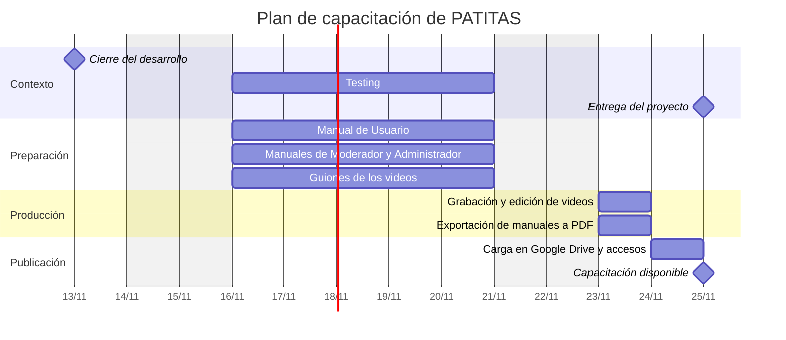

# 1.3.2 Planificación de capacitación

## 1.3.2.1 Introducción

PATITAS es una plataforma web para publicar y encontrar mascotas perdidas o encontradas. Al publicar un reporte con foto, el sistema la compara automáticamente con las demás publicaciones mediante inteligencia artificial y sugiere posibles coincidencias. La plataforma incluye además el registro de mascotas propias, un mapa con la ubicación de los reportes, chat entre usuarios, notificaciones configurables, un módulo de comercios (veterinarias, refugios y pet shops) y la seguridad de la cuenta con verificación de email y doble factor de autenticación. Para mantener la calidad del contenido, la moderación combina un filtro automático por IA al publicar con denuncias de los usuarios que resuelven los moderadores ([ADR-0016](../adr/0016-moderacion-hibrida.md)).

El aprovechamiento de estas funcionalidades depende de que cada persona sepa utilizarlas. Por eso se diseñó un plan de capacitación para los tres roles del sistema: Usuario, Moderador y Administrador (`backend/prisma/schema.prisma:18-24`). Los roles son acumulativos: el Moderador tiene además las funciones del Usuario, y el Administrador las de ambos. El comercio no es un rol, sino un perfil que cualquier usuario puede registrar ([ADR-0019](../adr/0019-comercio-perfil-no-rol.md)); su uso forma parte de la capacitación del Usuario.

## 1.3.2.2 Objetivos de capacitación

Cada rol tiene responsabilidades específicas, por lo que la capacitación se organiza por rol:

**Usuario.** Utilizar de forma autónoma todas las funcionalidades disponibles para cualquier cuenta: registro, verificación de email, inicio de sesión y recuperación de la contraseña; activación del doble factor de autenticación; registro de mascotas propias; publicación, consulta, edición y cierre de reportes de mascotas perdidas o encontradas, incluida la generación del flyer; revisión y confirmación de las coincidencias sugeridas por la IA; uso del mapa, del chat y de las notificaciones; denuncia de publicaciones y anuncios inapropiados; y, si corresponde, registro y gestión de un comercio con sus anuncios, estadísticas y plan Premium.

**Moderador.** Resolver las denuncias de la comunidad desde el panel de moderación. Aprenderá a revisar las publicaciones denunciadas y a decidir entre ocultar el reporte o descartar la denuncia, y a revisar los anuncios denunciados y decidir entre darlos de baja o desestimar la denuncia, conociendo el efecto de cada acción sobre el contenido y sobre su autor.

**Administrador.** Gestionar los roles de los usuarios de la plataforma. Aprenderá a buscar usuarios, asignar o quitar los roles de Moderador y Administrador, y consultar el registro de cambios de rol, conociendo las restricciones que aplica el sistema.

## 1.3.2.3 Estrategia de capacitación

La capacitación es virtual y asincrónica para los tres roles: no hay sesiones en vivo ni evaluación final. Cada persona aprende a su propio ritmo con dos materiales complementarios:

- **Videos tutoriales** breves, uno por grupo de funcionalidades, grabados sobre el sistema y alojados en Google Drive. Pueden verse tantas veces como haga falta.
- **Manual en PDF** por rol, con instrucciones paso a paso de cada pantalla, para consultar en cualquier momento.

| Rol | Modalidad | Material | Acceso |
|---|---|---|---|
| Usuario | Virtual asincrónica | Videos de Usuario y Manual de Usuario (PDF) | Carpeta de Google Drive compartida por enlace, de solo lectura |
| Moderador | Virtual asincrónica | Videos de Usuario y de Moderador; manuales de Usuario y de Moderador (PDF) | Además, carpeta de Google Drive compartida solo con las cuentas de los moderadores y administradores |
| Administrador | Virtual asincrónica | Videos y manuales de los tres roles | Además, carpeta de Google Drive compartida solo con las cuentas de los administradores |

Tabla 1.3.2-1. Modalidad y material por rol. Fuente: definición del equipo (2026-11-03).

**Usuario.** Los videos se organizan en tutoriales cortos por módulo, en el orden en que un usuario nuevo usa la plataforma: primero la cuenta, después los reportes y las coincidencias, y por último la comunicación y los comercios. El Manual de Usuario sigue el mismo orden.

**Moderador.** Como el Moderador también es Usuario, se capacita primero con el material de Usuario. Su material propio cubre el panel de moderación: la cola de publicaciones denunciadas y la de anuncios denunciados, las acciones disponibles en cada una y su efecto. El Manual de Moderador detalla cada acción y sus consecuencias.

**Administrador.** El Administrador se capacita con el material de Usuario y de Moderador, y además con el de administración: la pantalla de usuarios, el cambio de rol con su confirmación y el registro de cambios de rol. El Manual de Administrador detalla las restricciones del sistema sobre los cambios de rol.

## 1.3.2.4 Recursos de la capacitación

Los recursos incluyen materiales y humanos, adaptados a cada rol.

### 1.3.2.4.1 Recursos Materiales

**Usuario**

- **Videos de capacitación:** tutoriales alojados en una carpeta de Google Drive compartida por enlace.
- **Manual de Usuario:** documento PDF con las funcionalidades del rol de Usuario.

**Moderador**

- **Videos de capacitación:** los de Usuario más los de Moderador, en una carpeta de Google Drive de acceso restringido.
- **Manual de Moderador:** documento PDF con el uso del panel de moderación y el efecto de cada acción.

**Administrador**

- **Videos de capacitación:** los de Usuario y de Moderador más los de Administrador, en una carpeta de Google Drive de acceso restringido.
- **Manual de Administrador:** documento PDF con la gestión de usuarios y roles.

### 1.3.2.4.2 Recursos Humanos

**Usuario**

- **Creación de videos tutoriales:** el equipo de desarrollo (Grupo 1) escribe los guiones, graba y publica los tutoriales en Google Drive.
- **Creación del Manual de Usuario:** el equipo de desarrollo redacta y actualiza el manual.

**Moderador**

- **Creación de videos tutoriales:** el equipo de desarrollo graba y publica los tutoriales del panel de moderación.
- **Creación del Manual de Moderador:** el equipo de desarrollo redacta y actualiza el manual.

**Administrador**

- **Creación de videos tutoriales:** el equipo de desarrollo graba y publica los tutoriales de administración.
- **Creación del Manual de Administrador:** el equipo de desarrollo redacta y actualiza el manual.

**Todos los roles**

- **Gestión de accesos:** el equipo de desarrollo comparte la carpeta de Usuario por enlace y las carpetas restringidas de Google Drive con las cuentas de los moderadores y administradores.

## 1.3.2.5 Contenido de la capacitación

El contenido se arma a partir de las pantallas existentes (`frontend/src/router.tsx`). No se incluye la consulta de publicaciones sin iniciar sesión, porque todavía no está implementada ([#187](https://github.com/ISI-ProyectoFinal-2026/Grupo1/issues/187)).

### Usuario

Video "Capacitación de Usuario PATITAS 1" (actividad asincrónica)

- Registrarse
- Verificar el email y reenviar el email de verificación
- Iniciar sesión
- Recuperar la contraseña
- Navegación principal: Inicio, Reportes, Chats, Comercios y menú Más
- Cerrar sesión

Video "Capacitación de Usuario PATITAS 2" (actividad asincrónica)

- Activar la verificación en dos pasos
- Guardar los códigos de recuperación
- Generar códigos de recuperación nuevos
- Desactivar la verificación en dos pasos
- Recuperar el acceso sin el segundo factor

Video "Capacitación de Usuario PATITAS 3" (actividad asincrónica)

- Consultar mis mascotas
- Registrar una mascota
- Editar una mascota
- Eliminar una mascota

Video "Capacitación de Usuario PATITAS 4" (actividad asincrónica)

- Crear un reporte de mascota perdida o encontrada
- Completar el reporte con los datos de una mascota registrada
- Subir la foto y atender el aviso de foto poco nítida
- Marcar la ubicación en el mapa
- Revisar los reportes similares sugeridos antes de publicar
- Reporte en procesamiento

Video "Capacitación de Usuario PATITAS 5" (actividad asincrónica)

- Consultar el feed de reportes
- Filtrar por tipo, zona y fechas
- Alternar entre la vista de lista y la vista de mapa
- Consultar el detalle de un reporte
- Consultar comercios cercanos a un reporte

Video "Capacitación de Usuario PATITAS 6" (actividad asincrónica)

- Consultar las coincidencias sugeridas por la IA
- Confirmar una coincidencia
- Descartar una coincidencia

Video "Capacitación de Usuario PATITAS 7" (actividad asincrónica)

- Editar un reporte propio
- Cerrar un reporte
- Eliminar un reporte
- Generar el flyer para compartir
- Subir un flyer propio

Video "Capacitación de Usuario PATITAS 8" (actividad asincrónica)

- Contactar al autor de un reporte
- Consultar la lista de chats
- Enviar mensajes

Video "Capacitación de Usuario PATITAS 9" (actividad asincrónica)

- Consultar las notificaciones
- Configurar las preferencias de notificación: posible coincidencia, mensaje nuevo, cambio de estado de mi reporte y nuevo reporte en mi zona
- Compartir y dejar de compartir la ubicación

Video "Capacitación de Usuario PATITAS 10" (actividad asincrónica)

- Denunciar un reporte
- Denunciar un anuncio

Video "Capacitación de Usuario PATITAS 11" (actividad asincrónica)

- Consultar el directorio de comercios
- Consultar el perfil de un comercio
- Registrar un comercio

Video "Capacitación de Usuario PATITAS 12" (actividad asincrónica)

- Consultar el panel del comercio
- Editar los datos y la ubicación del comercio
- Consultar las estadísticas del comercio
- Crear, pausar y editar anuncios
- Consultar las métricas de un anuncio
- Contratar o renovar el plan Premium

Fuente: `frontend/src/router.tsx`, `frontend/src/layouts/MainLayout.tsx`, `frontend/src/pages/auth/`, `frontend/src/pages/account/`, `frontend/src/pages/pets/`, `frontend/src/pages/reports/`, `frontend/src/pages/chat/ChatPage.tsx`, `frontend/src/pages/business/`, `frontend/src/components/reports/`, `frontend/src/components/account/`, `frontend/src/components/ads/AdBanner.tsx`, `frontend/src/components/business/`.

### Moderador

Video "Capacitación de Moderador PATITAS 1" (actividad asincrónica)

- Acceso al panel de moderación desde el menú Más
- Consultar las publicaciones denunciadas pendientes de revisión
- Ocultar un reporte: el reporte deja de estar publicado, se cierran sus demás denuncias pendientes y se notifica al autor
- Descartar una denuncia: el reporte sigue publicado

Video "Capacitación de Moderador PATITAS 2" (actividad asincrónica)

- Consultar los anuncios denunciados
- Dar de baja un anuncio
- Desestimar una denuncia

Fuente: `frontend/src/pages/moderation/ModerationPage.tsx`, `frontend/src/components/moderation/ReportFlagList.tsx`, `frontend/src/components/moderation/AdFlagList.tsx`, `backend/src/services/report-flags.service.ts:67-105`.

### Administrador

Requiere los PR [#269](https://github.com/ISI-ProyectoFinal-2026/Grupo1/pull/269) a [#272](https://github.com/ISI-ProyectoFinal-2026/Grupo1/pull/272) ([#224](https://github.com/ISI-ProyectoFinal-2026/Grupo1/issues/224)), en revisión al 2026-11-03.

Video "Capacitación de Administrador PATITAS 1" (actividad asincrónica)

- Acceso a la administración desde el menú Más
- Buscar usuarios por nombre o email y filtrar por rol
- Cambiar el rol de un usuario y confirmar el cambio
- Restricciones: no se puede cambiar el rol propio ni quitar el último administrador
- Notificación al usuario cuyo rol cambió

Video "Capacitación de Administrador PATITAS 2" (actividad asincrónica)

- Consultar el registro de cambios de rol

Fuente: PR #272: `frontend/src/pages/admin/AdminUsersPage.tsx`, `frontend/src/components/admin/ConfirmRoleChangeDialog.tsx`, `frontend/src/components/admin/RoleAuditLog.tsx`, `backend/src/services/admin-users.service.ts`.

## 1.3.2.6 Diagrama de tiempos

La capacitación se prepara después del cierre del desarrollo (13/11/2026): los manuales y los guiones se escriben en paralelo con el testing (16 al 20/11), y los videos se graban una vez corregidos los hallazgos del testing, para que muestren la versión final. El material se publica antes de la entrega del 25/11. Desde su publicación, cada rol realiza la capacitación a su ritmo.

Figura 1.3.2-1. Diagrama de Gantt del plan de capacitación. Fuente: fechas de cierre del desarrollo, testing y entrega definidas por el equipo (2026-11-03); tareas de capacitación propuestas en esta sección.
