# 1.3.3 Planificación, ejecución y documentación de pruebas

Los resultados de esta sección provienen de la última ejecución exitosa del workflow CI sobre `main`: [corrida 38512798771](https://github.com/ISI-ProyectoFinal-2026/Grupo1/actions/runs/38512798771), commit `8ff5c26`. Para obtenerla: `gh run list --workflow ci.yml --branch main --status success -L 1` y `gh run view 38512798771 --log`.

## 1.3.3.1 Objetivos y alcances

El objetivo es verificar de forma automática, en cada push y pull request a `main`, que los tres paquetes de código y el flujo completo de la interfaz funcionan ([`ci.yml`](../../.github/workflows/ci.yml)).

| Job de CI | Herramienta | Qué verifica | Tests | Cobertura |
|---|---|---|---|---|
| Backend (Node.js) | Jest + supertest | Servicios, rutas, middlewares, sockets y flujos contra PostgreSQL con las migraciones aplicadas | 929 en 63 suites | Sentencias 97,15 % (1809/1862); ramas 92,06 % (580/630); funciones 98,98 % (294/297); líneas 97,1 % (1778/1831) |
| Frontend (React) | Vitest + Testing Library | Componentes, hooks, servicios y rutas | 648 en 72 archivos | Sentencias 93,19 % (1302/1397); ramas 88,09 % (799/907); funciones 93,56 % (451/482); líneas 94 % (1223/1301) |
| Backend IA (Python) | pytest + pytest-cov | Servicios de embeddings, análisis de imagen y matching, y el endpoint de la API | 55 aprobados, 2 omitidos | Sentencias 92 % (229/249) |
| E2E UI (Playwright) | Playwright (Chromium) | Flujos de usuario completos en el navegador | 18 aprobados | No aplica |

Fuente: log de la [corrida 38512798771](https://github.com/ISI-ProyectoFinal-2026/Grupo1/actions/runs/38512798771) (commit `8ff5c26`, 2026-10-14). Los comandos de cada job están en `ci.yml`: `npm run test:coverage` (backend y frontend), `npm run test:e2e` (frontend) y `python -m pytest tests/ -v --cov=app` (backend-ia).

Backend y frontend fallan si la cobertura baja del 70 % en sentencias, ramas, funciones o líneas ([`jest.config.js`](../../backend/jest.config.js), [`vitest.config.ts`](../../frontend/vitest.config.ts)). Backend IA: umbral mínimo de cobertura No disponible (no figura en la configuración de pytest ni en el job).

## 1.3.3.2 Pruebas de validación de ingreso de datos

El backend valida las entradas con Zod en 12 archivos de [`backend/src/validators/`](../../backend/src/validators). Las pruebas de rutas verifican las respuestas de rechazo con estado 400: 21 archivos de `backend/tests/` lo aseguran, entre ellos [`auth.routes.test.ts`](../../backend/tests/auth/auth.routes.test.ts), [`reports.routes.test.ts`](../../backend/tests/reports/reports.routes.test.ts), [`pets.routes.test.ts`](../../backend/tests/pets/pets.routes.test.ts) y [`uploads.routes.test.ts`](../../backend/tests/uploads/uploads.routes.test.ts). La ejecución se incluye en los 929 tests del job de backend.

## 1.3.3.3 Prueba de lógica de los módulos principales

La lógica se prueba a nivel de servicio en `backend/tests/` (por ejemplo [`matching.service.test.ts`](../../backend/tests/matching/matching.service.test.ts), [`chats.service.test.ts`](../../backend/tests/chats/chats.service.test.ts), [`reports.service.test.ts`](../../backend/tests/reports/reports.service.test.ts), [`flyer.service.test.ts`](../../backend/tests/reports/flyer.service.test.ts) y las pruebas de TOTP en [`two-factor/`](../../backend/tests/two-factor)), en `frontend/` con Vitest y en [`backend-ia/tests/`](../../backend-ia/tests) para el pipeline y los servicios de IA. Las cifras están en 1.3.3.1.

## 1.3.3.4 Pruebas de integración entre módulos del sistema

- **Backend contra base real.** El job construye la imagen de PostgreSQL del proyecto, aplica las migraciones y ejecuta Jest. Las pruebas de extremo a extremo del backend están en [`backend/tests/e2e/`](../../backend/tests/e2e): ciclo de vida del reporte, moderación por IA, moderación de denuncias y errores del ciclo de vida.
- **Interfaz.** [`frontend/e2e/`](../../frontend/e2e) contiene 8 especificaciones (F1 a F8): registro, login y creación de reporte; coincidencia y notificación; denuncia y moderación; cierre de reporte; errores; verificación de email; recuperación de contraseña; segundo factor. La corrida registra 18 pruebas aprobadas en 33,9 s. Esta suite usa un stub del servicio de IA, por lo que el Backend IA real no participa ([`ci.yml`](../../.github/workflows/ci.yml)).
- **Backend IA contra base real.** El job levanta PostgreSQL y aplica las migraciones de Prisma antes de ejecutar pytest.

## 1.3.3.5 Pruebas de carga

Las pruebas se ejecutaron el 2026-11-24 con k6, scripts versionados en [`perf/`](../../perf) y el commit `2eb4a9c` ([issue #40](https://github.com/ISI-ProyectoFinal-2026/Grupo1/issues/40); herramientas en [ADR-0029](../adr/0029-herramientas-pruebas-de-performance.md), estado Pendiente). Las duraciones se redujeron respecto de las propuestas del issue (ver Tabla 1.3-2), el entorno fue una única máquina de desarrollo compartida con otras aplicaciones y varios resultados no se repitieron entre corridas. Por eso los valores son indicativos: no son la capacidad de un entorno de producción. Los resultados crudos están en `perf/results/` (ignorado por git); este apartado transcribe lo necesario.

### 1. Objetivos

| ID | Indicador | Objetivo | Origen |
|---|---|---|---|
| SLO-1 | p95 de `http_req_duration` por endpoint (salvo login) | < 500 ms con 200 usuarios concurrentes | Criterio original del issue #40 y RNF-01 |
| SLO-2 | p95 de `matching_duration` | < 5 s | Criterio original del issue #40 y RNF-02 |
| SLO-3 | % de error (`http_req_failed` más checks fallidos) | < 1 % | Propuesta |
| SLO-4 | p99 de la API | < 1000 ms | Propuesta |
| SLO-5 | Apdex con T = 500 ms | ≥ 0,90 | Propuesta |
| SLO-6 | Throughput sostenido con SLO-1 cumplido | ≥ línea base, fijada tras la primera corrida | Propuesta: línea base medida de 4,5 it/s (14,4 req/s) con mezcla 80/20 visitante/creación en el punto de quiebre |

Tabla 1.3-1. Objetivos de performance (SLO-1 a SLO-6). Fuente: issue #40, sección 1 (Objetivos); `perf/results/breakpoint.slo.md` para la línea base de SLO-6.

### 2. Escenarios y entorno

**Modelo de carga.** Mezcla de flujos del issue sin flyer (8 %, requiere R2) ni chat (7 %, el script de k6 no implementa el handshake de Socket.IO); los pesos se re-normalizaron sobre el 85 % restante: visitante (feed y 2-3 detalles) 64,7 %, login con "mis reportes" y coincidencias 17,6 %, login con creación de reporte y 3 consultas de estado 11,8 %, login con `/auth/me` 5,9 %. Think time de 3 a 8 s en el modelo cerrado. Un usuario distinto por VU.

| Escenario | Modelo y etapas ejecutadas | Propuesta del issue |
|---|---|---|
| Smoke | 2 VUs, 1 min (66,6 s medidos) | Igual |
| Carga (L) | Cerrado: 0→100 VUs en 30 s, meseta de 75 s; →200 en 30 s, meseta de 150 s; →500 en 45 s, meseta de 75 s; →0 en 30 s (435 s, `PERF_SCALE` 0,25) | 29 min en total (mesetas de 5, 10 y 5 min) |
| Punto de quiebre (B) | Abierto: 8 escalones de 45 s desde 2 it/s con +0,5 it/s; mezcla 80 % visitante y 20 % creación | Desde 10 it/s con +10 it/s cada 2 min |
| Estrés (S) | Abierto: base de 4,5 it/s (capacidad de B), x1,5, x2 y x3 (60 s cada nivel más 5 s de rampa) y recuperación a la base (25 s de vaciado y 70 s estables) | Niveles de 3 min y recuperación de 5 min |
| Picos (P) | Abierto, solo visitante: base 20 s, x10 en 10 s, pico de 40 s, base en 10 s, recuperación de 60 s. Dos bases: 10 it/s (la del issue) y 2 it/s | Base de 10 it/s 1 min, pico de 2 min, recuperación de 3 min; incluye flyer |
| Volumen (V) | Abierto, 3 it/s constantes, mezcla 70 % visitante y 30 % usuario (login, "mis reportes", notificaciones); 30 s de calentamiento y 150 s de medición con la base en 1x y 10x | Escalón de 200 VUs de L con la base en 1x y 10x |
| Resistencia (E) | Abierto: 3,15 it/s (70 % de 4,5 it/s), rampas de 2 min y 31 min estables (35 min en total) | 4 h al 70 % del throughput de L, con sockets abiertos |
| Escalabilidad (C) | 1, 2 y 4 instancias del backend, cada una fija a un hilo lógico, detrás de un balanceador propio en Node; solo visitante; escalones de 45 s; `connection_limit` de Prisma fijo en 10 por instancia | 1, 2 y 4 CPU en el contenedor, variando el pool de Prisma |
| Lighthouse | `/login`, `/reports` y `/reports/:id`, móvil y escritorio, 3 corridas por ruta (mediana) | Igual |

Tabla 1.3-2. Escenarios ejecutados frente a lo propuesto en el issue. Fuente: `perf/README.md` (secciones 4 a 12) y los encabezados de `perf/results/*.slo.md`, commit `2eb4a9c`.

**Entorno.** Una sola máquina de desarrollo (Windows, 4 núcleos físicos y 8 hilos lógicos) con k6, el backend compilado (`node dist/index.js`), el stub del servicio de IA y PostgreSQL en Docker compartiendo los mismos núcleos, más aplicaciones ajenas: la CPU del sistema en reposo, sin ninguna corrida, midió entre 20 % y 46 %. Memoria RAM y versión de k6: No disponible (no se registraron). El backend corre con `NODE_ENV=test` para saltear los limitadores de tasa (si no, se mediría 429). El servicio de IA es un stub: no calcula embeddings, por lo que ningún reporte salió de `pending`.

**Datos.** Base `patitas_perf` sembrada con un script determinístico: 1x = 1000 reportes publicados y 2000 usuarios; 10x = 10 000 reportes. El volumen es un supuesto del equipo, pendiente de confirmación (el issue lo deja como decisión requerida). No se generan embeddings.

### 3. Resultados frente a los objetivos

En el escalón de 200 VUs de la carga (L), el objetivo de referencia, ningún SLO medido se cumple. Los mismos SLO sí se cumplen con carga baja (smoke y primeros escalones del punto de quiebre). Hay capturas de Grafana de L, B y E (Figuras 1.3-9, 1.3-10 y 1.3-11).

| SLO | Objetivo | Medido en L, 200 VUs | Resultado | Con carga baja |
|---|---|---|---|---|
| SLO-1 | p95 < 500 ms | 14 728 ms (peor endpoint: `create`); `feed` 3375 ms, `detail` 5366 ms | No cumple | Smoke: 258 ms (cumple) |
| SLO-2 | p95 < 5 s | No medido: ningún reporte salió de `pending` (stub de IA) | No medido | No medido en ningún escenario |
| SLO-3 | error < 1 % | 1,07 % | No cumple | Smoke: 0,00 % (cumple) |
| SLO-4 | p99 < 1000 ms | 17 565 ms (peor endpoint) | No cumple | Smoke: 413 ms (cumple) |
| SLO-5 | Apdex ≥ 0,90 | 0,094 | No cumple | Smoke: 1,000 (cumple) |
| SLO-6 | ≥ línea base | Línea base fijada en 4,5 it/s (14,4 req/s) | Medido | Escenario L: 28,0 req/s a 200 VUs sin cumplir SLO-1 |

Tabla 1.3-3. SLO frente a lo medido en el escalón de 200 VUs. Fuente: `perf/results/load.slo.md`, `perf/results/smoke.slo.md` y `perf/results/breakpoint.slo.md` (commit `2eb4a9c`).

#### Carga (L)

| Paso | Requests (req/s) | Error | Apdex | p95 feed (ms) | p95 detail (ms) | p95 create (ms) | p95 login (ms, informativo) |
|---|---|---|---|---|---|---|---|
| 100 VUs | 1911 (25,5) | 0,21 % | 0,836 | 900,4 | 1155,1 | 2390,8 | 1919,2 |
| 200 VUs | 4197 (28,0) | 1,07 % | 0,094 | 3374,7 | 5366,1 | 14 728,4 | 8354,1 |
| 500 VUs | 2570 (34,3) | 24,79 % | 0,000 | 13 940,4 | 24 041,2 | 32 577,8 | 17 254,4 |

Tabla 1.3-4. Carga: resultados por paso de VUs (escala 0,25). Fuente: `perf/results/load.slo.md` y `load.summary.json`, commit `2eb4a9c`.

SLO-1 no se cumple ni a 100 VUs: el p95 de `feed` es 900,4 ms. Una repetición con observabilidad activa tampoco cumplió ningún SLO (Tabla 1.3-13). El throughput casi no crece al triplicar los VUs (25,5, 28,0 y 34,3 req/s): el sistema se saturó a 100 VUs o antes. Con la base en 10x, la misma prueba empeoró: 13,0 req/s a 100 VUs, p95 de `feed` de 5128 ms, 4,26 % de error a 200 VUs y 87,93 % a 500 VUs (`perf/results/load.v10x.slo.md`; ver 4, hallazgo 1).

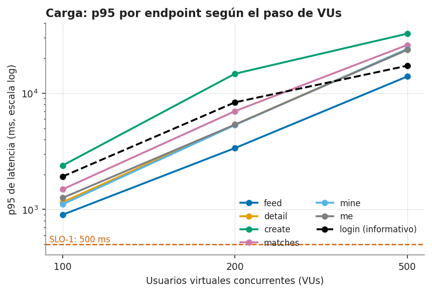

Figura 1.3-1. Carga: p95 por endpoint según el paso de VUs, con el SLO-1 en 500 ms. Fuente: `perf/results/load.summary.json`, generada con `perf/scripts/make-report-figures.py` (commit `2eb4a9c`); imagen `docs/informe/img/1-3/fig-1-3-1-carga-p95.png`.

#### Punto de quiebre (B)

| Escalón | Objetivo (it/s) | Medido (it/s) | req/s | p95 feed (ms) | p95 detail (ms) | p95 create (ms) | Error | SLO-1 y SLO-3 |
|---|---|---|---|---|---|---|---|---|
| s1 | 2 | 1,98 | 6,6 | 52 | 162 | 55 | 0,00 % | Cumple |
| s2 | 2,5 | 2,50 | 8,1 | 51 | 232 | 90 | 0,00 % | Cumple |
| s3 | 3 | 3,00 | 9,6 | 55 | 234 | 216 | 0,00 % | Cumple |
| s4 | 3,5 | 3,50 | 11,0 | 88 | 240 | 334 | 0,00 % | Cumple |
| s5 | 4 | 3,98 | 12,7 | 105 | 259 | 295 | 0,00 % | Cumple |
| s6 | 4,5 | 4,50 | 14,4 | 157 | 257 | 342 | 0,00 % | Cumple |
| s7 | 5 | 5,00 | 16,1 | 169 | 327 | 541 | 0,00 % | No cumple |
| s8 | 5,5 | 5,50 | 18,0 | 169 | 306 | 354 | 0,00 % | Cumple |

Tabla 1.3-5. Punto de quiebre: resultados por escalón (mezcla 80/20). Fuente: `perf/results/breakpoint.slo.md`, commit `2eb4a9c`.

Capacidad medida: 4,5 it/s (14,4 req/s), el último escalón consecutivo desde el inicio que cumple. El escalón de 5 it/s falló solo por el p95 de `create` (541 ms) y el de 5,5 it/s cumplió (354 ms): con unas 45 creaciones por escalón, el p95 de `create` es ruidoso, y 4,5 it/s es una estimación, no un límite exacto. Una corrida previa con paso de +2 it/s dio capacidad 2 it/s (`breakpoint.coarse.slo.md`). Una repetición con observabilidad activa y los mismos parámetros dio 3,5 it/s (Tabla 1.3-13): el borde de capacidad observado está entre 3,5 y 4,5 it/s según la corrida. El valor de 4,5 it/s se mantiene como referencia documentada de SLO-6.

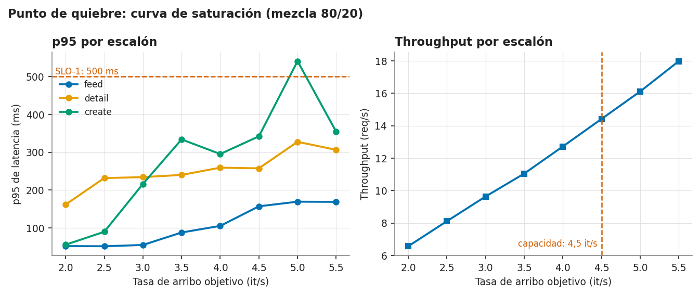

Figura 1.3-2. Punto de quiebre: p95 por endpoint y throughput frente a la tasa de arribo. Fuente: `perf/results/breakpoint.summary.json`, generada con `perf/scripts/make-report-figures.py` (commit `2eb4a9c`); imagen `docs/informe/img/1-3/fig-1-3-2-punto-de-quiebre.png`.

#### Estrés (S)

| Nivel | Objetivo (it/s) | Medido (it/s) | Descartadas (estim.) | Error | p95 máximo de la API (ms) | SLO-1 |
|---|---|---|---|---|---|---|
| base | 4,50 | 4,49 | 1 | 0,00 % | 496 | Cumple |
| x1,5 | 6,75 | 6,71 | 3 | 0,00 % | 1785 | No cumple |
| x2 | 9,00 | 8,85 | 10 | 0,16 % | 9284 | No cumple |
| x3 | 13,50 | 10,78 | 177 | 2,55 % | 26 217 | No cumple |
| Recuperación, vaciado (30 s) | 4,50 | 4,77 | 0 | 0,00 % | 12 616 | No cumple |
| Recuperación, estable | 4,50 | 4,51 | 0 | 0,00 % | 567 | No cumple |

Tabla 1.3-6. Estrés: resultados por nivel (referencia 100 % = 4,5 it/s). Fuente: `perf/results/stress.slo.md`, commit `2eb4a9c`.

El proceso no cayó (`/health` respondió tras la carga) y el error en sobrecarga fue menor a 5 % (máximo 2,55 % en x3): ambos criterios se cumplen. La recuperación no cumple: en el tramo estable el p95 máximo fue 567 ms (`create`; `feed` 244 ms y `detail` 320 ms cumplen). Una corrida anterior con otra división de la recuperación (`stress.v1.slo.md`) dio p95 máximos muy distintos en los mismos niveles (x2: 1385 ms frente a 9284 ms), lo que indica variabilidad entre corridas.

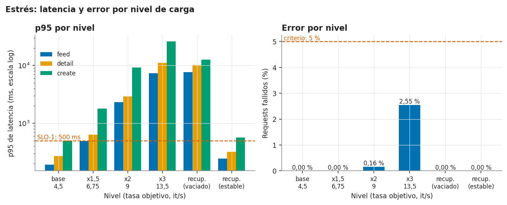

Figura 1.3-3. Estrés: p95 y porcentaje de error por nivel de carga. Fuente: `perf/results/stress.summary.json`, generada con `perf/scripts/make-report-figures.py` (commit `2eb4a9c`); imagen `docs/informe/img/1-3/fig-1-3-3-estres.png`.

#### Picos (P)

| Tramo | Base 10 it/s: objetivo (medido) | p95 feed / detail (ms) | Base 2 it/s: objetivo (medido) | p95 feed / detail (ms) |
|---|---|---|---|---|
| Base (0-20 s) | 10,00 (9,95) | 73 / 33 | 2,00 (1,95) | 66 / 22 |
| Pico (20-80 s) | 85,02 (31,28) | 6529 / 5390 | 17,00 (17,00) | 48 / 27 |
| Recuperación, vaciado (80-110 s) | 10,03 (10,00) | 1309 / 2086 | 2,01 (2,00) | 50 / 18 |
| Recuperación, estable (110-140 s) | 10,03 (10,00) | 49 / 24 | 2,01 (2,03) | 44 / 10 |

Tabla 1.3-7. Picos: tasa de iteraciones por tramo y p95 con las dos bases (it/s). Fuente: `perf/results/spike.slo.md` y `perf/results/spike.base2.slo.md`, commit `2eb4a9c`.

Con la base del issue (10 it/s, pico de 100 it/s), el pico no se alcanzó: se midieron 31,28 it/s frente a un promedio objetivo de 85,02 it/s en el tramo, con 3223 `dropped_iterations` y el tope de 500 VUs de k6 alcanzado. El error durante el pico fue 0,00 % y el p95 de la recuperación estable fue 49 ms, pero la latencia en el pico superó los 5 s. La primera ventana de 5 s por debajo de 500 ms apareció a los 85-90 s, 5 s después del fin del tramo de pico. Con la base de 2 it/s (pico de 20 it/s) se cumple todo, pero esa corrida no exigió al backend (CPU máxima de 76,7 % de un núcleo): no sirve como evidencia de resistencia a picos. No se midió el pico con flyer (ver 2).

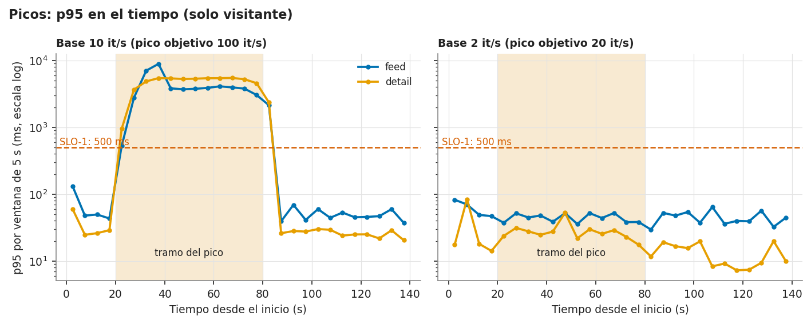

Figura 1.3-4. Picos: p95 de `feed` y `detail` por ventana de 5 s, con las dos bases y el tramo de pico marcado. Fuente: `perf/results/spike.windows.json` y `spike.base2.windows.json`, generada con `perf/scripts/make-report-figures.py` (commit `2eb4a9c`); imagen `docs/informe/img/1-3/fig-1-3-4-picos.png`.

#### Volumen (V)

| Endpoint | p95 1x (ms) | p95 10x (ms) | Variación del p95 | Respuesta 1x (bytes) | Respuesta 10x (bytes) | SLO-1 a 10x |
|---|---|---|---|---|---|---|
| feed | 63,1 | 651,8 | x10,33 | 571 942 | 5 739 966 | No cumple |
| detail | 253,9 | 347,7 | x1,37 | 571 | 573 | Cumple |
| mine | 259,2 | 346,1 | x1,34 | 571 | 2871 | Cumple |
| notifications | 261,2 | 346,3 | x1,33 | 2 | 2 | Cumple |

Tabla 1.3-8. Volumen: comparación entre la base en 1x y en 10x a 3 it/s (error de 0,00 % en ambos volúmenes). Fuente: `perf/results/volume.compare.md`, commit `2eb4a9c`.

A 1x se cumple SLO-1 (peor p95: 261 ms). A 10x no se cumple por `feed` (651,8 ms). `GET /api/reports` crece con los datos: la respuesta pasa de 571 942 a 5 739 966 bytes (x10,04), igual que el p95 (x10,33). `notifications` devuelve una lista vacía en ambos volúmenes, por lo que mide el costo de la consulta y no el tamaño de la respuesta.

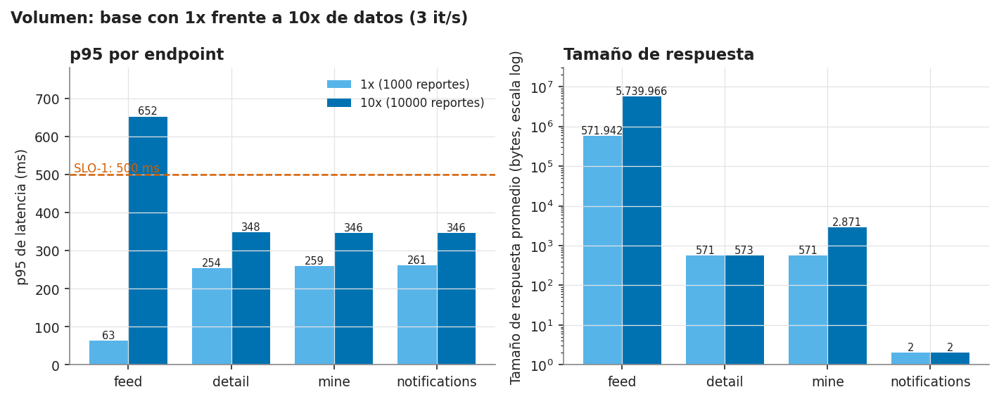

Figura 1.3-5. Volumen: p95 y tamaño de respuesta por endpoint con la base en 1x y 10x. Fuente: `perf/results/volume.compare.json`, generada con `perf/scripts/make-report-figures.py` (commit `2eb4a9c`); imagen `docs/informe/img/1-3/fig-1-3-5-volumen.png`.

#### Resistencia (E)

| Medición | Resultado | Criterio | Veredicto |
|---|---|---|---|
| SLO-1 (toda la corrida) | 385 ms (peor endpoint) | < 500 ms | Cumple |
| SLO-3 | 0,02 % (5 de 753 creaciones fallidas) | < 1 % | Cumple |
| SLO-4 | 623 ms | < 1000 ms | Cumple |
| SLO-5 (Apdex) | 0,999 | ≥ 0,90 | Cumple |
| p95 del tercio 3 frente al tercio 1 | Peor endpoint (`me`): 1,00; `create`: 0,71 | ≤ 1,10 | Cumple |
| Memoria del backend (RSS) | Media por tercio: 222,4, 252,3 y 250,2 MB; máximo 261,9 MB | Sin crecimiento sostenido | No hay crecimiento sostenido (escalón que se estabiliza) |
| Conexiones a PostgreSQL | Medias por tercio: 7,30, 8,00 y 8,00; máximo 8 | Sin crecimiento sostenido | No hay crecimiento sostenido |

Tabla 1.3-9. Resistencia: 35 min a 3,15 it/s (31 min estables, tercios de 10,33 min; 6236 iteraciones y 21 847 requests). Fuente: `perf/results/soak.slo.md` y `soak.analysis.md`, commit `2eb4a9c`.

La corrida duró 31 min estables en lugar de las 4 h del issue, y la comparación "última hora frente a la primera" se sustituyó por la del último tercio frente al primero. En ese tiempo no se observó una fuga lineal: el RSS subió unos 30 MB entre el primer y el segundo tercio y luego se mantuvo (pendiente de la segunda mitad: -0,15 MB/min). Esto no confirma ni descarta una fuga lenta que solo aparezca en horas, ni si la memoria vuelve a bajar luego de una corrida de estrés. El tamaño de la base se mantuvo en 20,5 MB. El log del backend creció de 24,6 KB (media del tercio 1) a 82,3 KB (tercio 3).

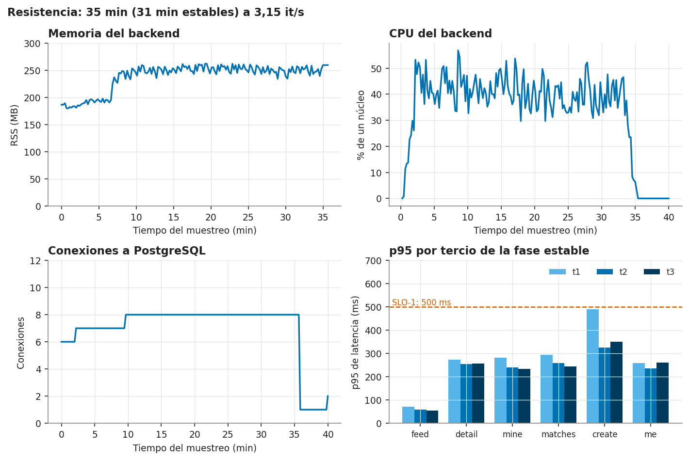

Figura 1.3-6. Resistencia: memoria, CPU y conexiones del backend en el tiempo y p95 por tercio de la fase estable. Fuente: `perf/results/soak.resources.csv` y `soak.meta.json`, generada con `perf/scripts/make-report-figures.py` (commit `2eb4a9c`); imagen `docs/informe/img/1-3/fig-1-3-6-resistencia.png`.

#### Escalabilidad (C): inconclusa

| Instancias | Corrida | Capacidad (it/s) | Primer escalón que falla (it/s, medidos) |
|---|---|---|---|
| 1 | Principal | Menor que 18 (no cumple ni el primero) | 18 (11,89) |
| 1 | Repetición 1 | Menor que 16 | 16 (14,52) |
| 1 | Repetición 1, grilla gruesa | 20 | 25 (24,61) |
| 1 | Repetición 2 (censurada) | Mayor o igual que 24: no falló ningún escalón de la grilla (14 a 24 it/s) | No falló |
| 2 | Principal | 21 (72,8 req/s) | 24 (23,96) |
| 2 | Repetición 1 | 18 | 21 (20,30) |
| 4 | Principal | 48 (167,1 req/s) | 54 (53,96) |
| 4 | Repetición 1 | Menor que 24 | 24 (19,85) |

Tabla 1.3-10. Escalabilidad: capacidad de 1, 2 y 4 instancias en todas las corridas (solo visitante; capacidad = último escalón que cumple SLO-1, error < 1 % y entrega ≥ 95 % de la tasa). Fuente: `perf/results/scalability.compare.md`, `rep1/scalability.compare.md`, `rep1/scalability.1cpu.coarse.slo.md` y `rep2-n1-censurado/scalability.1cpu.slo.md`, commit `2eb4a9c`.

El criterio propuesto (duplicar instancias da al menos x1,6 de capacidad) no se puede dar por cumplido ni por incumplido. En la corrida principal el paso de 2 a 4 instancias dio x2,28 (rango x2,00 a x2,57), pero el de 1 a 2 no tiene valor (la instancia única no cumplió ni el primer escalón; el piso es x1,17); en la repetición 1 ninguno de los dos pasos tiene valor. La misma configuración de 1 instancia arrojó capacidades menores que 16, menores que 18, 20 y mayores o iguales que 24 en corridas distintas. En la corrida principal, la instancia única llegó al primer fallo con 64 % de un núcleo mientras la CPU total del sistema estaba en 80 %; en la repetición 2 la misma configuración sostuvo 24 it/s sin fallar. Con 4 instancias, la CPU del sistema fue de 92 % a 98 % y k6 usó entre 125 % y 138 % de un núcleo: el generador y la máquina compartida compiten con el backend, por lo que ese resultado tampoco mide solo al backend.

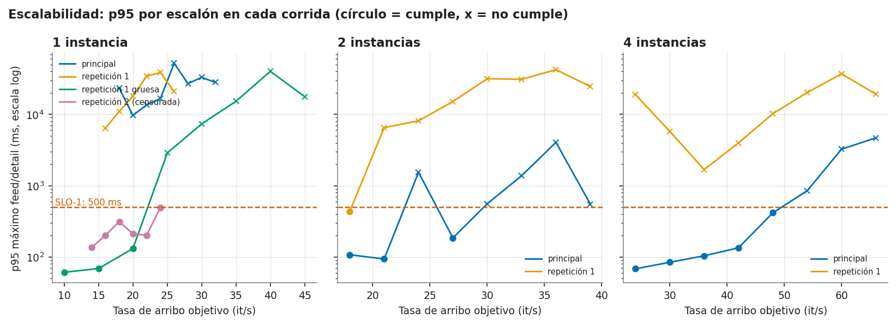

Figura 1.3-7. Escalabilidad: p95 máximo de `feed` y `detail` por escalón en todas las corridas de 1, 2 y 4 instancias, con el SLO-1. Fuente: `perf/results/scalability.*cpu.steps.json`, `rep1/` y `rep2-n1-censurado/`, generada con `perf/scripts/make-report-figures.py` (commit `2eb4a9c`); imagen `docs/informe/img/1-3/fig-1-3-7-escalabilidad.png`.

#### Frontend (Lighthouse CI)

| Factor de forma | Ruta | Performance | Accesibilidad | LCP (ms) | TBT (ms) | Peso (KiB) | Auditorías de accesibilidad fallidas |
|---|---|---|---|---|---|---|---|
| Móvil | `/login` | 84 | 100 | 3370 | 247 | 296,9 | Ninguna |
| Móvil | `/reports` | 64 | 98 | 2623 | 2742 | 857,8 | `heading-order` (1) |
| Móvil | `/reports/:id` | 66 | 92 | 4941 | 506 | 396,4 | `definition-list` (1), `dlitem` (7) |
| Escritorio | `/login` | 99 | 100 | 808 | 15 | 296,9 | Ninguna |
| Escritorio | `/reports` | 84 | 98 | 632 | 357 | 857,8 | `heading-order` (1) |
| Escritorio | `/reports/:id` | 97 | 92 | 1267 | 15 | 482,8 | `definition-list` (1), `dlitem` (7) |

Tabla 1.3-11. Lighthouse CI: mediana de 3 corridas por ruta (Lighthouse 12.6.1, `vite preview`). Fuente: `perf/results/lighthouse/summary.md`, commit `2eb4a9c`.

Los umbrales (performance ≥ 80 y accesibilidad ≥ 90) son propuestas del issue, a calibrar con esta línea base. Accesibilidad los cumple en las seis combinaciones. Performance no los cumple en móvil en `/reports` (64) y `/reports/:id` (66). El bundle es un único archivo de JavaScript de 849,67 kB sin comprimir (248,5 kB transferidos); en `/reports` móvil, Lighthouse estima 166 KiB de JavaScript sin usar.

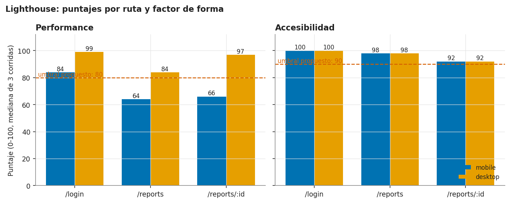

Figura 1.3-8. Lighthouse: puntajes de performance y accesibilidad por ruta y factor de forma, con los umbrales propuestos. Fuente: `perf/results/lighthouse/summary.json`, generada con `perf/scripts/make-report-figures.py` (commit `2eb4a9c`); imagen `docs/informe/img/1-3/fig-1-3-8-lighthouse.png`.

#### Observabilidad (Prometheus y Grafana)

Se montaron Prometheus v3.15.1 y Grafana 12.4.14 en Docker, solo para uso local y con acceso anónimo de solo lectura (commit `fe0a359`, [ADR-0029](../adr/0029-herramientas-pruebas-de-performance.md)). Es una versión liviana: sin cAdvisor, node-exporter ni postgres_exporter. k6 1.3.0 envía las métricas por `experimental-prometheus-rw` (percentiles p50, p90, p95 y p99 como gauges); la CPU y la memoria RSS del backend y las conexiones a PostgreSQL provienen del muestreador del repositorio (`perf/scripts/sample-resources.mjs --metrics-port=9101`), que Prometheus consulta cada 5 s. Se incluyen el dashboard oficial de k6 (19665, revisión 3) y un dashboard propio, "Carga y recursos", con p95, req/s, VUs y porcentaje de error junto con CPU, RSS y conexiones en el mismo eje de tiempo. El panel de p95 es el promedio de los p95 por serie (endpoint), no un p95 global.

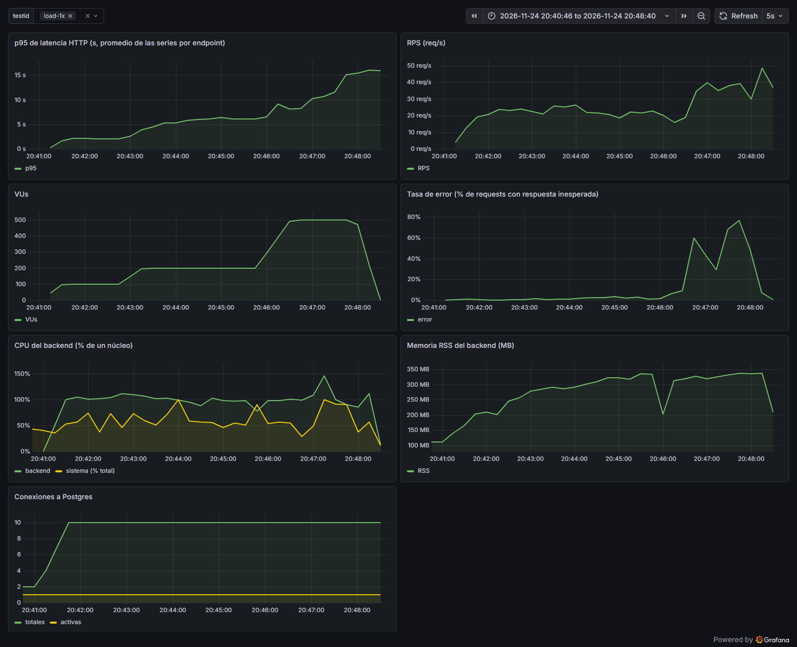

Figura 1.3-9. Grafana, dashboard "Carga y recursos", corrida de carga (testid `load-1x`, `PERF_SCALE` 0,25; 20:40:46 a 20:48:40). Se ven la escalera de 100, 200 y 500 VUs, el p95 promedio que crece hasta unos 15 s, el error que llega a un máximo de unos 77 % en una ventana del tramo de 500 VUs (el 59,06 % de la Tabla 1.3-13 es el promedio de todo el paso), la CPU del backend en torno a 100 % de un núcleo, el RSS entre unos 110 y 340 MB y las conexiones a PostgreSQL en 10. Fuente: dashboard Grafana "Carga y recursos" de la corrida `load-1x`, commit `fe0a359`; imagen `docs/informe/img/1-3/fig-1-3-9-grafana-carga.png`.

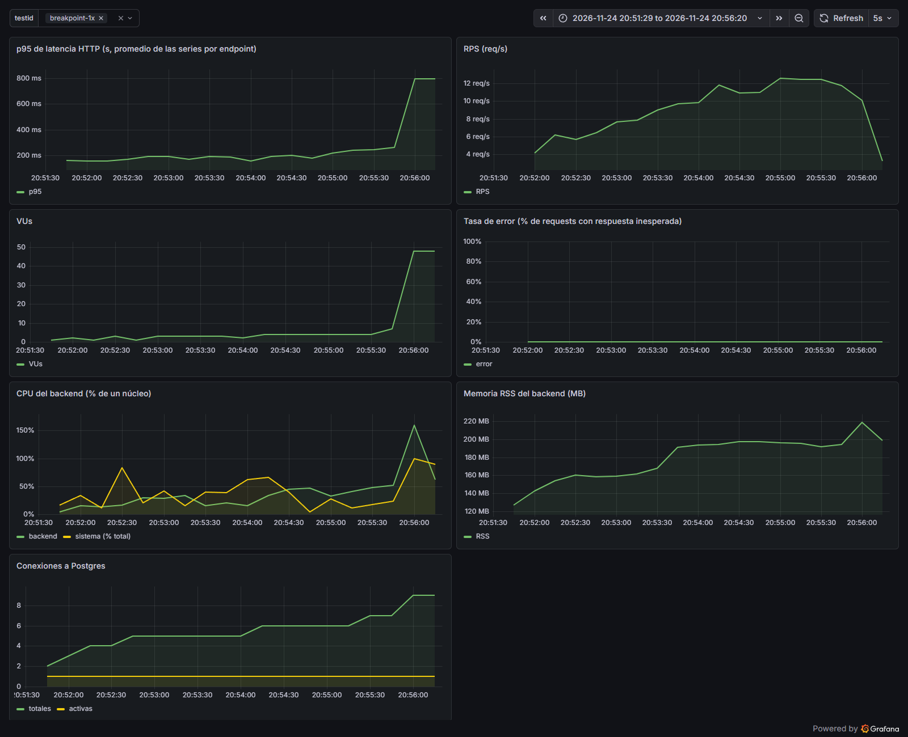

Figura 1.3-10. Grafana, dashboard "Carga y recursos", corrida del punto de quiebre (testid `breakpoint-1x`; 20:51:29 a 20:56:20). Se ven el p95 promedio estable por debajo de unos 300 ms hasta el tramo final, donde sube a unos 800 ms con un salto de VUs (hasta unos 48), el error en 0 % y la CPU del backend con un máximo cercano a 160 % de un núcleo al final. Fuente: dashboard Grafana "Carga y recursos" de la corrida `breakpoint-1x`, commit `fe0a359`; imagen `docs/informe/img/1-3/fig-1-3-10-grafana-quiebre.png`.

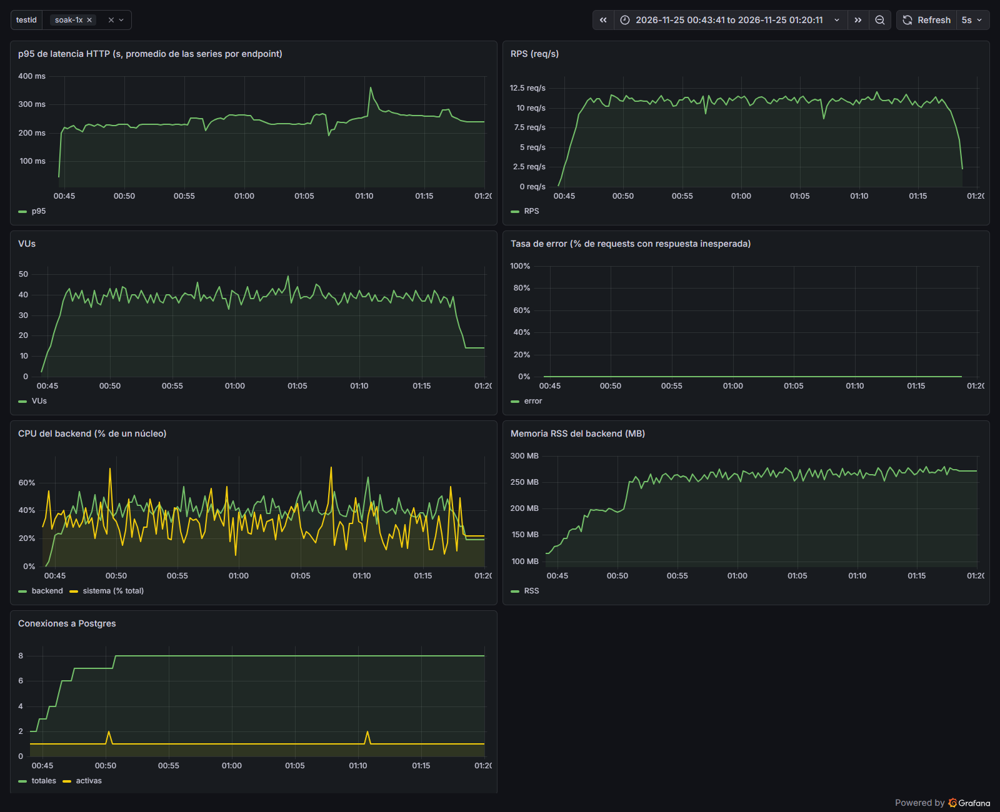

Figura 1.3-11. Grafana, dashboard "Carga y recursos", corrida de resistencia (testid `soak-1x`; inicio de k6 a las 00:44:11, fase estable de 00:46:11 a 01:17:11). Se ven los req/s en torno a 11 durante la fase estable, entre unos 35 y 45 VUs, el error en 0 %, el p95 promedio entre unos 220 y 270 ms con un máximo cercano a 360 ms hacia las 01:10, la CPU del backend con una media de 41 % de un núcleo, el RSS que sube de unos 115 MB a unos 270 MB (en el análisis, medias por tercio de 227,6, 265,3 y 269,0 MB; pendiente de 2,22 MB/min en toda la fase estable y de 0,41 MB/min en la segunda mitad) y las conexiones a PostgreSQL que llegan a 8 y quedan en 8. Las series terminan hacia las 01:18: tras la rampa de bajada no hay muestras durante unos 14 min (ver Limitaciones). Fuente: dashboard Grafana "Carga y recursos" de la corrida `soak-1x`, con el commit `8967e73` del repositorio al momento de la corrida (el commit no incluye los resultados); imagen `docs/informe/img/1-3/fig-1-3-11-grafana-resistencia.png`.

El overhead de Docker se midió durante las tres corridas (muestreo cada ~8 s nominales). En la prueba anterior con nginx en Docker, `com.docker.backend` llegó a ~79 % de un núcleo, motivo por el que ese balanceador se descartó (ver Limitaciones). Al terminar, la memoria de Grafana era de ~108 MiB y la de Prometheus de ~42 MiB.

| Proceso | Carga: media / máximo | Punto de quiebre: media / máximo | Resistencia: media / máximo |
|---|---|---|---|
| `com.docker.backend` | 9,7 / 58,7 | 8,9 / 42,8 | 8,5 / 33,8 |
| Todos los procesos de Docker | 16,2 / 72,4 | 13,6 / 48,4 | 13,6 / 41,8 |
| Grafana | 1,0 / 3,0 | 0,9 / 2,0 | 1,0 / 7,2 |
| Prometheus | 0,6 / 2,6 | 0,8 / 7,9 | 0,6 / 2,1 |
| Contenedor de PostgreSQL (ya existía; no forma parte de la observabilidad) | 8,7 / 95,7 | 6,4 / 73,9 | 3,8 / 28,1 |

Tabla 1.3-12. Overhead de Docker durante las corridas con observabilidad (% de un núcleo, media y máximo). Fuente: muestreo de procesos durante las corridas `load-1x`, `breakpoint-1x` (commit `fe0a359`) y `soak-1x` (commit `8967e73`); `perf/README.md`, sección 13.

En la resistencia, el muestreo (183 muestras, de las 00:44 a las 01:19) usó un script nuevo que suma los procesos `com.docker*`, `Docker Desktop*` y `docker*`; la equivalencia exacta con el criterio de agrupación de las dos primeras columnas no se verificó. En la última muestra (01:18), la memoria de Grafana era de ~97 MiB y la de Prometheus de ~40 MiB.

Se repitieron la carga (L) y el punto de quiebre (B) con la observabilidad activa, con los mismos parámetros y en la misma máquina, con aplicaciones ajenas presentes. No hubo corrida de control, por lo que las diferencias no se pueden atribuir a la observabilidad: pueden deberse a ella, a la variabilidad entre corridas o a la carga ajena. No se hicieron más repeticiones.

| Medición | Línea base | Con observabilidad |
|---|---|---|
| L, 100 VUs: p95 feed / detail / create (ms) | 900 / 1155 / 2391 | 1295 / 1830 / 4412 |
| L, 200 VUs: p95 feed / detail / create (ms) | 3375 / 5366 / 14 728 | 4447 / 7916 / 19 070 |
| L, 500 VUs: p95 feed (ms) | 13 940 | 11 500 |
| L, req/s a 100 / 200 / 500 VUs | 25,5 / 28,0 / 34,3 | 22,1 / 22,5 / 37,8 |
| L, error a 100 / 200 / 500 VUs | 0,21 / 1,07 / 24,79 % | 0,42 / 2,22 / 59,06 % |
| L, Apdex a 100 / 200 / 500 VUs | 0,836 / 0,094 / 0,000 | 0,609 / 0,017 / 0,001 |
| B, capacidad (it/s) | 4,5 (falló en 5) | 3,5 (4 it/s falló por p95 de `create` de 591 ms; en 4,5 it/s el p95 de `feed` / `detail` fue 2324 / 2988 ms) |
| B, aborto de k6 por umbral | 369 s | 258 s |

Tabla 1.3-13. Repetición con observabilidad activa frente a la línea base (L y B). Fuente: `perf/results/load.slo.md` y `breakpoint.slo.md` de la corrida con observabilidad, y Tablas 1.3-4 y 1.3-5 para la línea base, commit `fe0a359`.

En ninguna de las dos corridas de L se cumplió algún SLO. En B, la capacidad con observabilidad (3,5 it/s) quedó por debajo de la de la línea base (4,5 it/s); junto con la Tabla 1.3-5 y la corrida de +2 it/s, el borde observado está entre 3,5 y 4,5 it/s.

También se repitió la resistencia (E) con la observabilidad activa, con los mismos parámetros (3,15 it/s, 35 min) y la misma base sembrada en 1x. No hubo corrida de control, por lo que las diferencias no se pueden atribuir a la observabilidad: pueden deberse a ella, a la variabilidad entre corridas o a la carga ajena. Durante la corrida con observabilidad, k6, el muestreador y el muestreo de Docker no registraron muestras durante unos 14 min tras la rampa de bajada (de las 01:18 a las 01:32); la causa no se verificó. Por eso el tiempo medido por k6 fue de 2912,8 s en lugar de 2104,3 s y el promedio global de req/s (7,4) no es comparable; se usan los req/s por tercio. La fase estable no se vio afectada: sus tercios están completos y los registros de k6 son continuos hasta la rampa de bajada.

| Medición | Línea base | Con observabilidad |
|---|---|---|
| SLO-1, peor p95 por endpoint (ms) | 385 | 306 |
| SLO-3, `http_req_failed` / checks fallidos | 0,02 % / 0,02 % | 0,02 % / 0,02 % |
| SLO-4, peor p99 por endpoint (ms) | 623 | 639 |
| Apdex (SLO-5) | 0,999 | 0,998 |
| p95 t3/t1, peor endpoint sin login | 1,00 (`me`) | 1,24 (`me`; `mine`: 1,10) |
| req/s por tercio (t1 / t2 / t3) | 11,0 / 11,0 / 11,1 | 11,0 / 11,0 / 10,9 |
| Conexiones de TCP reiniciadas en `POST /api/reports` | 5 de 753 creaciones | 4 de 729 creaciones |
| RSS: media del primer / último tercio (MB) | 222,4 / 250,2 | 227,6 / 269,0 |
| RSS: pendiente en la fase estable (MB/min) | 1,49 | 2,22 |
| RSS: pendiente en la segunda mitad (MB/min) | -0,15 | 0,41 |
| RSS: máximo (MB) | 261,9 | 281,7 |
| Conexiones a PostgreSQL: media del primer tercio / máximo | 7,30 / 8 | 7,45 / 8 |

Tabla 1.3-14. Resistencia: línea base frente a la repetición con observabilidad activa. Fuente: `perf/results/soak.slo.md` y `soak.analysis.md` (línea base, commit `2eb4a9c`) y `soak.obs.slo.md`, `soak.obs.analysis.md` y `soak.obs.out.txt` (observabilidad, commit `8967e73`).

En ambas corridas se cumplen SLO-1, SLO-3, SLO-4 y SLO-5. Con observabilidad, el criterio de degradación (p95 del tercio 3 ≤ 110 % del tercio 1) no se cumple en `me` (1,24, con 416 solicitudes en toda la corrida) y `mine` queda en el límite (1,10), mientras que en la línea base todos los endpoints cumplen. Ambas corridas coinciden en que el criterio de crecimiento sostenido del RSS no se cumple (escalón que se estabiliza); con observabilidad, el RSS de la segunda mitad tiene una pendiente de 0,41 MB/min (t = 3,8), cuyo crecimiento proyectado (8,5 MB) queda por debajo del piso de 10 MB del criterio.

### 4. Hallazgos

1. **`GET /api/reports` sin paginar.** La respuesta pesa 571 942 bytes con 1000 reportes y 5 739 966 bytes con 10 000 (x10,04); el p95 pasó de 63,1 a 651,8 ms (x10,33) y SLO-1 dejó de cumplirse en `feed` (Tabla 1.3-8). Con la base en 10x, la carga L rindió 13,0 req/s a 100 VUs, frente a 25,5 req/s a 1x (Tabla 1.3-4 y `load.v10x.slo.md`).
2. **El login es caro en CPU (hipótesis).** `auth.service.ts` usa `bcryptjs` (JavaScript puro) y el login tiene p50 de 297,5 ms en el smoke, sin carga. Hipótesis: el hash bloquea el event loop de Node y degrada al resto de la API; se verificó en el código el uso de `bcryptjs`, pero no se perfiló. Los flujos con login suman 35,3 % de la mezcla de L.
3. **Sin contrapresión.** Con sobrecarga la latencia crece en lugar de rechazar: en x3 el p95 llega a 7390 ms en `feed` y 26 217 ms en `create` con 2,55 % de error (Tabla 1.3-6); en L a 500 VUs, p95 de hasta 32 578 ms. Los resultados no desglosan el tipo de error: no se puede afirmar si fueron timeouts o 5xx.
4. **5 conexiones reiniciadas en `POST /api/reports` durante la resistencia.** El log de k6 registra 5 errores de lectura TCP (conexión interrumpida por el host remoto) en 748 creaciones exitosas a 3,15 it/s, con el resto de los endpoints sin fallas. Causa: No disponible. En la repetición de L con observabilidad, los reinicios de conexión (`wsarecv`) en `POST /api/reports` aparecieron desde 100 VUs; no se verificó si ocurrían en la línea base. En la repetición de la resistencia con observabilidad hubo 4 reinicios en 729 creaciones (Tabla 1.3-14).
5. **Memoria.** En el pico con base de 10 it/s el RSS subió de 148,9 a 442,7 MB y terminó en 417,8 MB, unos 100 s después de terminar el pico; en el estrés llegó a 348,2 MB y se mantuvo en 327-348 MB durante la recuperación; con la base en 10x, la carga L llegó a 1589 MB (`spike.resources.csv`, `stress.resources.csv`, `load.v10x.resources.csv`). En el estrés, la última muestra válida muestra 134,7 MB a los 394 s y luego el proceso deja de muestrearse a los 410 s: no se puede atribuir esa caída a una liberación de memoria. En la resistencia de la línea base, el RSS se estabilizó en ~250 MB (Tabla 1.3-9); en la repetición con observabilidad, las medias por tercio fueron 227,6, 265,3 y 269,0 MB (máximo 281,7 MB), con una pendiente de 0,41 MB/min en la segunda mitad que no alcanza el piso de 10 MB del criterio de crecimiento sostenido (Tabla 1.3-14). En 31 min no se puede distinguir si ese nivel se estabiliza o sigue subiendo lentamente.
6. **Frontend.** Un único archivo de JavaScript de 849,67 kB; performance móvil de 64 y 66 en `/reports` y `/reports/:id`, por debajo del umbral propuesto de 80; TBT de 2742 ms en `/reports` móvil. Accesibilidad: lista de definición mal formada (`definition-list`, `dlitem`) en `/reports/:id` y orden de encabezados (`heading-order`) en `/reports` (Tabla 1.3-11).
7. **Resultados con variabilidad.** Capacidad de 1 instancia entre menor que 16 y mayor o igual que 24 it/s (Tabla 1.3-10); p95 en x2 de 1385 ms y 9284 ms en dos corridas de estrés; escalón de 5 it/s del punto de quiebre fallido y el de 5,5 it/s cumplido (Tabla 1.3-5).

### 5. Cuellos de botella

| Escenario | CPU del backend: media y máximo (% de un núcleo) | CPU del sistema: máximo (%) | Conexiones a PostgreSQL: máximo (activas, máximo) |
|---|---|---|---|
| Carga L (1x) | 91,1 y 113,8 | 59 | 10 (3) |
| Carga L (10x) | 109,7 y 148,9 | 100 | 10 (1) |
| Punto de quiebre | 29,8 y 60,7 | 79 | 8 (1) |
| Estrés | 58,1 y 111,1 | 94 | 10 (4) |
| Picos, base 10 it/s | 59,0 y 161,1 | 86 | 10 (2) |
| Picos, base 2 it/s | 21,2 y 76,7 | 69 | 9 (2) |
| Volumen 1x | 32,1 y 66,4 | 76 | 6 (1) |
| Volumen 10x | 75,3 y 112,4 | 87 | 7 (2) |
| Resistencia | 33,8 y 56,8 | 87 | 8 (2) |

Tabla 1.3-15. Recursos muestreados por escenario (la media incluye las muestras en reposo del inicio y el final; intervalo de 3 a 10 s). Fuente: `perf/results/*.resources.csv`, generado por `perf/scripts/sample-resources.mjs`, commit `2eb4a9c`.

- **El backend (proceso de Node) es lo primero que se acerca a un núcleo, no PostgreSQL ni la máquina.** En L el backend promedió 91,1 % de un núcleo (máximo 113,8 %) con la CPU del sistema en 59 % como máximo, y las conexiones activas a PostgreSQL promediaron 1,1 de 10 en el pool de Prisma (máximo 3): la base no estaba ocupada.
- **El dato de CPU no identifica el hilo.** Los valores por encima de 100 % (hasta 161,1 %) indican que el proceso usó más de un núcleo (hilos del motor de Prisma, GC o serialización); la hipótesis del login con `bcryptjs` (hallazgo 2) no se puede confirmar con este muestreo.
- **El punto de quiebre no mostró saturación de CPU:** el máximo fue 60,7 % de un núcleo cuando falló el escalón de 5 it/s, por un p95 de `create` ruidoso (Tabla 1.3-5).
- **Con 10x, el costo se desplaza a la serialización y la memoria de `GET /api/reports`:** CPU de 148,9 % y RSS de hasta 1589 MB (hallazgo 1).
- **En escalabilidad con 4 instancias la máquina compartida pasa a ser el límite** (CPU del sistema de 92 % a 98 %, k6 con 125-138 % de un núcleo): este análisis no mide el límite de la máquina ni del backend (ver Tabla 1.3-10).

### 6. Recomendaciones

Propuestas para el equipo; no se crearon issues ni se implementó nada. El issue ya relaciona los trabajos «Paginar el feed y poner debounce al filtro de zona» y «Carga diferida por ruta y presupuesto de bundle».

| Etiqueta | Propuesta | Evidencia |
|---|---|---|
| [BUG] | Paginar `GET /api/reports` (vincular con el issue existente del feed) | Tabla 1.3-8, hallazgo 1 |
| [REFACTOR] | Perfilar el login y, según el resultado, evaluar `bcrypt` nativo, hilos de trabajo o menos rondas de hash | Hallazgo 2 (hipótesis sin perfilar) |
| [FEATURE] | Limitar la cola de requests y responder 429 o 503 ante sobrecarga | Hallazgo 3 |
| [BUG] | Investigar los 5 cortes de conexión en `POST /api/reports` | Hallazgo 4 |
| [REFACTOR] | Dividir el bundle por ruta (vincular con el issue existente) | Hallazgo 6, Tabla 1.3-11 |
| [BUG] | Corregir `definition-list`/`dlitem` en el detalle del reporte y el orden de encabezados en el feed | Tabla 1.3-11 |
| [FEATURE] | Medir SLO-2 con el Backend IA real y definir el evento "matching terminado" (decisión del equipo) | Tabla 1.3-3 |
| [FEATURE] | Soporte de Socket.IO en k6 y entorno con R2 para cubrir chat y flyer | Sección 2 |
| [FEATURE] | Repetir resistencia (4 h), picos con base de 10 it/s con un tope de VUs mayor y escalabilidad en una máquina sin carga ajena y con el generador aparte | Limitaciones |
| [BUG] | Revisar por qué el RSS no baja tras el pico de 10 it/s (con muestreo hasta el final de la corrida) | Hallazgo 5 |

Tabla 1.3-16. Recomendaciones propuestas como issues candidatos. Fuente: hallazgos 1 a 7 de este apartado; issue #40 (sección "Relacionadas").

### Limitaciones

- Reducción de duraciones (Tabla 1.3-2): la carga de 435 s en lugar de 29 min, la resistencia de 31 min estables en lugar de 4 h y el punto de quiebre en pasos de 0,5 it/s.
- Una sola máquina compartida entre generador de carga, backend, base y aplicaciones ajenas; no se midió el límite de la máquina.
- Cada escenario se corrió una vez (salvo las repeticiones de escalabilidad y estrés), no al menos dos veces con la mediana como pide el issue; hay variabilidad entre corridas.
- SLO-2 no se midió; chat y flyer quedaron fuera.
- Observabilidad (ADR-0029): hay capturas de Grafana de la carga (L), la resistencia (E) y el punto de quiebre (B) (Figuras 1.3-9 a 1.3-11), por lo que se cumple el criterio de aceptación del issue de capturas de L, E y B. La resistencia con Grafana duró 35 min (31 estables), no 4 h. Esa corrida tuvo un tramo de unos 14 min sin muestras tras la rampa de bajada, de causa no verificada. La versión liviana no incluye cAdvisor, node-exporter ni postgres_exporter, y suma overhead medible (Tabla 1.3-12). No hubo corrida de control: la diferencia con la línea base no se puede atribuir a la observabilidad (Tablas 1.3-13 y 1.3-14).
- El resumen de carga de la línea base (`load.summary.json`) fue sobrescrito por la corrida posterior con observabilidad (`perf/results/` no se versiona); solo se recuperó `load.slo.md` desde la salida estándar. Los números del informe y las Figuras 1.3-1 a 1.3-8 provienen de la línea base y se generaron antes de esa sobrescritura.
- El volumen 10x y la mezcla de flujos son supuestos del equipo; el seed no genera embeddings ni notificaciones.
- El balanceador de escalabilidad es un proxy de Node propio (con nginx en Docker Desktop el camino de red añadía una latencia que distorsionaba la medición); el pool de Prisma no se varió.
- Los resultados no incluyen una comparación "antes y después" de mejoras.

## 1.3.3.6 Pruebas de seguridad por niveles de usuarios

- **Roles y autorización.** El backend define los roles `usuario_regular`, `moderador` y `admin` ([1.2.4](1-2-4-modelo-de-datos.md)). Las pruebas que los ejercitan incluyen [`auth.middleware.test.ts`](../../backend/tests/middlewares/auth.middleware.test.ts), [`report-flags.routes.test.ts`](../../backend/tests/report-flags/report-flags.routes.test.ts) y [`flag-moderation.e2e.test.ts`](../../backend/tests/e2e/flag-moderation.e2e.test.ts).
- **Cuenta y sesión.** Verificación de email ([`email-gate.routes.test.ts`](../../backend/tests/auth/email-gate.routes.test.ts)), validez de sesión ([`session.service.test.ts`](../../backend/tests/auth/session.service.test.ts)) y segundo factor (`two-factor.*.test.ts` en [`auth/`](../../backend/tests/auth)).
- **Limitación de tasa.** Pruebas globales ([`global-rate-limit.test.ts`](../../backend/tests/app/global-rate-limit.test.ts)) y por función (cuenta, 2FA, creación de reportes y flyers).

### Análisis de vulnerabilidades (Snyk)

| Medición | Antes | Después |
|---|---|---|
| Vulnerabilidades críticas detectadas por Snyk Open Source | No disponible | 0 en backend y frontend (backend: 1 alta; frontend: 2 altas y 2 medias) |

Fuente: [`SECURITY_REPORT.md`](../SECURITY_REPORT.md) (issue [#41](https://github.com/ISI-ProyectoFinal-2026/Grupo1/issues/41), commit base `8ff5c26`), integrado con el pull request [#207](https://github.com/ISI-ProyectoFinal-2026/Grupo1/pull/207) (merge `66106fd`). Snyk se corrió solo después de los fixes, por lo que la columna Antes no está disponible; la línea base de `npm audit` registra 2 críticas en el backend antes de los fixes. El workflow [`snyk-security.yml`](../../.github/workflows/snyk-security.yml) falla ante vulnerabilidades críticas de Snyk Open Source en backend y frontend (líneas 46-51).
